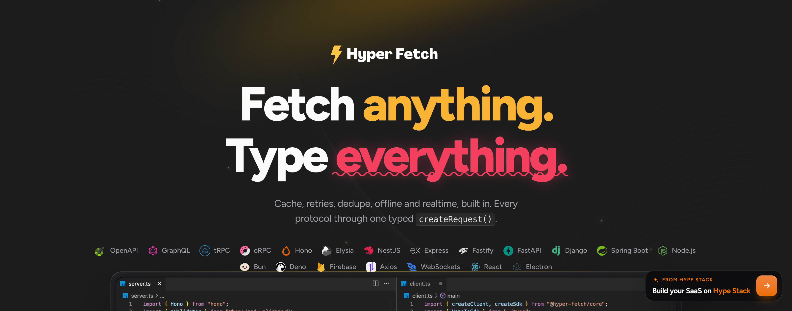

<p align="center">
  
</p>

<p align="center">
  <a href="https://hyperfetch.bettertyped.com/docs/getting-started/quick-start"><b>Quick Start</b></a> ·
  <a href="https://hyperfetch.bettertyped.com/">Documentation</a> ·
  <a href="https://hyperfetch.bettertyped.com/docs/guides/Basic/Setup">Guides</a> ·
  <a href="https://discord.gg/7upC2kVmyM">Discord</a>
</p>

<p align="center">
  <a href="https://github.com/BetterTyped/hyper-fetch"></a>
  <a href="https://www.npmjs.com/package/@hyper-fetch/core"></a>
  <a href="https://www.npmjs.com/package/@hyper-fetch/core"></a>
  <a href="https://bundlejs.com/?q=@hyper-fetch/core"></a>
  <a href="https://github.com/BetterTyped/hyper-fetch"></a>
  <a href="https://github.com/BetterTyped/hyper-fetch/blob/main/License.md"></a>
  <a href="https://twitter.com/maciej_pyrc"></a>
</p>

## 🚀 Quick Start

```bash
npm install @hyper-fetch/core
```

### Define requests manually

```ts
import { createClient } from "@hyper-fetch/core";

// Create a client. It is the single entry point for all your API calls
const client = createClient({ url: "https://api.example.com" });

// Define a typed request. The response shape is inferred everywhere from here
const getUsers = client.createRequest<{ response: { id: number; name: string }[] }>()({
  endpoint: "/users",
  method: "GET",
});

// Send it. data, error and status are fully typed
const { data, error, status } = await getUsers.send();
```

### Or generate from OpenAPI

```bash
npx @hyper-fetch/cli generate --url https://api.example.com/openapi.json
```

```ts
import { sdk } from "./generated";

// Every endpoint from your schema is available as a typed method
const { data } = await sdk.users.list.send();
```

## 💥 Why HyperFetch?

A typical app glues together a fetch wrapper, a query cache, a socket client, a codegen step and a mocking library. Each
one brings its own types, its own retry logic and its own bugs. Hyper Fetch is one typed layer for all of it.

| You usually combine         | With Hyper Fetch you get                               |
| --------------------------- | ------------------------------------------------------ |
| `fetch` or an Axios wrapper | `createClient()` with swappable adapters               |
| TanStack Query or SWR       | Cache, deduplication, retries and React hooks built in |
| A socket client             | Typed `Socket` listeners and emitters                  |
| OpenAPI codegen             | `npx @hyper-fetch/cli generate`                        |
| MSW and hand-written mocks  | `setMock()` and `@hyper-fetch/testing`                 |

### 🔮 Types you never write twice

- **Zero guesswork** - Params, payload, query params, response and error are typed on every request. No `any`
- **URL params checked at compile time** - `/users/:userId` makes `userId` required. Typos fail the build
- **Typed from your schema** - Point the CLI at OpenAPI and every endpoint becomes a typed request
- **One request, every layer** - The type you declare once flows into `send()`, hooks, cache and devtools

### 💾 Server state handled for you

- **Cache with stale time** - Fresh data comes from cache. Stale data revalidates in the background
- **Persisted cache** - Plug in `lazyStorage` and the cache survives reloads
- **No duplicate calls** - Identical requests in flight share one response
- **Optimistic updates** - Show the result now. `optimistic()` rolls it back if the request fails
- **Pagination and streams** - `useInfiniteFetch` for endless lists, `useStream` for streamed responses

### 📴 Built for bad networks

- **Retries** - Set attempts and delay per request with `setRetry()` and `setRetryTime()`
- **Offline queue** - Requests sent offline wait and replay when the connection returns
- **Cancel anything** - Abort one request or a whole group by its abort key
- **Progress** - Upload and download progress events with time estimates

### 📡 Realtime on the same model

- **WebSockets and SSE, one API** - Typed listeners and emitters for both protocols
- **Reconnects on its own** - Configurable reconnect attempts and timing
- **No render floods** - Batch messages or keep only the latest one before they reach React

### 🧪 Tooling included

- **Devtools** - HyperFlow shows every request, the cache and the queue live
- **Mocking** - `setMock()` on any request. HTTP, GraphQL, WebSocket and SSE mock servers for tests
- **ESLint plugin** - Catches empty and misspelled generic types on requests and clients
- **Works everywhere** - React, Next.js, Remix, Astro, Node.js and Bun. SSR hydration included

## 🔌 Works with

<table align="center">
  <tr>
    <td align="center" width="120"><a href="https://hyperfetch.bettertyped.com/docs/core/overview"><br /><b>REST</b></a></td>
    <td align="center" width="120"><a href="https://hyperfetch.bettertyped.com/docs/cli/commands/generate"><br /><b>OpenAPI</b></a></td>
    <td align="center" width="120"><a href="https://hyperfetch.bettertyped.com/docs/integrations/adapter-graphql/overview"><br /><b>GraphQL</b></a></td>
    <td align="center" width="120"><br /><b>tRPC</b><br /><sub>coming soon</sub></td>
    <td align="center" width="120"><br /><b>oRPC</b><br /><sub>coming soon</sub></td>
    <td align="center" width="120"><a href="https://hyperfetch.bettertyped.com/docs/integrations/hono/overview"><br /><b>Hono</b></a></td>
  </tr>
  <tr>
    <td align="center" width="120"><a href="https://hyperfetch.bettertyped.com/docs/integrations/adapter-firebase/overview"><br /><b>Firebase</b></a></td>
    <td align="center" width="120"><a href="https://hyperfetch.bettertyped.com/docs/integrations/adapter-firebase-admin/overview"><br /><b>Firebase Admin</b></a></td>
    <td align="center" width="120"><a href="https://hyperfetch.bettertyped.com/docs/integrations/adapter-axios/overview"><br /><b>Axios</b></a></td>
    <td align="center" width="120"><a href="https://hyperfetch.bettertyped.com/docs/sockets/overview"><br /><b>Sockets &amp; SSE</b></a></td>
    <td align="center" width="120"><a href="https://hyperfetch.bettertyped.com/docs/react/overview"><br /><b>React</b></a></td>
  </tr>
</table>

---

## Try other BetterTyped projects

Hyper Fetch is the data layer inside Hype Stack, the full-stack template I build alongside it.

<p align="center">
  <a href="https://hype-stack.dev">
    
  </a>
</p>

<p align="center">
	<a href="https://github.com/sponsors/prc5?tier=Platinum">
		<picture>
			
		</picture>
	</a>
</p>

<p align="center">
	<a href="https://github.com/sponsors/prc5?tier=Platinum">
		<picture>
			
		</picture>
	</a>
</p>

## 📦 Packages

Every package ships at the same version.

| Package                                                                                      | What it does                                                           |
| -------------------------------------------------------------------------------------------- | ---------------------------------------------------------------------- |
| [`@hyper-fetch/core`](https://www.npmjs.com/package/@hyper-fetch/core)                       | The client, requests, cache, queues, retries and offline support       |
| [`@hyper-fetch/react`](https://www.npmjs.com/package/@hyper-fetch/react)                     | `useFetch`, `useSubmit`, `useListener` and the rest of the React hooks |
| [`@hyper-fetch/sockets`](https://www.npmjs.com/package/@hyper-fetch/sockets)                 | Typed WebSocket and Server-Sent Events listeners and emitters          |
| [`@hyper-fetch/cli`](https://www.npmjs.com/package/@hyper-fetch/cli)                         | Generates a typed SDK from an OpenAPI schema                           |
| [`@hyper-fetch/graphql`](https://www.npmjs.com/package/@hyper-fetch/graphql)                 | GraphQL queries and mutations with `gql` documents                     |
| [`@hyper-fetch/firebase`](https://www.npmjs.com/package/@hyper-fetch/firebase)               | Firestore and Realtime Database from the browser                       |
| [`@hyper-fetch/firebase-admin`](https://www.npmjs.com/package/@hyper-fetch/firebase-admin)   | Firestore and Realtime Database from the server                        |
| [`@hyper-fetch/axios`](https://www.npmjs.com/package/@hyper-fetch/axios)                     | Runs every request through Axios                                       |
| [`@hyper-fetch/plugin-devtools`](https://www.npmjs.com/package/@hyper-fetch/plugin-devtools) | Connects your app to the HyperFlow devtools                            |
| [`@hyper-fetch/testing`](https://www.npmjs.com/package/@hyper-fetch/testing)                 | HTTP, GraphQL, WebSocket and SSE mock servers for tests                |
| [`eslint-plugin-hyper-fetch`](https://www.npmjs.com/package/eslint-plugin-hyper-fetch)       | Lint rules for request and client generic types                        |

<p align="center">
	<a href="https://github.com/sponsors/prc5?tier=Gold">
		<picture>
			
		</picture>
	</a>
</p>

<p align="center">
	<a href="https://github.com/sponsors/prc5?tier=Gold">
		<picture>
			
		</picture>
	</a>
</p>

## Examples

### Fetching data

```ts
// Every value you get back is typed
const { data, error, status } = await getUsers.send();
```

### Mutation with params and payload

```ts
// Params go in the URL and the payload goes in the body. Both are typed
const { data, error, status } = await createUser.send({
  params: { teamId: 1 },
  payload: { name: "Jane", email: "jane@example.com" },
});
```

### React hooks

```tsx
import { useFetch } from "@hyper-fetch/react";

const UserList = () => {
  // useFetch triggers the request on mount and returns typed state
  const { data, loading, error } = useFetch(getUsers);

  if (loading) return <p>Loading...</p>;
  if (error) return <p>Error loading users</p>;
  return (
    <ul>
      {data?.map((u) => (
        <li key={u.id}>{u.name}</li>
      ))}
    </ul>
  );
};
```

## Documentation

- [Getting Started](https://hyperfetch.bettertyped.com/docs/getting-started/quick-start)
- [Core Concepts](https://hyperfetch.bettertyped.com/docs/core/overview)
- [React Integration](https://hyperfetch.bettertyped.com/docs/react/overview)
- [CLI & SDK Generation](https://hyperfetch.bettertyped.com/docs/cli/commands/generate)
- [API Reference](https://hyperfetch.bettertyped.com/api/)
- [Guides](https://hyperfetch.bettertyped.com/docs/guides/Basic/Setup)

<p align="center">
	<a href="https://github.com/sponsors/prc5?tier=Silver">
		<picture>
			
		</picture>
	</a>
</p>

<p align="center">
	<a href="https://github.com/sponsors/prc5?tier=Silver">
		<picture>
			
		</picture>
	</a>
</p>

## Our sponsors

<p align="center">
	<a href="https://github.com/sponsors/prc5">
		
	</a>
</p>

## License

[Apache-2.0](https://github.com/BetterTyped/hyper-fetch/blob/main/License.md)
