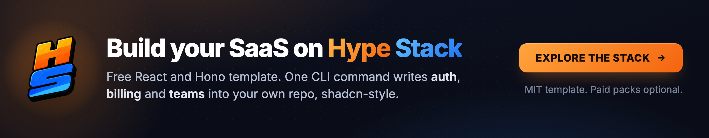

<p align="center">
  
</p>

<p align="center">
  <a href="https://hyperfetch.bettertyped.com/docs/getting-started/quick-start"><b>Quick Start</b></a> ·
  <a href="https://hyperfetch.bettertyped.com/">Documentation</a> ·
  <a href="https://hyperfetch.bettertyped.com/docs/guides/Basic/Setup">Guides</a> ·
  <a href="https://discord.gg/7upC2kVmyM">Discord</a>
</p>

<p align="center">
  <a href="https://github.com/BetterTyped/hyper-fetch"></a>
  <a href="https://www.npmjs.com/package/@hyper-fetch/core"></a>
  <a href="https://www.npmjs.com/package/@hyper-fetch/core"></a>
  <a href="https://bundlejs.com/?q=@hyper-fetch/core"></a>
  <a href="https://github.com/BetterTyped/hyper-fetch"></a>
  <a href="https://github.com/BetterTyped/hyper-fetch/blob/main/License.md"></a>
  <a href="https://twitter.com/maciej_pyrc"></a>
</p>

## 🔌 Works with

<table align="center">
  <tr>
    <td align="center" width="120"><a href="https://hyperfetch.bettertyped.com/docs/core/overview"><br /><b>REST</b></a></td>
    <td align="center" width="120"><a href="https://hyperfetch.bettertyped.com/docs/cli/commands/generate"><br /><b>OpenAPI</b></a></td>
    <td align="center" width="120"><a href="https://hyperfetch.bettertyped.com/docs/integrations/adapter-graphql/overview"><br /><b>GraphQL</b></a></td>
    <td align="center" width="120"><br /><b>tRPC</b><br /><sub>coming soon</sub></td>
    <td align="center" width="120"><br /><b>oRPC</b><br /><sub>coming soon</sub></td>
    <td align="center" width="120"><a href="https://hyperfetch.bettertyped.com/docs/core/overview"><br /><b>Hono</b></a></td>
  </tr>
  <tr>
    <td align="center" width="120"><a href="https://hyperfetch.bettertyped.com/docs/integrations/adapter-firebase/overview"><br /><b>Firebase</b></a></td>
    <td align="center" width="120"><a href="https://hyperfetch.bettertyped.com/docs/integrations/adapter-firebase-admin/overview"><br /><b>Firebase Admin</b></a></td>
    <td align="center" width="120"><a href="https://hyperfetch.bettertyped.com/docs/integrations/adapter-axios/overview"><br /><b>Axios</b></a></td>
    <td align="center" width="120"><a href="https://hyperfetch.bettertyped.com/docs/sockets/overview"><br /><b>Sockets &amp; SSE</b></a></td>
    <td align="center" width="120"><a href="https://hyperfetch.bettertyped.com/docs/react/overview"><br /><b>React</b></a></td>
  </tr>
</table>

## 🚀 Quick Start

```bash
npm install @hyper-fetch/core
```

### Define requests manually

```ts
import { createClient } from "@hyper-fetch/core";

// Create a client. It is the single entry point for all your API calls
const client = createClient({ url: "https://api.example.com" });

// Define a typed request. The response shape is inferred everywhere from here
const getUsers = client.createRequest<{ response: { id: number; name: string }[] }>()({
  endpoint: "/users",
  method: "GET",
});

// Send it. data, error and status are fully typed
const { data, error, status } = await getUsers.send();
```

### Or generate from OpenAPI

```bash
npx @hyper-fetch/cli generate --url https://api.example.com/openapi.json
```

```ts
import { sdk } from "./generated";

// Every endpoint from your schema is available as a typed method
const { data } = await sdk.users.list.send();
```

## Why HyperFetch?

- 🔮 **Zero guesswork** - End-to-end TypeScript types from schema to response, full autocompletion, zero `any`
- 📡 **One interface for everything** - REST, GraphQL, Firebase, WebSockets and SSE. Stop learning a new library for
  each API
- 💾 **Data management built in** - Caching, queuing, offline support, retries and deduplication out of the box
- ⚡ **Works everywhere** - React, Next.js, Remix, Astro, Node.js and Bun. Same API, every environment

---

## Try other BetterTyped projects

Hyper Fetch is the data layer inside Hype Stack, the full-stack template I build alongside it.

<p align="center">
  <a href="https://hype-stack.dev">
    
  </a>
</p>

<p align="center">
	<a href="https://github.com/sponsors/prc5?tier=Platinum">
		<picture>
			
		</picture>
	</a>
</p>

<p align="center">
	<a href="https://github.com/sponsors/prc5?tier=Platinum">
		<picture>
			
		</picture>
	</a>
</p>

## Packages

| Package                                                                                                             | Version                                                                                                                         | Downloads                                                                                                                              | Size                                                                                                                                          |
| ------------------------------------------------------------------------------------------------------------------- | ------------------------------------------------------------------------------------------------------------------------------- | -------------------------------------------------------------------------------------------------------------------------------------- | --------------------------------------------------------------------------------------------------------------------------------------------- |
| [@hyper-fetch/core](https://github.com/BetterTyped/hyper-fetch/tree/main/packages/core)                             | [](https://www.npmjs.com/package/@hyper-fetch/core)                       | [](https://www.npmjs.com/package/@hyper-fetch/core)                       | [](https://bundlephobia.com/package/@hyper-fetch/core)                       |
| [@hyper-fetch/react](https://github.com/BetterTyped/hyper-fetch/tree/main/packages/react)                           | [](https://www.npmjs.com/package/@hyper-fetch/react)                     | [](https://www.npmjs.com/package/@hyper-fetch/react)                     | [](https://bundlephobia.com/package/@hyper-fetch/react)                     |
| [@hyper-fetch/sockets](https://github.com/BetterTyped/hyper-fetch/tree/main/packages/sockets)                       | [](https://www.npmjs.com/package/@hyper-fetch/sockets)                 | [](https://www.npmjs.com/package/@hyper-fetch/sockets)                 | [](https://bundlephobia.com/package/@hyper-fetch/sockets)                 |
| [@hyper-fetch/cli](https://github.com/BetterTyped/hyper-fetch/tree/main/packages/cli)                               | [](https://www.npmjs.com/package/@hyper-fetch/cli)                         | [](https://www.npmjs.com/package/@hyper-fetch/cli)                         | [](https://bundlephobia.com/package/@hyper-fetch/cli)                         |
| [@hyper-fetch/firebase](https://github.com/BetterTyped/hyper-fetch/tree/main/packages/adapter-firebase)             | [](https://www.npmjs.com/package/@hyper-fetch/firebase)               | [](https://www.npmjs.com/package/@hyper-fetch/firebase)               | [](https://bundlephobia.com/package/@hyper-fetch/firebase)               |
| [@hyper-fetch/firebase-admin](https://github.com/BetterTyped/hyper-fetch/tree/main/packages/adapter-firebase-admin) | [](https://www.npmjs.com/package/@hyper-fetch/firebase-admin)   | [](https://www.npmjs.com/package/@hyper-fetch/firebase-admin)   | [](https://bundlephobia.com/package/@hyper-fetch/firebase-admin)   |
| [@hyper-fetch/graphql](https://github.com/BetterTyped/hyper-fetch/tree/main/packages/adapter-graphql)               | [](https://www.npmjs.com/package/@hyper-fetch/graphql)                 | [](https://www.npmjs.com/package/@hyper-fetch/graphql)                 | [](https://bundlephobia.com/package/@hyper-fetch/graphql)                 |
| [@hyper-fetch/axios](https://github.com/BetterTyped/hyper-fetch/tree/main/packages/adapter-axios)                   | [](https://www.npmjs.com/package/@hyper-fetch/axios)                     | [](https://www.npmjs.com/package/@hyper-fetch/axios)                     | [](https://bundlephobia.com/package/@hyper-fetch/axios)                     |
| [@hyper-fetch/plugin-devtools](https://github.com/BetterTyped/hyper-fetch/tree/main/packages/plugin-devtools)       | [](https://www.npmjs.com/package/@hyper-fetch/plugin-devtools) | [](https://www.npmjs.com/package/@hyper-fetch/plugin-devtools) | [](https://bundlephobia.com/package/@hyper-fetch/plugin-devtools) |

<p align="center">
	<a href="https://github.com/sponsors/prc5?tier=Gold">
		<picture>
			
		</picture>
	</a>
</p>

<p align="center">
	<a href="https://github.com/sponsors/prc5?tier=Gold">
		<picture>
			
		</picture>
	</a>
</p>

## Examples

### Fetching data

```ts
// Every value you get back is typed
const { data, error, status } = await getUsers.send();
```

### Mutation with params and payload

```ts
// Params go in the URL and the payload goes in the body. Both are typed
const { data, error, status } = await createUser.send({
  params: { teamId: 1 },
  payload: { name: "Jane", email: "jane@example.com" },
});
```

### React hooks

```tsx
import { useFetch } from "@hyper-fetch/react";

const UserList = () => {
  // useFetch triggers the request on mount and returns typed state
  const { data, loading, error } = useFetch(getUsers);

  if (loading) return <p>Loading...</p>;
  if (error) return <p>Error loading users</p>;
  return <ul>{data?.map((u) => <li key={u.id}>{u.name}</li>)}</ul>;
};
```

## Documentation

- [Getting Started](https://hyperfetch.bettertyped.com/docs/getting-started/quick-start)
- [Core Concepts](https://hyperfetch.bettertyped.com/docs/core/overview)
- [React Integration](https://hyperfetch.bettertyped.com/docs/react/overview)
- [CLI & SDK Generation](https://hyperfetch.bettertyped.com/docs/cli/commands/generate)
- [API Reference](https://hyperfetch.bettertyped.com/api/)
- [Guides](https://hyperfetch.bettertyped.com/docs/guides/Basic/Setup)

<p align="center">
	<a href="https://github.com/sponsors/prc5?tier=Silver">
		<picture>
			
		</picture>
	</a>
</p>

<p align="center">
	<a href="https://github.com/sponsors/prc5?tier=Silver">
		<picture>
			
		</picture>
	</a>
</p>

## Our sponsors

<p align="center">
	<a href="https://github.com/sponsors/prc5">
		
	</a>
</p>

## License

[Apache-2.0](https://github.com/BetterTyped/hyper-fetch/blob/main/License.md)
