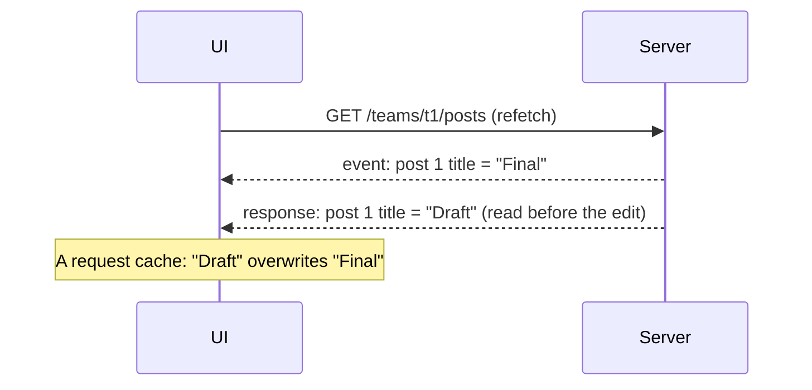

import { BlogPostImage, Screenshot } from "@site/src/components";

<BlogPostImage
  title="Introducing HyperFetch DB"
  description="Store each record once. Show it live everywhere."
  badge="feature"
  href="/blog/hyper-fetch-db"
  pattern="interactive"
  patternMask="radial"
  patternFocus="center"
  file="posts.tsx"
>

```ts
const { data } = useLiveQuery(
  db.post.where((post) => eq(post.teamId, teamId)),
);
// A write, a socket event or a response for post 1 updates every view
```

</BlogPostImage>

HyperFetch DB is a normalized cache that stays live. `@hyper-fetch/db` stores each record once, in a typed collection
that your existing requests and socket listeners fill, and every view that shows the record updates when a mutation, a
socket event or another response changes it. A response that was in flight during the change cannot overwrite it. The
package is new and in beta, and apps that do not install it are not affected.

{/* truncate */}

:::info Version

Written for **HyperFetch 10.2** and later, the release that shipped `@hyper-fetch/db`. The
[release overview](/blog/hyper-fetch-10-0) links the rest of the v10 series.

:::

```bash npm2yarn2pnpm
npm install @hyper-fetch/db @hyper-fetch/react @hyper-fetch/sockets
```

## Highlights

- **[Collections instead of a normalized Cache](#collections-instead-of-a-normalized-cache)**: one typed row per
  record, loaded by the requests you already have.
- **[Queries that pick their request](#queries-that-pick-their-request)**: query a collection, and the db sends what
  the endpoint can serve and filters the rest.
- **[Live by default](#live-by-default)**: socket events insert, update and delete rows in every loaded list.
- **[Late responses cannot win](#late-responses-cannot-win)**: writes are ordered per field, so a slow response never
  undoes a newer change.
- **[Optimistic writes without rollback code](#optimistic-writes-without-rollback-code)**: a write shows at once and
  reverts exactly what it changed.
- **[List and detail](#list-and-detail)**: summaries and full records stay in step, joins load related rows in one
  request.
- **[An offline outbox](#an-offline-outbox)**: writes persist, replay in order after a restart, and one tab replays
  for all.
- **[From your SDK or Firestore](#from-your-sdk-or-firestore)**: one call derives a whole collection.
- **[How we tested it](#how-we-tested-it)**: seeded random races, and bug reports ported from other data libraries.

---

## One record, many copies

The core Cache stores one response per `cacheKey`. When post 1 appears in a team list, a search result and a detail
page, the app holds three copies of it, each in the shape of its own response. Keeping them current with REST and a
socket is the same hand-written work in every app:

- A socket handler has to find each cached response that holds the post and patch it, in that response's shape. The one
  it forgets shows stale data.
- A new post has to land in the right lists, at the right position, inside the pages that were loaded. Most apps give
  up and refetch every list.
- A list request that was in flight during the socket event returns later and overwrites the newer title.
- After a reconnect nobody knows which events were missed, so everything refetches.

GraphQL documents, which return many related types at once, and Firestore snapshots, which stream document changes,
need the same thing. We wanted one answer for all three.

---

## Collections instead of a normalized Cache

Our first design normalized the core Cache: requests kept reading through it, and entities were stored underneath. It
created a second read path. Reading an entity had no fetching or freshness rules of its own, so one post could be fresh
in one view and stale in another. We dropped it, together with partial rows, where one row held a list's fields and a
detail's extra fields with freshness tracked per field.

What shipped is a separate package, modelled on [TanStack DB](https://tanstack.com/db). A **collection** holds complete
rows of one schema, and components query collections, never endpoints:

```ts title="db.ts"
const Post = collection(PostSchema, { key: "id", version: "updatedAt" })
  .load(getTeamPosts, {
    where: {
      // highlight-next-line
      teamId: { eq: (teamId) => ({ params: { teamId } }), required: true },
    },
  })
  // highlight-next-line
  .load(getPost, { byKey: (id) => ({ params: { postId: id } }) });

export const db = createDb({ post: Post });
```

- The schema is any [Standard Schema](https://standardschema.dev), such as Zod, Valibot or ArkType. Without one,
  `rowType<Post>()` gives the type and skips validation.
- A **loader** is a request you already have, plus how query conditions map to it. Mocks set with `setMock()`, plugins,
  authentication and mappers apply to it unchanged.
- Every row is complete. A loader whose rows miss a field, add one or change its type does not compile.
- When a list returns summaries, the summaries are their own collection. That keeps every row honest about which fields
  it has.

---

## Queries that pick their request

A query names the data, and the db finds the request. It plans each query in four steps: answer from the rows it holds
when a fresh loaded subset contains the query, otherwise pick the loader that can send the most conditions, subscribe
to the syncs that keep the result live, and share the subset with every query that needs the same one.

```tsx title="popular-posts.tsx"
const popular = db.post
  .where((post) => and(eq(post.teamId, teamId), gt(post.likes, 10)))
  .orderBy((post) => post.createdAt, "desc");

// highlight-next-line
const { data, status } = useLiveQuery(popular);

const plan = popular.explain();
// plan.sent   the teamId condition, as GET /teams/:teamId/posts
// plan.local  likes > 10, run on the rows that come back
// plan.syncs  the listeners that keep the result live
```

`useLiveQuery` comes from `@hyper-fetch/react` and identifies a query by its structure, like `useFetch` does with a
request, so there is no dependency array. A query that sets the required filters of no loader does not compile, and
`.local()` reads only the rows the db holds. Queries work without React too: `subscribe()` and `getSnapshot()` run in
any code.

---

## Live by default

A **sync** is a socket listener declared on the collection. No component writes a socket handler:

```ts title="db.ts"
const byTeam = { teamId: { eq: (teamId) => ({ params: { teamId } }) } };

const Post = collection(PostSchema, { key: "id", version: "updatedAt" })
  // ...loaders
  // highlight-start
  .sync(onPostCreated, { type: "insert", where: byTeam })
  .sync(onPostChanged, { type: "update", where: byTeam })
  .sync(onPostDeleted, { type: "delete", where: byTeam });
  // highlight-end
```

- An `insert` joins every loaded list whose filters it matches, at its sorted position, without a refetch.
- An `update` that moves a row out of a filter, such as a post going back to draft, removes it from lists of published
  posts.
- `where` maps the query's filters to listener params, so a query for team `t1` opens team `t1`'s topics only. Ten
  components showing team `t1` share one subscription per topic.
- A subset subscribes to its syncs **before** it sends its request, and buffers events that arrive while the request is
  in flight. An update for a row that only the response brings is not lost.
- After a reconnect, the subsets the socket covered count as stale and refetch, unless the subscription resumed from
  its last event id, because the server then sends the missed events.

The db uses the same operators on the client that loaders send to the server. That is how it knows which loaded lists
a new row belongs to without asking.

---

## Late responses cannot win

This is the race that breaks most hand-written realtime lists:



The db orders every write per field instead of per response:

- With `version`, a write changes only the fields whose stored version is not newer than its own. A response read from a
  lagging replica cannot undo version 5 with version 3.
- Without `version`, a response changes only the fields that were last written before its request was sent. A socket
  event or a mutation result that arrived in the meantime stays.
- Order comes from one counter the db advances when a request is sent or a write lands, never from the clock, so two
  writes in the same millisecond still have an order.
- A delete counts as a write. The db remembers the deleted key until the requests sent before the delete have settled,
  so a late response cannot bring the row back.

Set `version` on every collection with syncs. It names a field that grows with every change on the server: a number, a
string or a date.

---

## Optimistic writes without rollback code

A write applies an optimistic layer at once, then sends the request from the collection's `mutate` mapping:

```tsx title="post-row.tsx"
const rename = async (id: number) => {
  // highlight-next-line
  const { success, error } = await db.post.update(id, { title: "Renamed" });
  if (!success) toast(error);
};
```

- The layer records exactly what the write changed. On failure only that is reverted, and changes made since stay.
- Writes to one row are sent one at a time, in order. When one fails, the writes built on it are dropped with it.
- A response that is the row is written in the same step that drops the layer, so nothing flickers. A `204` needs
  `onSuccess`: `"keep"`, `"refetch"`, or `"sync"` to wait for the socket event.
- An insert can leave the key to the server. The row gets a temporary key and a render key that survives the swap, so
  components keyed by it do not remount.
- Like `send()`, a write resolves with `{ success, data, error }` and never throws.

`db.transaction` groups writes to several rows and collections into one layer that is kept or reverted as a whole, sent
as one request or one write after another.

---

## List and detail

A list returns summaries and the detail returns the full post, so they are two collections. A link keeps them in step:

```tsx title="post-page.tsx"
const db = createDb(
  { post: Post, postSummary: PostSummary },
  // highlight-next-line
  { links: [["post", "postSummary"]] },
);

const header = useLiveQuery(db.postSummary.findOne(postId).local());
const body = useLiveQuery(db.post.findOne(postId));
```

The header renders from the summary at once when the list loaded the post, and the body waits for the full row. A write
or an optimistic change to one collection changes the fields the other has, and a summary never gains `body`.

Related records work the same way. `normalize` stores the author nested in each post in the `user` collection, and
`.join("author", db.user, (post) => post.authorId)` loads the authors of a whole list in one `byKeys` request. A change
to one user updates every result that points at it.

---

## An offline outbox

Core can already hold requests while the device is offline. The db holds **writes to rows**, so after a reload the UI
shows the rows with the offline edits applied:

```ts title="db.ts"
const db = createDb(collections, {
  // highlight-start
  offline: true,
  persistence: { storage: localStorage, scope: user.id, version: 1 },
  // highlight-end
});

const created = db.post.insert(draft);
db.comment.insert(comment, { dependsOn: [created] });
```

- Pending writes are stored as plain records, not requests, and replay in order across the whole db, so a comment goes
  out after its post.
- Each write passes an id to `map` to send as an idempotency key, because a write interrupted mid-request is sent again
  after a restart.
- A rejected write takes its dependents with it, so a rejected post leaves no orphan comment.
- One tab, elected with Web Locks, replays the outbox. The others send their writes to it over a `BroadcastChannel`.
- `scope` keeps one user's rows from being restored for another, and `db.clear()` wipes the scope on sign-out, in every
  tab.

---

## From your SDK or Firestore

When an API follows REST conventions, one call declares the loaders and the writes. Firestore collections get their
queries, snapshots and local writes in one call too:

<Tabs>
<TabItem value="sdk" label="REST SDK">

```ts title="db.ts"
const Post = collection(PostSchema, { key: "id", version: "updatedAt" })
  // highlight-next-line
  .resource(sdk.posts, { item: "$postId", list: { where: ["status"] } });
```

</TabItem>
<TabItem value="firestore" label="Firestore">

```ts title="db.ts"
import { firestoreCollection } from "@hyper-fetch/firebase/db";

// highlight-next-line
const Post = firestoreCollection(PostSchema, {
  client,
  socket,
  path: "posts",
  key: "id",
});
```

</TabItem>
</Tabs>

`.resource()` reads `GET /posts`, `GET /posts/:postId`, `POST`, `PATCH` and `DELETE` from a typed SDK, so OpenAPI,
Hono and Elysia apps get collections the same way. GraphQL documents work as loaders too, with `normalize` spreading one
response over several collections.

---

## See it in HyperFlow

`DevtoolsPlugin({ dbs: [db] })` adds a DB page to HyperFlow, with every collection, query plan, loaded subset and
pending write:

<Screenshot src="/img/hyper-flow/db.webp" alt="The HyperFlow DB page listing collections, live queries and the outbox" />

`db.inspect()` returns the same data in code, and `db.onError` reports failed loads, syncs, writes and outbox entries in
one place.

---

## How we tested it

A live cache is only worth it if it never shows a value the server does not have. We tested for that directly:

- **Seeded races.** A model test runs 90 seeds of 40 random steps: optimistic writes, changes made on the server by
  someone else and refetches, with every response held and released in random order. Whatever the order, once things
  settle the client shows exactly the server's rows, holds no pending layers, and every write has resolved. Seeds are
  fixed, so a failure replays.
- **Other libraries' bug reports.** We read the issue trackers of Apollo Client, Dexie, RxDB, urql, Relay and Electric,
  and turned their hardest cases into specs: a failed update over a newer server value, responses that return in
  reverse order, a row deleted by an event while an update is pending.
- **A type budget.** A fixture with 50 collections uses every typed feature. The typecheck fails when it stops
  compiling or when its instantiation count grows more than about 25% past what we measured, so the strict types stay
  fast in big apps.

---

## More in the package

- `useLiveInfiniteQuery` pages over the held rows and loads backend pages only when the window needs them.
- `db.dehydrate()` on the server and `createDb(collections, { state })` with `DbProvider` on the client render a page
  with its rows and no loading state.
- Server-only operators, such as a full-text `search`, are sent to the backend and never evaluated on the client.
- Persisted rows and the outbox keep `Date`, `bigint`, `Map` and `Set`, and `codecs` add your own types.

---

## Try the beta

`@hyper-fetch/db` is in beta. Start with one screen where the same records show in two places, and tell us what breaks:
[open an issue](https://github.com/BetterTyped/hyper-fetch/issues) and we will fix it with a test, or start a
[discussion](https://github.com/BetterTyped/hyper-fetch/discussions).

## Learn more

- [DB overview](/docs/db/overview): when to use the db instead of `useFetch`.
- [Quick start](/docs/db/quick-start): from a request to a live query and a write, in four steps.
- [Thinking in collections](/docs/guides/db/basics/thinking-in-collections): the guide series, from loaders to offline.
- [Realtime sync](/docs/guides/db/basics/realtime-sync): scoping, mapping messages and reconnects.
- [Offline-first](/docs/guides/db/patterns/offline-first): persistence, the outbox and tabs.
- [Migrating from React Query](/docs/guides/db/production/migrating-from-react-query): moving one screen at a time.
- [useLiveQuery](/docs/react/db/use-live-query): the React hook and its result.
