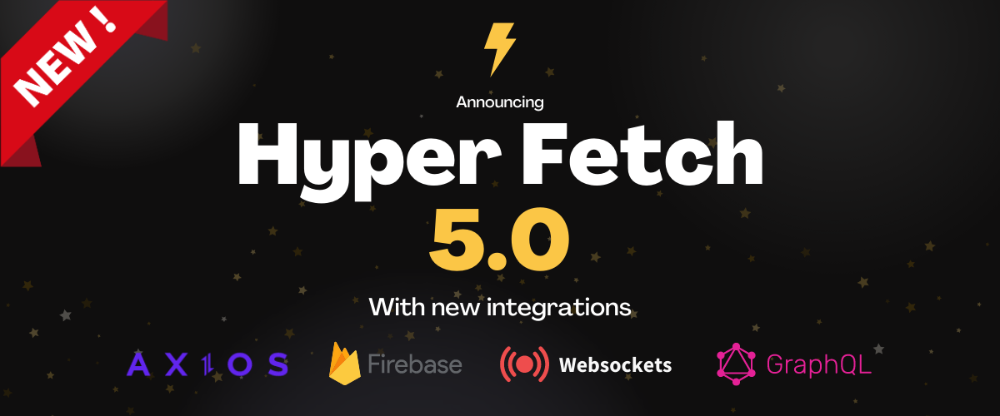

## The most important update to date has been released!

New version of our library got released and with it, dozens of updates and new features, additional tests, remodeled and
refined typescript that should satisfy the most demanding users.

We provided many, many updates and enhancements to improve the experience and ensure everything is working just great.

> That’s not all, we are extremely excited to present you our first integrations - Firebase, Axios and GraphQL adapters!

<!--truncate-->

:::info What is HyperFetch?

**HyperFetch** is a fetching framework built to keep things simple and efficient. It's type-safe
design and user-friendly interface ensure a seamless integration experience, whether you're working on the browser or
the server. Next-generation features streamlines architecture creation, grants access to the request lifecycle, and
empowers rapid development of new components and functionalities, all while facilitating real-time data exchange.

:::

## Highlights

Overview of the most important changes for HyperFetch 5.0 and some of 4.0 features.

### ✨ New response interface

We’ve changed the structure of our response interface. Instead of an array, it returns an object. Interface provides
also the additional data object with adapter specific data. By default it gives you response headers.

**Old:**

```ts
const [data, error, status] = await getUsers.send();
```

**New:**

```ts
const {
  data,
  error,
  status,
  success,
  extra: { headers },
} = await getUsers.send();
```

### 🔮 Better adapters

We have improved our adapters - the new interface allows for much greater configuration and extensibility. Now you can
easily attach any library with any protocol you want. This comes with next level typescript interface which controls
type safety.

### 🎯 Firebase, Graphql, Axios adapters

Added adapters for Firebase, GraphQL, and Axios with the following capabilities:

- **Firebase:** Admin, Firestore, and Realtime adapters for both node and browser
- **GraphQL:** Simple GraphQL adapter with tags parsing, compatible with both node and browser
- **Axios:** Supercharged Axios adapter for both node and browser

### 🎭 Mocker

Create your own responses with full support for functionalities like success/error responses, request sequences,
upload/download progress, response time and more.

```ts
import { getUser } from "./api";

// 1. Real request
const { data } = await getUser.send();
console.log(data); // Server Response: {name: "Maciej" }

// 2. Mocked request
const mockedData = { name: "Kacper" };
getUser.setMock({ data: mockedData });

const response = await getUser.send();
console.log(data); // Mocked Response: {name: "Kacper" }
```

> You can also use callback functions to make dynamic responses!

### 💎 Request Mappers

**Modify, map or validate** requests before sending them to server.

```ts
import { z } from "zod";
import { client } from "./api.client";

const User = z.object({
  name: z.string(),
  age: z.number(),
});

const request = client
  .createRequest<{ success: boolean }, { name: string; age: number }, ZodError>()({ endpoint: "/user", method: "POST" })
  .setRequestMapper((req) => {
    // Validate request data before sending it to server
    // Throwing an error will result with the request not being sent
    User.parse(req.data); // => throw ZodError on schema validation

    return req;
  });

// Usage:

const { data, error } = await request.send({
  // Ha! I beat you typescript!
  data: { name: "Maciej", age: "WRONG" as any },
});

console.log(data); // null
console.log(error); // ZodError -> Validation failed
```

### 🚀 Response Mappers

**Modify, map or validate** response from the server.

```ts
import { client } from "./api.client";

const request = client
  .createRequest<{ firstName: string; lastName: string }>()({ endpoint: "/user", method: "POST" })
  .setResponseMapper((response) => {
    const { data } = response;
    // We can handle error and successful cases
    if (data) {
      console.log(data); // { firstName: "Maciej", lastName: "Pyrc" }

      return {
        ...response,
        data: {
          ...data,
          // Enrich your response
          fullName: `${data.firstName} ${data.lastName}`,
        },
      };
    }

    return response;
  });

// Usage:

const { data } = await request.send();

console.log(data); // { firstName: "Maciej", lastName: "Pyrc", fullName: "Maciej Pyrc" }
```

## Other changes:

- ⚡︎ **Improved Cache methods** Ability to directly change cache by update or set methods which also consume callback
  function now
- 📡 **Key mappers** - in HyperFetch everything is grouped by keys. Now you can provide global key generation
  strategies to make this process fully custom.
- 🎡 **Flattened cache** of response object - this allows for better and easier interactions with cache
- 🗺️ **Added tsd typescript tests** - we locked crucial typescript rules and made the solid foundation for the testing
  our typescript.
- 🪴 **Added isSuccess value** - this property on response tells us whether our request was successful.
- 🏵️ **Adapters new generic types** - we can set custom types for request methods, options, query params and additional
  data passed with response.
- 👾 ”**Revalidate**” names changed into **“invalidate” for core** and **“refetch” for react**
- 🗯️ Added **setEndpointMapper** for client to allow parsing graphql DocumentNodes
- 🏋🏻‍♂️ Method **setAdapter** can return new Client instance now and inherit it’s types
- 🪢 Emitter **acknowledge event** now pass parameters as single object
- 🐛 **Tons of bug fixes and tests** - we had to improve a lot of parts of the system to make it faster, better and more
  customizable. Fixed many typescript issues and locked crucial parts with typescript tests. FormData fixes on the node
  adapter.

---

## Special thanks ❤️

We would like to thank the wonderful community for participating in our journey, especially the people who contributed
significantly to testing and solving problems with us and giving us a lot of feedback, which is incredibly valuable.
Thank you for your time, help and support!

- [John Gerome Baldonado](https://github.com/johngerome)
- [Stefan](https://github.com/stefanullinger)

---

## See you soon! 🎉🎉

Thank you for all the support, we are going to release some new great updates in the near future. Right now we are
exploring openapi code generation, trpc adapter and some more interesting topics on how to improve the HF.

See you soon!
