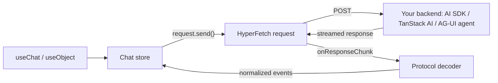

import { LinkCard } from "@site/src/components";

# Overview

> `@hyper-fetch/ai` is a provider-agnostic, end-to-end typed AI chat client. Your backend keeps using the AI library
> you like - Vercel AI SDK, TanStack AI or any AG-UI agent - and HyperFetch becomes its frontend.

---

## Why?

AI libraries ship two halves: a server part that talks to model providers and runs tool loops, and a client part
(`useChat`, `useObject`) that renders the stream. The server part is where providers, models and agents change every
month. The client part only needs to understand the stream the server sends.

`@hyper-fetch/ai` replaces only the client half:

- **No provider lock-in** - switch your backend between AI SDK, TanStack AI or an AG-UI agent (LangGraph, Mastra,
  CrewAI, Pydantic AI, ...) by changing one `protocol` option.
- **No providers to maintain** - models, API keys and tool loops stay on your server.
- **End-to-end types** - derive the chat types from your backend's types; tool inputs and outputs, data parts, message
  metadata and agent state are typed in every message part and callback.
- **It's a HyperFetch request** - auth, headers, plugins, retries, the devtools and the mocker work for your chat
  endpoint like for any other request.

---

## Supported backends

| Backend | Protocol | What it reads |
| --- | --- | --- |
| Vercel AI SDK v5 - v7 | `aiSDKProtocol()` | UI message stream (`createUIMessageStreamResponse`, `toUIMessageStreamResponse`) |
| Vercel AI SDK text stream | `aiSDKTextProtocol()` | `createTextStreamResponse`, `toTextStreamResponse` |
| TanStack AI 1.x | `tanstackAIProtocol()` | `toServerSentEventsResponse` (SSE) and `toHttpResponse` (NDJSON) |
| Any AG-UI 1.0 agent | `aguiProtocol()` | AG-UI events over SSE or NDJSON |

TanStack AI speaks AG-UI on the wire, so `tanstackAIProtocol()` is the AG-UI protocol plus TanStack's conventions (the
`X-Run-Id` header and interrupt answers).

---

## What you get

- Messages made of typed parts: text, reasoning, tool calls, data, sources, files and steps
- Streaming tool input (partial JSON) and server-side tool results
- Client-side tools with schema validation, manual tool results and automatic follow-up requests
- Tool approvals (AI SDK) and interrupts (AG-UI / TanStack AI)
- Shared agent state with JSON Patch updates (AG-UI)
- Stop, regenerate and resume
- Structured output streaming with partial objects (`useObject`)
- Standard Schema validation for tool input, data parts, metadata and objects
- Encoders for mocking AI streams in tests

:::info Not supported yet

Stream resumption is supported for AI SDK (`resumeRequest`), but not TanStack AI's offset-based reconnect. AG-UI binary
(protobuf) encoding and TanStack AI's subagent, MCP app and structured-output chat parts are not decoded into dedicated
parts yet - they reach you through `onEvent` / `onData`.

:::

---

## See More

<LinkCard type="docs" title="Quick Start" description="Connect your first chat." to="/docs/ai/quick-start" />
<LinkCard type="docs" title="Type safety" description="End-to-end types from your backend." to="/docs/ai/type-safety" />
