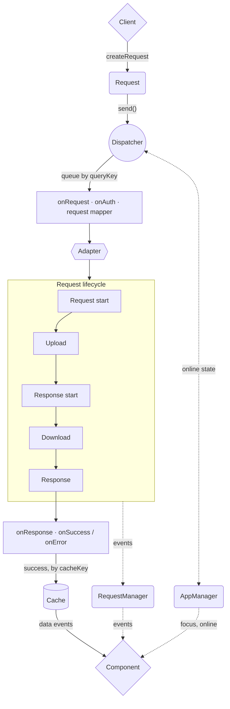
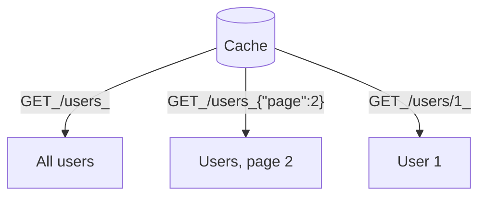
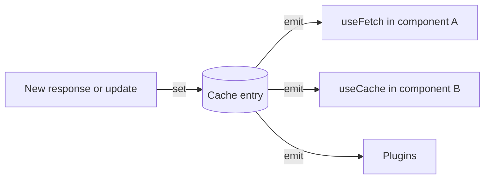

This page follows one `send()` through the client: from the request, through the dispatcher and the adapter, to the
cache and the components that read it. Read it before writing an adapter, a plugin or your own framework bindings.

---

## The steps

1. **Create.** `client.createRequest()` builds an immutable request. Its `cacheKey`, `queryKey` and `abortKey` are
   derived from the method, endpoint and query params.
2. **Dispatch.** `send()` adds it to the queue of its `queryKey` in `fetchDispatcher` (GET, QUERY) or
   `submitDispatcher`. The [dispatcher](/docs/core/dispatcher) deduplicates, cancels or queues it, and holds it while
   the [AppManager](/docs/core/managers#appmanager) reports the app offline.
3. **Intercept.** `onRequest`, `onAuth` (when `auth` is on) and the request mapper change the request.
4. **Send.** The [adapter](/docs/core/adapter) sends it and reports start, upload, download and the response. Each step
   is an event on the [RequestManager](/docs/core/managers#requestmanager).
5. **Respond.** `onResponse`, then `onSuccess` or `onError` change the response. A failed attempt may be retried.
6. **Store.** A successful response is written to the [cache](/docs/core/cache) under `cacheKey`. The cache emits it
   to every reader of that key, and `send()` resolves.

`exec()` skips steps 2 and 6: it runs the interceptors and the adapter only.

---

## How the cache holds responses

Each `cacheKey` is one entry. Requests with the same method, filled endpoint and query params share it.

When an entry changes, by a response, `cache.update`, `invalidate` or an optimistic update, the cache emits an event for
that key. Every mounted reader of the key, such as `useFetch`, re-renders or refetches.

---

## Next steps

<LinkCard
  type="guides"
  title="Request lifecycle"
  description="Every lifecycle callback of a request, in React."
  to="/docs/guides/react/basics/request-lifecycle"
/>

<LinkCard type="docs" title="Plugin" description="Hook into every step of this flow." to="/docs/core/plugin" />

<LinkCard
  type="guides"
  title="Custom adapter"
  description="Write the adapter step for your own transport."
  to="/docs/guides/core/advanced/custom-adapter"
/>
