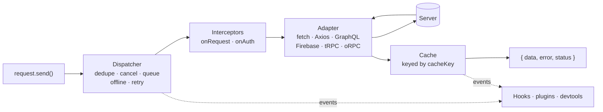

# Core overview

`@hyper-fetch/core` turns every endpoint into a typed **request** you define once and send from anywhere: a component,
a server loader, a test or a script. The **client** behind it caches responses, deduplicates and retries requests, runs
queues, waits out offline periods and reports every step as an event. It has no framework dependency and runs in
browsers, Node.js, Bun and Deno.

```ts title="api.ts"
import { createClient } from "@hyper-fetch/core";

// One client per backend
const client = createClient({ url: "https://api.example.com" });

// One request per endpoint, typed once
// highlight-start
export const getUser = client.createRequest<{ response: User }>()({
  endpoint: "/users/:userId",
});
// highlight-end

// Send it anywhere. `:userId` is a required, typed param.
const { data, error, status } = await getUser.send({ params: { userId: 1 } });
```

`send()` never throws. HTTP errors, timeouts, aborts and network failures all resolve with `error` set, so you branch on
the result instead of wrapping calls in `try/catch`.

---

## What the client does for you

Each tab is a complete example. None of them needs extra libraries or setup beyond the client above.

<Tabs>
<TabItem value="types" label="Type safety">

The endpoint string, the payload and the query params are checked when you send, not when the server answers.

```ts
const updateUser = client.createRequest<{
  response: User;
  payload: { name: string };
}>()({ endpoint: "/users/:userId", method: "PATCH" });

// error-next-line
await updateUser.send({ payload: { name: "Ann" } });
// Property 'params' is missing: `:userId` comes from the endpoint string

// highlight-next-line
await updateUser.send({ params: { userId: 1 }, payload: { name: "Ann" } }); // ✅
```

</TabItem>
<TabItem value="cache" label="Cache">

Successful responses are cached under a key derived from the method, endpoint and params. Read them without a request,
or show cached data first and refresh in the background.

```ts
const getUsers = client.createRequest<{ response: User[] }>()({
  endpoint: "/users",
  // highlight-next-line
  staleTime: 30_000, // fresh for 30 seconds
});

getUsers.read(); // cached response, no network

// Cached data now, network refresh in the background
// highlight-next-line
await getUsers.send({ cachePolicy: "revalidate" });

// After a mutation, mark the list stale so its readers refetch
client.cache.invalidate(getUsers);
```

</TabItem>
<TabItem value="dedupe" label="Dedupe and cancel">

Ten components asking for the same data at once make one request. For search-as-you-type, keep only the latest call.

```ts
// GET requests share one in-flight call by default
await Promise.all([getUsers.send(), getUsers.send(), getUsers.send()]); // 1 request

// Every new call aborts the previous one with the same key
// highlight-next-line
const searchUsers = getUsers.setCancelable(true).setQueryKey("users-search");

searchUsers.send({ queryParams: { search: "an" } }); // aborted
searchUsers.send({ queryParams: { search: "ann" } }); // sent
```

</TabItem>
<TabItem value="queues" label="Queues and offline">

Writes that must arrive in order go through a queue. When the device goes offline, they wait and continue once the
connection is back.

```ts
const saveNote = client.createRequest<{ response: Note; payload: NoteInput }>()({
  endpoint: "/notes",
  method: "POST",
  // highlight-start
  queued: true, // one at a time, in order
  offline: true, // wait for the network instead of failing
  retry: 3,
  // highlight-end
});

saveNote.send({ payload: first });
saveNote.send({ payload: second }); // starts after `first` finishes
```

</TabItem>
<TabItem value="auth" label="Auth and errors">

Interceptors on the client add tokens, refresh them on `401` and resend the original request.

```ts
client
  // highlight-start
  .onAuth((request) => request.setHeaders({ ...request.headers, Authorization: `Bearer ${tokens.access}` }))
  .onError(async (response, request) => {
    // highlight-end
    if (response.status !== 401 || request.used) return response;
    await refreshTokens();
    return request.setUsed(true).send(); // retried once with the new token
  });
```

</TabItem>
<TabItem value="adapters" label="Any backend">

The same request API works over every transport. Swap the adapter and keep the rest of your code.

```ts
import { GraphqlAdapter } from "@hyper-fetch/graphql";

const graphql = createClient({ url: "https://api.example.com/graphql" })
  // highlight-next-line
  .setAdapter(GraphqlAdapter());

const getUser = graphql.createRequest<{ response: { user: User } }>()({
  endpoint: userQuery, // a GraphQL document instead of a path
});
```

</TabItem>
</Tabs>

---

## How a request travels

A request is an immutable description of one call. `send()` hands it to a dispatcher, which applies deduplication,
cancelation, queues, offline handling and retries before the adapter talks to the server. The response lands in the
cache, and every step emits an event that hooks, plugins and [HyperFlow devtools](/docs/hyper-flow) listen to.



| Building block                                  | What it owns                                                                           |
| ----------------------------------------------- | -------------------------------------------------------------------------------------- |
| [Client](/docs/core/client)                 | Base URL, adapter, cache, dispatchers, interceptors and plugins for one backend        |
| [Request](/docs/core/request)               | One endpoint: method, params, payload, query params, cache and retry options           |
| [Dispatcher](/docs/core/dispatcher)         | When requests go out: deduplication, cancelation, queues, offline and retries          |
| [Cache](/docs/core/cache)                   | Responses by key, freshness with `staleTime`, garbage collection with `cacheTime`      |
| [Adapter](/docs/core/adapter)               | The transport: the built-in fetch adapter, or Axios, GraphQL, Firebase and your own    |
| [Managers](/docs/core/managers)             | Focus and online state, request lifecycle events and aborting                          |

---

## Requests are templates

Because a request is plain data, you can derive variants, share it between server and client, mock it in a story and
inspect it in a test, all without a custom hook per endpoint.

```ts
const getUsers = client.createRequest<{
  response: User[];
  queryParams?: { team?: string };
}>()({ endpoint: "/users" });

// Every setter returns a new request, the original stays untouched
const getDesigners = getUsers.setQueryParams({ team: "design" });

getDesigners.endpoint; // "/users"
getDesigners.queryParams; // { team: "design" }

// Same request on the server...
export const loader = () => getDesigners.send();
// ...and in a test or a story, without a server
getDesigners.setMock(() => ({ data: [{ id: 1, name: "Ann" }], status: 200 }));
```

For larger APIs, [`createSdk`](/docs/core/sdk) builds all requests from one typed schema, and the
[CLI](/docs/cli/overview) generates that schema from an OpenAPI spec.

---

## When to use core on its own

:::note When it fits

- **Backends, scripts and workers** where you want typed requests, retries and queues without a UI framework.
- **Your own framework binding**: Vue, Svelte or Solid code can subscribe to the client's events directly.
- **Shared API packages** consumed by several apps, such as a web app and a React Native app.

:::

In React, add [`@hyper-fetch/react`](/docs/react/overview) on top: `useFetch` and `useSubmit` read the same requests
and the same cache. For realtime data, add [`@hyper-fetch/sockets`](/docs/sockets/overview).

---

:::secondary Summary

- A **client** per backend owns the adapter, cache, dispatchers and interceptors.
- A **request** per endpoint is typed once and sent anywhere with `send()`, which never throws.
- Cache, deduplication, cancelation, queues, retries and offline handling come from the client, with no extra setup.

:::

## Next steps

Runnable examples: [Vanilla TypeScript](/examples/getting-started/vanilla) (core without a framework) and
[HyperFetch on the server](/examples/integrations/server-runtimes).

<div className="row">
  <div className="col col--6">
    <LinkCard
      type="docs"
      title="Quick start"
      description="Install core, create a client and send your first typed request."
      to="/docs/core/quick-start"
    />
  </div>
  <div className="col col--6">
    <LinkCard
      type="docs"
      title="Requests"
      description="Params, payloads, query params, keys and every option a request takes."
      to="/docs/core/request"
    />
  </div>
  <div className="col col--6">
    <LinkCard
      type="docs"
      title="Cache"
      description="How keys, staleTime, cacheTime and invalidation work."
      to="/docs/core/cache"
    />
  </div>
  <div className="col col--6">
    <LinkCard
      type="docs"
      title="React hooks"
      description="useFetch and useSubmit on top of the same requests."
      to="/docs/react/overview"
    />
  </div>
</div>
