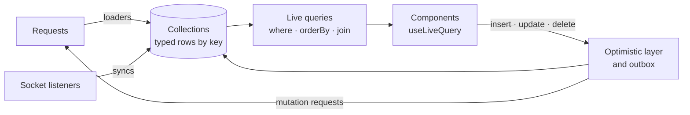

# DB overview

`@hyper-fetch/db` stores your server data as **collections** of typed rows, one row per record. The requests and socket
listeners you already have fill them. Components run **live queries** against collections instead of calling
endpoints, and a write to a row shows at once in every query that contains it.

```tsx title="posts.tsx"
import { collection, createDb, eq } from "@hyper-fetch/db";
import { useLiveQuery } from "@hyper-fetch/react";

// A collection: complete rows of one schema, loaded by an existing request
// highlight-start
const Post = collection(PostSchema, { key: "id" })
  .load(getTeamPosts, {
    where: {
      teamId: { eq: (teamId) => ({ params: { teamId } }), required: true },
    },
  })
  .mutate({
    update: {
      request: updatePost,
      map: (id, changes) => ({ params: { postId: id }, payload: changes }),
    },
  });
// highlight-end

export const db = createDb({ post: Post });

const TeamPosts = ({ teamId }: { teamId: number }) => {
  // highlight-start
  const { data } = useLiveQuery(
    db.post.where((post) => eq(post.teamId, teamId)),
  );
  // highlight-end

  return data?.map((post) => (
    // Shows in this list, in every other query with this post, and reverts if
    // the request fails
    <p
      key={post.id}
      onClick={() => db.post.update(post.id, { title: "Renamed" })}
    >
      {post.title}
    </p>
  ));
};
```

---

## When to use it

| Your data                                                                         | Use                                            |
| --------------------------------------------------------------------------------- | ---------------------------------------------- |
| Each screen shows its own response, such as a settings page or a report          | [`useFetch`](/docs/react/hooks/use-fetch)  |
| The same records show in several views, such as a list, a detail and a counter   | `@hyper-fetch/db`                              |
| Records change from mutations, sockets and other users at the same time           | `@hyper-fetch/db`                              |
| Writes must work offline and replay in order when the connection returns          | `@hyper-fetch/db`                              |

A request used by both `useFetch` and a collection keeps two copies of its data, one in the Cache and one in the
collection, and they do not update each other. Pick one per request.

---

## What you get

- **[Live queries](#queries)** filter, sort and shape rows; the db sends what the loader can send and runs the rest
  locally.
- **[Optimistic writes](#writes)** show at once and revert exactly what they changed when the request fails.
- **[Realtime syncs](#syncs-and-ingest)** apply socket messages to every query that holds the row, without a refetch.
- **[Related data](/docs/db/related-data)**: links, normalized nested records and batched joins.
- **[Transactions](/docs/db/transactions)** keep or revert several writes together.
- **Offline writes** go through a persisted outbox and replay in order when the connection returns.
- **[Server rendering](/docs/db/server-rendering)** with a db per request, dehydrated into the page.

---

## How data flows



The sections below cover each part. The [quick start](/docs/db/quick-start) builds the example above step by step.

---

## Collections

A collection is a typed set of **complete rows**, defined by a [Standard Schema](https://standardschema.dev) such as a
Zod, Valibot or ArkType schema, and a key. Every row has every field of the schema, so a query can use any of them.

```ts title="src/db.ts"
import { collection, createDb, rowType } from "@hyper-fetch/db";

const Post = collection(PostSchema, { key: "id", version: "updatedAt" });
// no schema, writes are not validated
const Draft = collection(rowType<Draft>(), { key: "id" });

const db = createDb({ post: Post, draft: Draft });
```

When a list returns summaries and a detail returns more fields, they are two collections, such as `postSummary` and
`post`. `version` names a field that grows with every change on the server: a write never replaces fields with a newer
version.

---

## Loaders

A loader is a request plus the way to read complete rows from its response. A list loader declares the operators each
field can send and whether it is paginated. A loader with `byKey` or `byKeys` reads rows by key.

```ts title="src/db.ts"
const Post = collection(PostSchema, { key: "id" })
  .load(getTeamPosts, {
    rows: (response) => response.data.items,
    where: {
      teamId: { eq: (teamId) => ({ params: { teamId } }), required: true },
      likes: { gt: (likes) => ({ queryParams: { likes_gt: likes } }) },
    },
    orderBy: {
      createdAt: (direction) => ({
        queryParams: { sort: `createdAt:${direction}` },
      }),
    },
  })
  .load(getPostsByIds, { byKeys: (ids) => ({ queryParams: { ids } }) });
```

- The rows `rows` returns, or the response's items without it, must be exactly the schema's row. Otherwise the loader
  returns a `RowMismatch` and `createDb` does not compile.
- `fixed` declares conditions the endpoint applies on its own, such as `{ archived: false }`.
- `serverOnly` names fields the backend compares differently from the client, so queries on them are never answered
  from rows the db holds.
- `.resource(sdk.posts, { item: "$postId" })` derives the list, the by-key loader and the mutations from REST
  conventions of an SDK resource.

---

## Queries

```ts title="src/queries.ts"
import { and, eq, gt } from "@hyper-fetch/db";

const query = db.post
  .where((post) => and(eq(post.teamId, 1), gt(post.likes, 10)))
  .orderBy((post) => post.createdAt, "desc")
  .select((post) => ({ id: post.id, title: post.title }));

// the loader, what is sent, what runs locally and which syncs keep it live
query.explain();
```

- The db splits `where` at its top-level `and`: conditions the loader declares go to the backend, the rest run on the
  returned rows.
- A query that sets no loader's required filters does not compile. A paginated loader has to send every condition and
  order of a query.
- `findOne(key)` reads a row by key, and `.local()` reads only rows the db holds.
- `op("search", post.title, text)` is a server-only operator, such as full-text search. The loader maps it like any
  operator, as in `title: { search: (text: string) => ({ queryParams: { q: text } }) }`, and a query that uses one
  must send it. Its subset never answers other queries, and a new row marks it stale instead of joining it.
- For lists that grow page by page, see [`useLiveInfiniteQuery`](/docs/react/db/use-live-infinite-query).
- `subscribe`, `getSnapshot` and `get` work without React. In React, use [`useLiveQuery`](/docs/react/db/use-live-query).

---

## Syncs and ingest

```ts title="src/db.ts"
const byTeam = { teamId: { eq: (teamId) => ({ params: { teamId } }) } };

collection(PostSchema, { key: "id" })
  .sync(onPostCreated, { type: "insert", where: byTeam })
  .sync(onPostChanged, { type: "update", where: byTeam })
  .sync(onPostDeleted, { type: "delete", where: byTeam })
  .ingest(searchPosts, { rows: (response) => response.results });
```

`insert` messages carry complete rows, `update` messages the key and changed fields, `delete` messages the key. A loaded
subset is fresh while its syncs deliver all three, and refetches after a reconnect unless the sync `resumes`.

---

## Related data

```ts title="src/db.ts"
const db = createDb(
  { post: Post, postSummary: PostSummary, user: User },
  { links: [["post", "postSummary"]] },
);

db.postSummary
  .where((post) => eq(post.teamId, 1))
  .join("author", db.user, (post) => post.authorId);
```

Links keep two shapes of the same record in step, `normalize` writes nested records into their own collections, and
joins add the related row to each result. See [Related data](/docs/db/related-data). For Firestore,
`firestoreCollection` declares a whole collection in one call, see [Firestore](/docs/db/firestore).

---

## Writes

```ts title="src/db.ts"
collection(PostSchema, { key: "id" }).mutate({
  update: {
    request: updatePost,
    map: (key, changes) => ({ params: { postId: key }, payload: changes }),
  },
  delete: {
    request: deletePost,
    map: (key) => ({ params: { postId: key } }),
    onSuccess: "keep",
  },
});

const result = await db.post.update(1, { title: "Renamed" });
```

A write shows at once as an optimistic layer and reverts exactly what it changed when it fails. Writes to one row go
out in order. A response that is not the row needs `onSuccess`: `"keep"`, `"refetch"` or `"sync"`. Like `send()`, a
write never rejects.

With `offline`, writes go through a persisted outbox that one tab replays in order. Each write's id is passed to
`map`, so it can be sent as an idempotency key.

```ts title="db.ts"
const db = createDb(collections, {
  offline: { retryable: (response) => response.status !== 422 },
  persistence: { storage: localStorage, scope: userId, version: 1 },
});
```

Several writes that belong together go in one [transaction](/docs/db/transactions), kept or reverted as a whole. An
insert of a key the db already holds, and an update that changes a row's key, resolve with an error and send nothing.

---

## Errors

Requests, writes and queries never throw. What fails is reported to `db.onError`:

```ts title="src/db.ts"
db.onError(({ type, error, collection }) => report(type, error));
```

| `type`        | What failed                                                                    |
| ------------- | ------------------------------------------------------------------------------ |
| `mutation`    | A write the server rejected, or one dropped because a write it depends on was  |
| `validation`  | A row or write the collection's schema rejected                                |
| `load`        | A load whose mapping threw, such as `rows` reading a response it did not expect |
| `sync`        | A sync event whose mapping threw. The next events still apply.                 |
| `outbox`      | A stored write this db cannot replay, or an outbox of another format           |
| `persistence` | Storage that failed or holds data this version cannot read                     |
| `subscriber`  | A query listener that threw. The other listeners are still notified.           |

A failed load keeps the rows the query showed and sets `error` on it, and the next refetch tries again.

---

## Server rendering and devtools

- On the server, create a db per request, load with `query.get()` and send `db.dehydrate()` with the page. See
  [Server rendering](/docs/db/server-rendering).
- Persisted and dehydrated values are stored as type-tagged JSON, so `Date`, `bigint`, `Map` and `Set` come back as
  they were. Other types need a codec in the `codecs` option of `createDb`.
- `db.inspect()` describes what the db holds, and the devtools plugin's `dbs` option shows it in the
  [DB Inspector](/docs/hyper-flow/features/db) of HyperFlow.

---

## Next steps

- Guides: [loaders](/docs/guides/db/basics/loaders), [live queries](/docs/guides/db/basics/live-queries),
  [optimistic writes](/docs/guides/db/basics/optimistic-writes), [real-time sync](/docs/guides/db/basics/realtime-sync),
  [offline-first](/docs/guides/db/patterns/offline-first), [common mistakes](/docs/guides/db/production/common-mistakes).
- API reference: [`collection`](/docs/api/db/Functions/collection), [`createDb`](/docs/api/db/Functions/createDb).

<LinkCard
  type="guides"
  title="DB Guides"
  description="Task-focused guides that build one app: loaders, live queries, optimistic writes, real-time sync, offline-first and more."
  to="/docs/guides/db/basics/thinking-in-collections"
/>

<div className="row">
  <div className="col col--6">
    <LinkCard
      type="docs"
      title="Quick start"
      description="From a request to a live query and an optimistic write in four steps."
      to="/docs/db/quick-start"
    />
  </div>
  <div className="col col--6">
    <LinkCard
      type="docs"
      title="useLiveQuery"
      description="Run live queries in React components."
      to="/docs/react/db/use-live-query"
    />
  </div>
  <div className="col col--6">
    <LinkCard
      type="promo"
      title="DB Inspector in HyperFlow"
      description="See collections, loaded subsets, live query plans and the outbox."
      to="/docs/hyper-flow/features/db"
    />
  </div>
</div>
