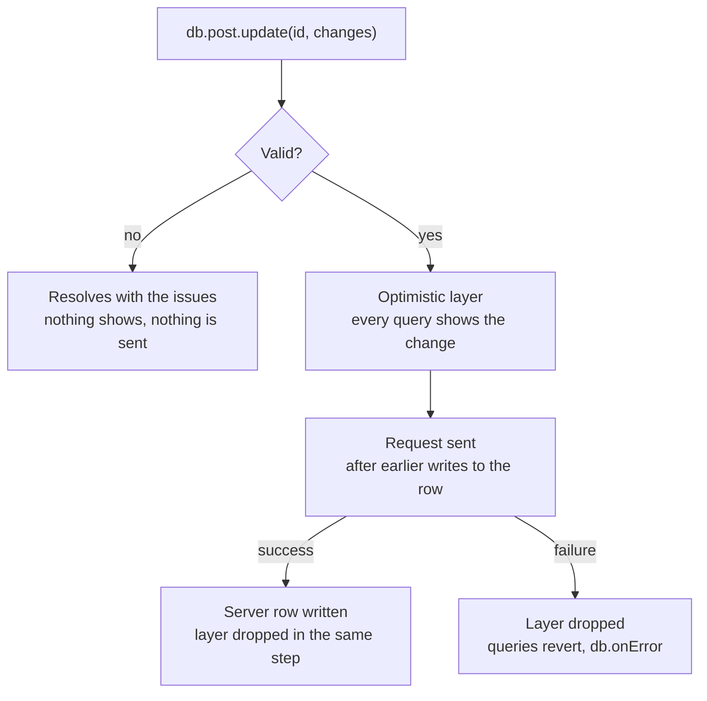

# Optimistic Writes

An optimistic write shows its result before the server answers. Like buttons, renames and checkboxes feel instant, even
on a slow network. The hard part is the undo: when the request fails, the UI must go back, without wiping out other
changes made in the meantime. With the db, a write is an **optimistic layer** on top of the server's rows. The layer
records exactly what it changed, so a failure removes it and nothing else. You write no rollback code.

This guide adds liking, renaming, creating and deleting posts to Teamboard.

:::secondary What you'll learn

1.  How optimistic updates are done **with React Query**, and what the db does for you.
2.  How to declare **insert, update and delete** once, with `.mutate()`.
3.  How to write from components and read the **result** of a write.
4.  What to do when the **response is not the row**: `keep`, `refetch` or `sync`.
5.  How writes to one row are **ordered**, and what happens to writes built on a failed one.
6.  How to send an **idempotency key**, and how keys and **render keys** work for new rows.

:::

---

## The classic way

With request-level caching, every optimistic update is a small protocol. In React Query it looks like this:

```tsx
useMutation({
  mutationFn: (changes) => api.patch(`/posts/${postId}`, changes),
  onMutate: async (changes) => {
    await queryClient.cancelQueries({ queryKey: ["posts", teamId] });
    const previous = queryClient.getQueryData(["posts", teamId]);
    queryClient.setQueryData(["posts", teamId], (old) =>
      old.map((post) => (post.id === postId ? { ...post, ...changes } : post)),
    );
    return { previous };
  },
  onError: (error, changes, context) => queryClient.setQueryData(["posts", teamId], context.previous),
  onSettled: () => queryClient.invalidateQueries({ queryKey: ["posts", teamId] }),
});
```

And that covers **one** cached list. The detail page, the search results and every other filter of the feed hold their
own copies. Restoring a snapshot in `onError` can also erase a change another mutation made in the meantime.

With the db, the same write is one line, and it reaches every query that shows the post:

```ts
await db.post.update(postId, { title: "Renamed" });
```

| Step                                | React Query                         | HyperFetch DB                                     |
| ----------------------------------- | ----------------------------------- | ------------------------------------------------- |
| Show the change                     | `setQueryData` on each cached query | Automatic, in every query that shows the row      |
| Protect it from in-flight responses | `cancelQueries`                     | Automatic: responses never overwrite newer writes |
| Undo on failure                     | Restore a snapshot                  | Automatic: the layer is dropped                   |
| Reconcile with the server           | `invalidateQueries`                 | The response row is written, or `onSuccess`       |

---

## Declaring writes

Writes are declared on the collection, next to its loaders. Each one maps the write to a request:

```ts
const Post = collection(PostSchema, { key: "id", version: "updatedAt" })
  .load(getPost, { byKey: (id) => ({ params: { postId: id } }) })
  .mutate({
    insert: {
      request: createPost,
      // `id` is the write's id: send it as an idempotency key
      map: (row, { id }) => ({ payload: { ...row, idempotencyKey: id } }),
    },
    update: {
      request: updatePost,
      map: (key, changes) => ({ params: { postId: key }, payload: changes }),
    },
    delete: {
      request: deletePost,
      map: (key) => ({ params: { postId: key } }),
    },
  });
```

- `insert` receives the row, `update` the key and the changed fields, `delete` the key. The last argument is the write's
  context, whose `id` stays the same when the write is sent again, for example after an offline restart.
- `db.post.update` accepts only the fields the request's payload can carry, and `db.post.insert` only a row the schema
  accepts. A collection that declares no `delete` has no `db.post.delete`.
- Writes are validated against the schema **before** they show. An invalid write resolves with the issues and sends
  nothing.

:::tip REST conventions

If your API follows REST conventions and you have an SDK, `.resource()` derives the loaders and all three mutations in
one call. See [Collections from a REST SDK](../02-patterns/rest-resources.mdx).

:::

---

## Writing from components

```tsx
const LikeButton = ({ post }: { post: PostSummary }) => {
  return <button onClick={() => db.post.update(post.id, { likes: post.likes + 1 })}>♥ {post.likes}</button>;
};
```

That is the whole component. The like count changes in every query that shows the post, in the same tick. If the request
fails, it goes back.

Teamboard's feed reads `postSummary`, a second collection for the same posts. Declare the two as linked in `createDb`
and an optimistic change to `post` shows in the feed at once too, and reverts in both. See
[List and Detail Views](../02-patterns/list-and-detail.mdx).

Every write returns a **transaction**: a promise of `{ success, data, error }` with an `id`. Like `send()`, it never
rejects, so you can await it for UI that depends on the outcome:

```tsx
const RenameForm = ({ post }: { post: Post }) => {
  const [title, setTitle] = useState(post.title);
  const [error, setError] = useState<string | null>(null);

  const save = async () => {
    setError(null);
    const result = await db.post.update(post.id, { title });
    if (!result.success) setError("Could not rename the post. Your change was undone.");
  };

  return (
    <div className="flex flex-col gap-2">
      <input className="rounded border px-2" value={title} onChange={(e) => setTitle(e.target.value)} />
      <button onClick={save}>Rename</button>
      {error && <p className="text-red-600">{error}</p>}
    </div>
  );
};
```

There is no `isPending` to track for the list itself: the list already shows the new title. Keep pending state for the
control that started the write, if it needs one.

---

## What happens to a write



- **On success**, the response row is written and the layer is dropped in one step, so nothing flickers. A response that
  carries the row, or some of its fields with the key, needs no code: the db writes it.
- **On failure or abort**, only this write's layer is dropped. Changes made by other writes, socket events and responses
  in the meantime stay.
- Either way, failures also reach `db.onError` with `type: "mutation"` or `"validation"`, which is a good place for a
  toast or error reporting.

---

## When the response is not the row

Many endpoints answer a write with `204 No Content`, `{ ok: true }` or some other shape. The db cannot write that into
the collection, so it needs to know what to do instead. Leaving it out does not compile:

```ts
const archivePost = client.createRequest<{ response: { ok: boolean }; payload: Partial<Post> }>()({
  endpoint: "/posts/:postId/archive",
  method: "POST",
});

collection(PostSchema, { key: "id" }).mutate({
  update: {
    request: archivePost,
    map: (key, changes) => ({ params: { postId: key }, payload: changes }),
    // highlight-next-line
    onSuccess: "keep",
  },
});
```

| `onSuccess` | After the request succeeds                                                               | Use it when                             |
| ----------- | ---------------------------------------------------------------------------------------- | --------------------------------------- |
| `"keep"`    | The optimistic change becomes the server state                                           | The server stores exactly what you sent |
| `"refetch"` | The loaded subsets holding the row reload; the layer stays until they land               | The server changes more than you sent   |
| `"sync"`    | The layer stays until a sync event for the row arrives, or refetches after `syncTimeout` | A socket event follows every write      |

`syncTimeout` defaults to five seconds and is set in `createDb`. With `"refetch"` and `"sync"`, the old value never
flashes back between the response and the new data.

Deletes need no `onSuccess`: a successful delete removes the row, whatever the response.

---

## Ordering and dependent writes

Writes to the **same row** go out one at a time, in order, because each is built on the ones before it. When one fails,
the writes queued behind it on that row are dropped too, and resolve with a `DependencyError`:

```ts
import { DependencyError } from "@hyper-fetch/db";

const rename = db.post.update(postId, { title: "Draft 2" });
const publish = db.post.update(postId, { status: "published" });

const result = await publish;
if (result.error instanceof DependencyError) {
  // The rename failed first, so the publish was never sent
}
```

Writes to different rows run in parallel, unless they go through the [offline outbox](../02-patterns/offline-first.mdx),
which replays every write in order. To make a write wait for another row's write, pass it in `dependsOn`:

```ts
const created = db.post.insert(newPost);
db.comment.insert(firstComment, { dependsOn: [created] }); // dropped if the post is rejected
```

Writes are also ordered against everything else that writes rows. A list response that was in flight while a write or
socket event landed never overwrites it, and a refetch waits for writes in flight before it replaces a list. With
`version` on the collection, ordering uses the server's version field, which is the most robust choice.

---

## Keys for new rows

Generate keys on the client whenever you can:

```ts
await db.post.insert({
  id: crypto.randomUUID(),
  teamId,
  authorId: currentUserId,
  title: "Untitled",
  body: "",
  status: "draft",
  likes: 0,
  createdAt: new Date().toISOString(),
  updatedAt: 0,
});
```

Client keys work offline, inside [transactions](../02-patterns/transactions.mdx), and for writes that depend on the new
row. When the server must assign keys, the insert input has to allow leaving the key out. The optimistic row then gets a
temporary key, and the server's row replaces it in one step when the response arrives. Writes made with the temporary
key in the meantime wait, then use the server's key.

Use `renderKey` for React keys, so a row does not remount when its temporary key is swapped:

```tsx
data?.map((post) => <PostCard key={db.postSummary.renderKey(post.id)} post={post} />);
```

:::caution Things that resolve with an error and send nothing

1. An insert of a key the collection already holds.
2. An update that changes a row's key.
3. A write that fails schema validation.
4. A write the collection declares no mutation for.

:::

:::note When to skip the optimistic layer

- The server **computes** the result: an order number, a price with tax, a generated slug. Show a pending state and
  write the response with [ingest](../02-patterns/list-and-detail.mdx) or `onSuccess: "refetch"`.
- Failure is **common or costly**, like payments. A loading state is more honest than a change that often reverts.
- The backend applies writes locally on its own, like Firestore. `firestoreCollection` already turns the db's layer off
  for you.

:::

---

:::success Writes done right!

Teamboard's writes feel instant and stay correct.

- You can declare **insert, update and delete** once with `.mutate()`, and send an **idempotency key**.
- You can write from any component and read the **result** without try/catch.
- You can handle responses that are not the row with **`keep`**, **`refetch`** or **`sync`**.
- You can rely on **per-row ordering**, and chain writes with **`dependsOn`**.
- You can create rows with **client keys**, and render server-keyed rows with **`renderKey`**.

:::

---

## Next steps

<LinkCard
  type="guides"
  title="Real-time Sync with WebSockets"
  description="Keep every live query current from socket events, without patching caches."
  to="/docs/guides/db/basics/realtime-sync"
/>

<LinkCard
  type="guides"
  title="Multi-record Writes with Transactions"
  description="Group writes to several rows and collections into one change that is kept or reverted as a whole."
  to="/docs/guides/db/patterns/transactions"
/>
