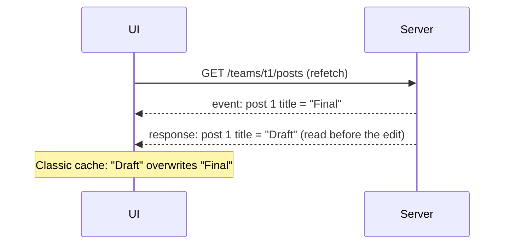

# Real-time sync with WebSockets

A **sync** is a socket listener whose `insert`, `update` and `delete` events change rows in a collection, so loaded rows
stay current between fetches. It is declared once, on the collection: no component writes a socket handler. This guide
makes Teamboard's feed live, so new posts appear, edits show and deleted posts disappear for everyone on the team.

:::secondary What you'll learn

1.  How to sync **inserts, updates and deletes** from socket listeners.
2.  How to **scope** a sync to the team a query shows, and share one subscription between views.
3.  How to **map messages** to rows, and why a mismatched message does not compile.
4.  How the db stops a **slow response** from overwriting a newer event, and what happens on **reconnect**.
5.  How to sync **one record** with its own channel, and **batches** of changes with `syncChanges`.

:::

---

## Three events, three syncs

Teamboard's server publishes three topics per team. Each one becomes a sync:

```ts title="src/sockets.ts"
const onPostCreated = socket.createListener<Post>()({
  topic: "teams/:teamId/posts/created",
});
const onPostChanged = socket.createListener<Partial<Post> & { id: string }>()({
  topic: "teams/:teamId/posts/changed",
});
const onPostDeleted = socket.createListener<{ id: string }>()({
  topic: "teams/:teamId/posts/deleted",
});
```

```ts title="src/db.ts"
const byTeam = { teamId: { eq: (teamId: string) => ({ params: { teamId } }) } };

const PostSummary = collection(PostSummarySchema, {
  key: "id",
  version: "updatedAt",
})
  .load(getTeamPosts, {
    rows: (response) => response.items,
    where: {
      teamId: { eq: (teamId) => ({ params: { teamId } }), required: true },
    },
  })
  .sync(onPostCreated, {
    type: "insert",
    where: byTeam,
    row: ({ body, ...summary }) => summary,
  })
  .sync(onPostChanged, {
    type: "update",
    where: byTeam,
    row: ({ body, ...changes }) => changes,
  })
  .sync(onPostDeleted, { type: "delete", where: byTeam });
```

| `type`   | The message carries                 | What the db does                                                 |
| -------- | ----------------------------------- | ---------------------------------------------------------------- |
| `insert` | A complete row                      | Creates the row, or replaces it. It joins every list it matches. |
| `update` | The key and any of the row's fields | Changes the fields it carries. The other fields stay.            |
| `delete` | The key                             | Removes the row from every view.                                 |

A new post joins every loaded list whose filters it matches, **at its sorted position**, without a refetch. Paginated
lists take it only when it sorts inside the pages they loaded (see [Pagination](/docs/guides/db/basics/infinite-scroll)).
An update that moves a row out of a filter, such as `status` changing to `draft`, removes it from lists that only show
published posts.

---

## Scoping a sync

`where` maps a query's filters to listener params, the same way a loader maps them to request params. A query for team
`t1` subscribes to `teams/t1/posts/changed`, and only that topic:

```ts
const { data } = useLiveQuery(
  db.postSummary.where((post) => eq(post.teamId, "t1")),
);

db.postSummary.where((post) => eq(post.teamId, "t1")).explain().syncs;
// [
//   { type: "insert", topic: "teams/t1/posts/created" },
//   { type: "update", topic: "teams/t1/posts/changed" },
//   { type: "delete", topic: "teams/t1/posts/deleted" },
// ]
```

- A sync covers the subsets whose **sent** `eq` conditions fill every field of its `where`.
- Views that need the same topic **share one subscription**: ten components showing team `t1` open three listeners, not
  thirty. The listener stops when the last query using it is released.
- A sync without `where` covers the whole collection, for a topic such as `posts/changed` that carries every post.
- A row read by key, with `findOne` or a join, joins the subscriptions its own fields pick, and moves to team `t2`'s
  topics when an event changes its team.

---

## Mapping messages to rows

The db does not strip fields a collection lacks. When a message carries more than the row, map it with `row`. Leave the
mapping out and the collection does not compile:

```ts
const PostSummary = collection(PostSummarySchema, { key: "id" }).sync(
  onPostCreated,
  {
    type: "insert",
    where: byTeam,
  },
);

// error-next-line
createDb({ postSummary: PostSummary });
// The message is a `Post` and carries `body`, so `.sync()` returned a RowMismatch
```

- `insert` messages must map to a **complete** row.
- `update` messages must map to the key plus fields of the row, with their types.
- `delete` reads the key from the message's key field. When the message names it differently, read it with `key`:

```ts
const onPostRemoved = socket.createListener<{ postId: string }>()({
  topic: "posts/removed",
});

collection(PostSummarySchema, { key: "id" }).sync(onPostRemoved, {
  type: "delete",
  key: (message) => message.postId,
});
```

A mapping that throws on an unexpected message is reported to `db.onError` with `type: "sync"`, and the next events
still apply.

### One listener, several collections

The detail page holds full posts in another collection. The same `changed` topic keeps both current:

```ts
const Post = collection(PostSchema, { key: "id", version: "updatedAt" })
  .load(getPost, { byKey: (id) => ({ params: { postId: id } }) })
  .sync(onPostChanged, { type: "update", where: byTeam });
```

`post` takes the message as it is, and `postSummary` drops `body` with its `row` mapping. Both views show the same title
after the same event, over one shared subscription per topic.

### Updates for rows you do not hold

An `update` for a row the collection does not hold is ignored: it only carries some fields, and rows are always
complete. When such an event should still bring the row in, load it by key:

```ts
collection(PostSchema, { key: "id" })
  .load(getPost, { byKey: (id) => ({ params: { postId: id } }) })
  .sync(onPostChanged, { type: "update", where: byTeam, incomplete: "refetch" });
```

`incomplete: "refetch"` needs a `byKey` or `byKeys` loader on the collection.

---

## Events and in-flight responses

Here is the race that breaks most hand-written real-time lists:



With request-level caching, the response lands last and wins. The db orders every write instead:

- **Without `version`**, a response changes only the fields written before its request was sent. An event or a write
  that arrived while the request was in flight is never overwritten.
- **With `version`**, a write changes only fields whose stored version is not newer than its own. A response sent
  **after** the event, but read from a lagging replica or a cache, cannot undo version 5 with version 3.
- A delete counts as a write. A late response cannot bring a deleted row back.

Set `version` on every collection with syncs, as `{ key: "id", version: "updatedAt" }`. It names a field that grows with
every change on the server: a number, a string or a date.

A subset also subscribes to its syncs **before** its request is sent, and applies the events that arrive while the
request is in flight after the response. An update for a row that only the response brings is not lost.

---

## Freshness, disconnects and reconnects

A loaded subset is **fresh while its syncs deliver all three events**: `insert`, `update` and `delete` subscriptions
that the server has started, on a connected socket. A live subset never refetches because time passed. Sync every event
type your server publishes: a subset missing one falls back to refetching after the request's `staleTime`.

When the connection drops, the rows stay and the query reports it:

```tsx title="src/live-badge.tsx"
const LiveBadge = ({
  teamId,
}: {
  teamId: string;
}) => {
  const { stale } = useLiveQuery(
    db.postSummary.where((post) =>
      eq(post.teamId, teamId),
    ),
  );

  return stale ? (
    <span className="text-amber-600">
      Reconnecting...
    </span>
  ) : (
    <span className="text-green-600">
      Live
    </span>
  );
};
```

After a reconnect, nobody knows which events were missed, so every subset the reconnected socket's syncs covered turns
stale. Subsets that mounted queries use refetch at once; unused ones refetch when a query uses them again.

### Subscriptions that resume

Some servers resume a subscription from the last event id after a reconnect and send what was missed. Tell the db, and
it skips the refetch:

```ts
collection(PostSummarySchema, { key: "id" }).sync(onPostChanged, {
  type: "update",
  where: byTeam,
  row: ({ body, ...changes }) => changes,
  resumes: true,
});
```

Only set `resumes` when your adapter and server really replay missed events. Otherwise a reconnect leaves stale rows
with no refetch to correct them.

---

## One record, one channel

Some backends publish a channel per record, such as `posts/:postId/changed`. A sync with `byKey` keeps one row read by
key live through a listener of its own:

```ts
const onOnePostChanged = socket.createListener<
  Partial<Post> & { id: string }
>()({
  topic: "posts/:postId/changed",
});

collection(PostSchema, { key: "id" })
  .load(getPost, { byKey: (id) => ({ params: { postId: id } }) })
  .sync(onOnePostChanged, {
    type: "update",
    byKey: (id) => ({ params: { postId: id } }),
  });
```

`db.post.findOne("p1")` now listens to `posts/p1/changed`. A `byKey` sync never covers list subsets, so a list never
opens one listener per row.

---

## Batches of changes

Some sources push several changes in one event: a snapshot, a change-data-capture stream, a "changes since" message.
`syncChanges` reads the complete rows to write, the keys to delete and the keys to load again from each event:

```ts
const onTeamChanges = socket.createListener<{
  upsert: Post[];
  delete: string[];
  refetch?: string[];
}>()({
  topic: "teams/:teamId/changes",
});
// Full posts of a team, as an array
const getTeamFullPosts = client.createRequest<{ response: Post[] }>()({
  endpoint: "/teams/:teamId/full-posts",
});

collection(PostSchema, { key: "id" })
  .load(getTeamFullPosts, {
    where: {
      teamId: { eq: (teamId) => ({ params: { teamId } }), required: true },
    },
  })
  .load(getPost, { byKey: (id) => ({ params: { postId: id } }) })
  .syncChanges(onTeamChanges, {
    changes: ({ data }) => data,
    // Sends each subset's conditions to the listener, here as topic params
    notation: (conditions) => ({
      params: Object.fromEntries(
        conditions.map((condition) => [condition.field, condition.value]),
      ),
    }),
  });
```

- `changes` receives the whole listener event, so adapter details such as Firestore's grouped changes are available.
- `notation` turns the conditions a subset sent into listener params, so one declaration covers every subset.
- A `syncChanges` subscription alone makes a subset live. This is how [`firestoreCollection`](/docs/db/firestore) keeps
  every query live through `onSnapshot`.

A sync never makes rows appear on its own: a query always loads through a loader first (see
[Loader, sync or ingest?](/docs/guides/db/basics/thinking-in-collections#loader-sync-or-ingest)). Prefer one topic per
filter value, such as per team, over one global topic, so each view only receives its own events.

---

:::success Congratulations!

Teamboard's feed updates the moment anyone changes a post.

- You can sync **inserts, updates and deletes** into every view, scoped with `where` and shared between views.
- You can **map messages** with `row` and `key`, and sync one listener into **several collections**.
- You can rely on **ordering**: in-flight responses never overwrite newer events, and `version` guards the rest.
- You can show **stale** rows after a disconnect, and skip refetches with **`resumes`**.
- You can keep **one record** live with `byKey`, and apply **batches** with `syncChanges`.

:::

---

## Next steps

<LinkCard
  type="guides"
  title="Pagination and infinite scroll"
  description="Cursor and limit loaders, live windows with useLiveInfiniteQuery, and new rows inside loaded pages."
  to="/docs/guides/db/basics/infinite-scroll"
/>

<LinkCard
  type="docs"
  title="DB overview: syncs and ingest"
  description="The short reference for syncs, syncChanges and ingest."
  to="/docs/db/overview#syncs-and-ingest"
/>

- API reference: [`SyncOptions`](/docs/api/db/Types/SyncOptions),
  [`SyncChangesOptions`](/docs/api/db/Types/SyncChangesOptions), [`QueryExplanation`](/docs/api/db/Types/QueryExplanation).
- Related: [WebSocket listeners](/docs/sockets/listener), [`useLiveQuery`](/docs/react/db/use-live-query).
