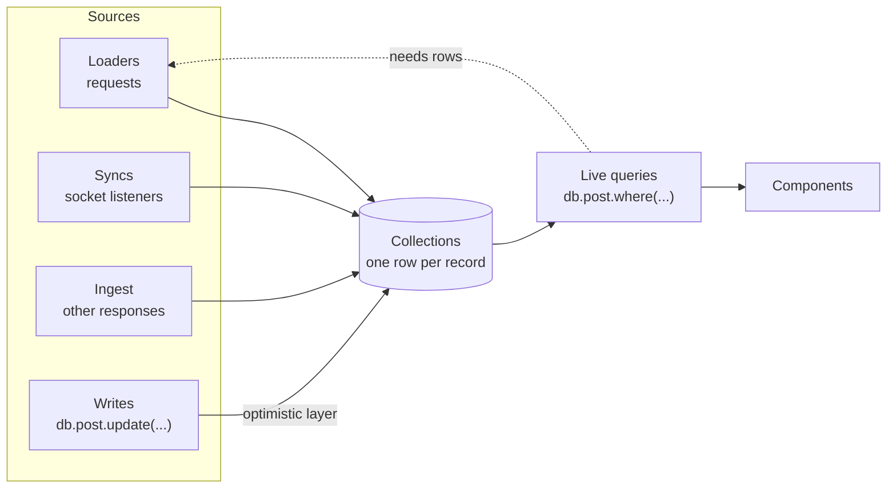

# Thinking in Collections

A post shows up in a team feed, in its own detail page and in a "recently edited" sidebar. Someone renames it, a socket
event arrives, and now three cached responses hold three copies of the same post. With request-level caching, each copy
has to be found and patched by hand, or refetched. `@hyper-fetch/db` takes a different approach: every post lives
**once**, as a row in a typed collection, and every view is a **live query** over that collection. Change the row and
every view that shows it updates.

This guide builds the mental model the other DB guides rely on. Each guide extends the same app: **Teamboard**, a team
workspace with posts, authors and comments.

:::secondary What you'll learn

1.  Why **request-level caching** leaves stale copies of the same record.
2.  What **collections**, **loaders**, **syncs** and **live queries** are, and how data flows between them.
3.  How the db **plans** a query, and how to read the plan with `explain()`.
4.  When to use the db, and when **`useFetch`** is the better fit.
5.  How to choose between a **loader**, a **sync** and **ingest** for each data source.

:::

---

## The problem with copies

Here is Teamboard built with request-level caching. The feed and the detail page each fetch their own response, and a
socket handler keeps them current:

```tsx
const TeamFeed = ({ teamId }: { teamId: string }) => {
  const { data } = useFetch(getTeamPosts.setParams({ teamId }));
  const { onEvent } = useListener(onPostChanged.setParams({ teamId }));

  onEvent(({ data: changes }) => {
    // Patch the feed's copy
    client.cache.update(getTeamPosts.setParams({ teamId }), (cached) => ({
      data: cached?.data && {
        ...cached.data,
        items: cached.data.items.map((post) => (post.id === changes.id ? { ...post, ...changes } : post)),
      },
    }));
    // highlight-start
    // ...and the detail page's copy, and the sidebar's, and every filtered variant of the feed
    // highlight-end
  });

  return data?.items.map((post) => <PostCard key={post.id} post={post} />);
};
```

Every new view that shows posts adds another copy to keep in step. The usual fixes have costs of their own:

- **Patch every copy by hand.** Each response has its own shape, and the copy you forget shows stale data.
- **Invalidate and refetch.** Little code, but every event becomes a request, and a new post still waits for the
  refetch.
- **Race conditions.** A list response that was in flight while the event arrived lands later and overwrites the newer
  title.

The root cause is that the source of truth is the **response**. The db moves it to the **record**.

---

## The same screen with the db

Declare what a post is, how it loads, how it stays live and how it changes. Do it once, next to your requests:

```ts title="src/db.ts"
import { collection, createDb } from "@hyper-fetch/db";

const byTeam = { teamId: { eq: (teamId: string) => ({ params: { teamId } }) } };

const PostSummary = collection(PostSummarySchema, { key: "id", version: "updatedAt" })
  // How rows load: the feed endpoint, which needs a team
  .load(getTeamPosts, {
    rows: (response) => response.items,
    where: { teamId: { eq: (teamId) => ({ params: { teamId } }), required: true } },
  })
  // How rows stay live: one socket topic per team
  .sync(onPostChanged, { type: "update", where: byTeam, row: ({ body, ...changes }) => changes });

export const db = createDb({ postSummary: PostSummary });
```

Components query the collection, never the endpoint:

```tsx
import { eq } from "@hyper-fetch/db";
import { useLiveQuery } from "@hyper-fetch/react";

const TeamFeed = ({ teamId }: { teamId: string }) => {
  const { data } = useLiveQuery(db.postSummary.where((post) => eq(post.teamId, teamId)));

  return data?.map((post) => <PostCard key={post.id} post={post} />);
};
```

There is no socket handler in the component and no cache key to patch. A `changed` event updates one row, and every
query that shows that row re-renders. A response that was in flight while the event arrived cannot overwrite it, because
writes are ordered by `version`.

---

## The mental model



Data flows one way: sources write rows, queries read rows. The only arrow back is a query asking a loader for rows it
does not have yet.

| Term                 | What it is                                                                                             |
| -------------------- | ------------------------------------------------------------------------------------------------------ |
| **Collection**       | A typed set of **complete rows**, defined by a schema and a key. The source of truth.                  |
| **Loader**           | A request a collection loads rows through, with the filters and orders it can send to the backend.     |
| **Sync**             | A socket listener whose `insert`, `update` and `delete` events change rows.                            |
| **Ingest**           | Writing the rows of some other response, such as a search, into a collection.                          |
| **Live query**       | A query over a collection whose result stays current as rows change.                                   |
| **Loaded subset**    | The rows one loader returned for one set of filters. Queries inside it are answered without a request. |
| **Optimistic layer** | A write shown at once and reverted exactly when its request fails.                                     |

Two rules make the model hold together:

- **Rows are complete.** Every row has every field of its schema, so any query can filter, sort and select any field. A
  list that returns summaries without `body` is its own collection, `postSummary`. The
  [List and Detail Views](../02-patterns/list-and-detail.mdx) guide shows how the two stay in step.
- **Types check the data path.** A loader, sync or write whose rows do not match the schema does not compile, and
  neither does a query that no loader can serve.

---

## How a query is served

A query only describes **what** to show. The db decides **how**, in four steps:

1. **Answer locally.** If a fresh loaded subset already contains the query, it is answered from the rows the db holds,
   with no request. `teamId = 1 and likes > 10` falls inside a loaded `teamId = 1` feed.
2. **Pick a loader.** Otherwise the db picks the loader that can send most of the query's conditions. The rest run on
   the returned rows.
3. **Keep it live.** The loaded subset subscribes to the syncs that cover it, before its request goes out.
4. **Share.** Queries that need the same subset share it, and its request.

`query.explain()` shows the plan, so nothing about it is hidden. For a mounted query it looks like this:

```ts
import { and, eq, gt } from "@hyper-fetch/db";

const popular = db.postSummary.where((post) => and(eq(post.teamId, "t1"), gt(post.likes, 10)));

popular.explain();
// {
//   kind: "list",
//   loader: 0,                       // the getTeamPosts loader
//   sent: [/* teamId = "t1" */],     // goes to the backend
//   local: [/* likes > 10 */],       // runs on the returned rows
//   answeredLocally: false,
//   syncs: [{ type: "update", topic: "teams/t1/posts/changed" }],
// }
```

`likes > 10` runs locally because the loader declares no `likes` filter. Add one to the loader and the same query sends
it instead. Components do not change.

---

## When to use the db

:::note When it pays off

- The same records show in **several views**: a feed, a detail page, a sidebar, a search.
- Records change from **several places**: your own mutations, socket events, other users.
- Writes must feel **instant** and survive failures without hand-written rollback code.
- The app has to keep working **offline** and replay writes later.
- Your backend is **Firestore** or another source with live snapshots.

:::

:::caution When useFetch is the better fit

- Each screen shows **its own data**, such as a settings page or a report. A request and its cache entry are simpler.
- Responses are **not records**: a computed dashboard, a file download, a one-off RPC result.
- You need **aggregates** such as counts and sums. Queries return rows, not computed values, so keep a request for them.

A request used by both `useFetch` and a collection keeps two copies of its data, one in the Cache and one in the
collection, and they do not update each other. Pick one per piece of data.

:::

The db and `useFetch` live side by side in one app. Start with the screens where copies already hurt.

---

## Loader, sync or ingest?

Every data source plugs in one of three ways. Pick by what the source is:

| The source...                                                        | Use              | Example                                      |
| -------------------------------------------------------------------- | ---------------- | -------------------------------------------- |
| is a request the db should send **when a query needs rows**          | `.load()`        | `GET /teams/:teamId/posts`, `GET /posts/:id` |
| **pushes** inserts, updates or deletes as they happen                | `.sync()`        | a WebSocket or SSE topic                     |
| pushes **batches of changes** in one event                           | `.syncChanges()` | a Firestore snapshot, a CDC stream           |
| is a request **you** send, whose response happens to contain records | `.ingest()`      | a search endpoint, a "publish" action        |

- A loader is the only one that makes rows appear on its own. Syncs and ingest change or add rows, but a query never
  waits for them.
- A collection can have all of them. Most have one or two loaders and a sync per event type.
- Writes are separate: `.mutate()` declares how `db.post.insert`, `update` and `delete` reach the server. See
  [Optimistic Writes](./optimistic-writes.mdx).

---

:::success Congratulations!

You know how HyperFetch DB thinks about data!

- You can explain why **request-level caching** leaves stale copies, and how collections keep one row per record.
- You can name the four sources of rows: **loaders**, **syncs**, **ingest** and **writes**.
- You can read a query's **plan** with `explain()`.
- You can decide when to use the db and when **`useFetch`** is simpler.

:::

---

## Next steps

<LinkCard
  type="guides"
  title="Loading Data with Loaders"
  description="Turn your existing requests into loaders: rows, filters, orders and reads by key."
  to="/docs/guides/db/basics/loaders"
/>

<LinkCard
  type="docs"
  title="DB Quick Start"
  description="The shortest path from a request to a live query."
  to="/docs/db/quick-start"
/>
