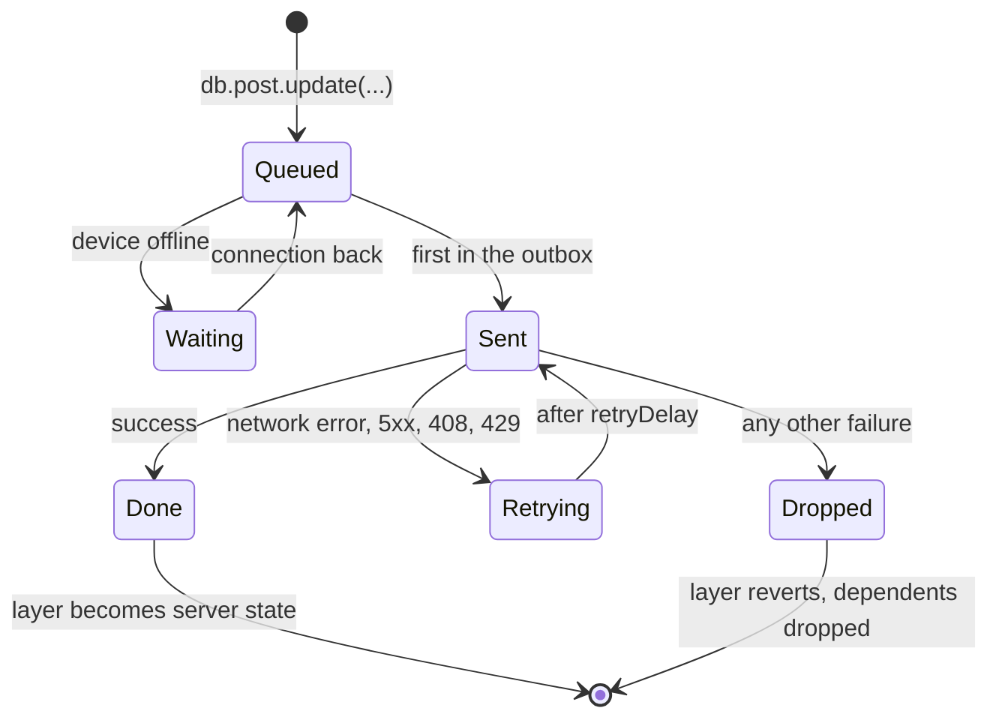

# Offline-first apps with the outbox

An offline-first app shows yesterday's rows on start, and a post written in a tunnel appears at once, survives a closed
tab and reaches the server exactly once. In `@hyper-fetch/db` that takes two options: **`persistence`** keeps rows and
pending writes in storage, and **`offline`** sends every write through an **outbox** that one tab replays in order.

:::secondary What you'll learn

1.  How to **persist rows** per user, and what a restored query shows before the network answers.
2.  How the **outbox** queues, replays and retries writes, and how it differs from core's request queue.
3.  How to send an **idempotency key** with every write, so a replayed write is applied once.
4.  How to handle **rejected writes**, and how `dependsOn` drops the writes built on them.
5.  How **several tabs** share one outbox, and how to **clear** everything on sign-out.

:::

---

## Request queue or outbox?

HyperFetch core can already hold requests while the device is offline: a request with `offline: true` waits in the
dispatcher queue (see the [offline guide](/docs/guides/core/advanced/offline)). That queue holds **requests**. The db's
outbox holds **writes to rows**, and that changes what survives a restart:

|                              | Core request queue                        | DB outbox                                          |
| ---------------------------- | ----------------------------------------- | -------------------------------------------------- |
| What is stored               | Requests                                  | Plain records: collection, operation, key, values  |
| After a reload, the UI shows | The last responses, if the cache persists | The rows **with the offline edits applied**        |
| Order                        | Per queue                                 | Across the whole db: a comment after its post      |
| A replay sent twice          | Up to your backend                        | Carries the same id, to send as an idempotency key |
| A rejected write             | Fails on its own                          | Reverts its row and drops the writes built on it   |
| Several tabs                 | Each tab has its own queue                | One tab replays for all of them                    |

Writes the outbox replays run with `offline: false`, so the dispatcher never keeps a second copy of a write. Use the
db's outbox for data in collections, and core's queue for everything else.

---

## Turn it on

```ts title="src/db.ts"
import { collection, createDb } from "@hyper-fetch/db";

const Post = collection(PostSchema, { key: "id", version: "updatedAt" })
  .load(getPost, { byKey: (id) => ({ params: { postId: id } }) })
  .mutate({
    insert: {
      request: createPost,
      // highlight-next-line
      map: (row, { id }) => ({ payload: { ...row, idempotencyKey: id } }),
    },
    update: {
      request: updatePost,
      // highlight-next-line
      map: (key, changes, { id }) => ({ params: { postId: key }, payload: { ...changes, idempotencyKey: id } }),
    },
    delete: { request: deletePost, map: (key) => ({ params: { postId: key } }), onSuccess: "keep" },
  });

export const createAppDb = (userId: string) =>
  createDb(
    { post: Post, comment: Comment, postSummary: PostSummary },
    {
      offline: true,
      persistence: { storage: localStorage, scope: userId, version: 1 },
    },
  );
```

- **`persistence`** stores each collection's server rows and loaded subsets, plus the outbox, in `storage`: any object
  with `getItem`, `setItem` and `removeItem`, synchronous like `localStorage` or asynchronous like an IndexedDB wrapper.
- **`scope`** keeps one user's data apart from another's. Use the user or tenant id.
- **`version`** is the version of your persisted rows. Bump it when a schema changes, and rows of the old version are
  cleared on start. The outbox is never cleared with them: it holds the only copy of unsent writes.
- **`offline: true`** sends every write through the outbox, online or not, so there is one path for every write.

:::caution Always send the id

Each write's id reaches `map` as `context.id`. A write is marked as sent **before** its request goes out, and a write
marked sent is sent again after a restart, because the db cannot know whether the server got it. Without an idempotency
key, a tab closed mid-request can create the same post twice. Send the id, and let the backend ignore an id it has seen.

:::

---

## What a restored app shows

On start, the db restores persisted rows and the outbox. Queries stay `loading` until the restore is done, then show
what it found:

```tsx title="src/feed.tsx"
const Feed = ({ teamId }: { teamId: string }) => {
  const { data, stale } = useLiveQuery(db.postSummary.where((post) => eq(post.teamId, teamId)));

  return (
    <div>
      {stale && <p className="text-sm text-amber-600">Showing saved posts</p>}
      {data?.map((post) => (
        <PostCard key={post.id} post={post} />
      ))}
    </div>
  );
};
```

- Restored rows show **before the network answers**, and their subsets count as **stale**, because the app may have been
  closed for days. They refetch as soon as the network allows.
- Offline edits are rebuilt from the outbox as optimistic layers, so the post written in the tunnel is still on screen
  after a reload.
- A query whose restore found no rows waits for the network before it shows an empty result, so a first visit offline
  does not flash "No posts": default five seconds, change it with `persistence.networkTimeout`.
- `await db.ready` resolves once rows and the outbox are restored, for code that must run after that.

Persisted values are stored as type-tagged JSON, so `Date`, `bigint`, `Map` and `Set` come back as they were. Values of
your own classes need a codec:

```ts title="src/db.ts"
const money: DbCodec = {
  name: "Money", // stored with each value: never rename it
  test: (value) => value instanceof Money,
  encode: (value) => ({ cents: (value as Money).cents, currency: (value as Money).currency }),
  decode: (value) => new Money((value as Money).cents, (value as Money).currency),
};

createDb(collections, { codecs: [money], persistence: { storage: localStorage, scope: userId } });
```

---

## Writing offline

Writes look the same online and offline. Rows created offline need a key generated on the client:

```ts title="src/new-post.ts"
const postId = crypto.randomUUID();

const post = db.post.insert({ ...draft, id: postId });

// Dropped if the post is rejected, so no comment points at a post that never existed
db.comment.insert(
  { id: crypto.randomUUID(), postId, authorId: user.id, body: "First!", createdAt: new Date().toISOString() },
  { dependsOn: [post] },
);
```

- The outbox replays writes **in the order they were made, across the whole db**, one at a time. The comment never
  reaches the server before its post.
- An insert that leaves the key to the server resolves with an error while the device is offline.
- `dependsOn` takes the writes this one is built on, as the returned `Transaction` objects or their ids. When one of
  them is rejected, this write is dropped too. Writes to the **same row** depend on each other without it.

The life of one write:



While a write is retrying, the writes behind it **wait**. They may depend on it, and sending them out of order could
apply a comment to a post the server does not have yet.

---

## Rejected writes

By default, a response with no status, a `5xx`, `408` or `429` is temporary and retried with backoff: one second,
doubling up to 30 seconds. Every other failure is permanent: the write is dropped, its row reverts, and later writes on
the same row or naming it in `dependsOn` are dropped with it. Change both rules with `offline` options:

```ts title="src/db.ts"
import { isTemporaryFailure } from "@hyper-fetch/db";

createDb(collections, {
  offline: {
    // A conflict will not go away by retrying
    retryable: (response) => response.status !== 409 && isTemporaryFailure(response),
    retryDelay: (attempt) => Math.min(2000 * attempt, 60_000),
  },
  persistence: { storage: indexedDbStorage, scope: user.id, version: 2 },
});
```

Tell the user when a change did not make it. Every dropped write reaches `db.onError`:

```ts title="src/db.ts"
db.onError(({ type, error, transaction }) => {
  if (type === "mutation" && transaction) {
    toast(`Your change to ${transaction.collection} could not be saved`);
  }
});
```

The `Transaction` returned by the write resolves too, with `{ success, data, error }`. It never rejects, but a write
made offline resolves only once it was replayed, which can be days later. Read it for immediate feedback while online,
and rely on `db.onError` for the rest.

---

## Showing what is waiting

`db.inspect()` describes the outbox, and `db.onChange` fires when it changes. Together they make a sync badge:

```tsx title="src/sync-status.tsx"
import { useSyncExternalStore } from "react";
import { useAppManager } from "@hyper-fetch/react";

const usePendingWrites = () =>
  useSyncExternalStore(
    db.onChange,
    () => db.inspect().outbox.length,
    () => 0,
  );

const SyncStatus = () => {
  const { isOnline } = useAppManager(client);
  const pending = usePendingWrites();

  if (pending === 0) return null;
  return <p>{isOnline ? `Syncing ${pending} changes...` : `${pending} changes will sync when you're back online`}</p>;
};
```

`inspect()` describes the whole db, so keep it for small views like this one rather than calling it per row.

---

## Several tabs

Each tab has its own db, and all of them share the storage. One tab, elected with Web Locks, replays the outbox and
writes persisted rows. The others send their writes to it over a `BroadcastChannel`, and learn each write's outcome from
it, so every tab keeps or reverts its optimistic layers the same way.

- When the leading tab closes, another one takes over and adopts the outbox it persisted. No write is lost.
- Without Web Locks, every tab treats itself as the leader.
- Tabs coordinate only a db with `persistence`. Pass `tabs: false` to turn coordination off, or
  `tabs: { locks, channel }` to bring your own lock manager and channel, for example in tests.

---

## Signing out

```ts title="src/auth.ts"
const signOut = async () => {
  await db.clear(); // rows, loaded subsets and the outbox of this scope, in every tab
  db.destroy(); // stops syncs, timers and the tab channel
  // Create the next user's db with their own scope
};
```

`db.clear()` drops pending writes too, and resolves their `Transaction`s with an error. Requests still in flight belong
to the previous user: their responses are never written. Since the scope is fixed when the db is created, create a new
db for the next user, for example in a [`DbProvider`](/docs/react/db/db-provider) keyed by the user id.

:::note When to use the outbox

- Users **create or edit** data where the connection is unreliable: field work, travel, mobile.
- A lost write is **expensive**: a form, a note, an order draft.
- Writes **depend on each other**, like a post and its comments, and must reach the server in order.

Skip `offline` for data where a late write is wrong, such as a seat reservation, and keep those as plain requests that
fail while offline. [Firestore collections](/docs/db/firestore) skip the outbox on their own, because Firestore queues
offline writes itself.

:::

---

:::success Congratulations!

Teamboard keeps working in a tunnel.

- You can **persist rows** per user with `persistence`, and show restored rows as stale.
- You can queue every write in the **outbox** with `offline`, replayed in order across the db.
- You can send each write's **id as an idempotency key**, so a replayed write is applied once.
- You can decide which failures are **retried**, and react to **rejected writes** with `db.onError` and `dependsOn`.
- You can share one outbox across **tabs**, and **clear** a user's data on sign-out.

:::

---

## Next steps

<LinkCard
  type="guides"
  title="Multi-record writes with transactions"
  description="Publish a post and notify the team in one optimistic change, kept or reverted as a whole."
  to="/docs/guides/db/patterns/transactions"
/>

<LinkCard
  type="docs"
  title="DB overview: writes"
  description="Optimistic writes, the outbox and persistence options in short form."
  to="/docs/db/overview#writes"
/>

- API reference: [`DbOfflineOptions`](/docs/api/db/Types/DbOfflineOptions),
  [`DbPersistenceOptions`](/docs/api/db/Types/DbPersistenceOptions), [`DbCodec`](/docs/api/db/Types/DbCodec),
  [`isTemporaryFailure`](/docs/api/db/Functions/isTemporaryFailure).
