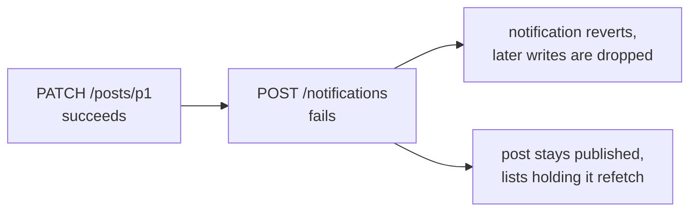

# Multi-record writes with transactions

Publishing a post in Teamboard sets its status to `published` and notifies the team, and if the server says no, both
changes should disappear. `db.transaction` groups writes to any rows and collections into **one optimistic change**,
kept or reverted as a whole. This guide builds that Publish button.

:::secondary What you'll learn

1.  Why **separate writes** leave half-finished changes on screen.
2.  How to send several writes as **one request** with a named transaction.
3.  How to build a **Publish button** with pending and error states from the transaction's result.
4.  How **unnamed transactions** send writes in order through each collection, and what a partial failure does.
5.  The rules transactions follow: **keys**, **validation** and **offline replay**.

:::

---

## The problem with separate writes

```ts title="src/publish.ts"
const publishPost = async (post: PostSummary) => {
  await db.post.update(post.id, { status: "published" });
  // error-next-line
  await db.notification.insert(notificationFor(post));
  // The insert failed: the post is published, and nobody was told
};
```

Each write has its own optimistic layer and its own fate. When the second one fails, the first one stays, and the screen
shows a state the server never agreed to as a whole. The fix is to let the server decide on both at once.

---

## One request for the whole change

Declare a **named transaction** in `createDb`. Its `mutationFn` receives every write and returns the request that sends
them:

```ts title="src/db.ts"
import type { TransactionWrite } from "@hyper-fetch/db";

const publish = client.createRequest<{
  response: { ok: true };
  payload: { idempotencyKey: string; mutations: TransactionWrite[] };
}>()({ endpoint: "/publish", method: "POST" });

export const db = createDb(
  { post: Post, postSummary: PostSummary, notification: Notification },
  {
    links: [["post", "postSummary"]],
    transactions: {
      publish: {
        mutationFn: ({ id, mutations }) => publish.setPayload({ idempotencyKey: id, mutations }),
      },
    },
  },
);
```

Then group the writes:

```ts title="src/publish.ts"
export const publishPost = (post: PostSummary) =>
  db.transaction("publish", (tx) => {
    tx.post.update(post.id, { status: "published" });
    tx.notification.insert({
      id: crypto.randomUUID(),
      teamId: post.teamId,
      postId: post.id,
      text: `${post.title} was published`,
      createdAt: new Date().toISOString(),
    });
  });
```

The server receives one body:

```json
{
  "idempotencyKey": "6f1c...",
  "mutations": [
    { "collection": "post", "op": "update", "key": "p1", "values": { "status": "published" } },
    {
      "collection": "notification",
      "op": "insert",
      "key": "n9",
      "values": { "id": "n9", "teamId": "t1", "...": "..." }
    }
  ]
}
```

- Every write shows **at once**: the post page, the feed through the link, and the notification list.
- On success the changes are **kept** as the server state. On failure **every** write reverts.
- `values` holds the complete row of an insert, the changed fields of an update, and nothing for a delete.
- The transaction id is a ready-made idempotency key. Send it, so a retried request is applied once.
- Named transactions can write **any** collection, also one that declares no `mutate`, because the request comes from
  `mutationFn`, not from the collections.
- Transaction names are typed: `db.transaction("publsh", ...)` does not compile.

### When the server changes more than you sent

Publishing might also set `publishedAt` on the server. With `onSuccess: "refetch"`, the loaded subsets that hold the
changed rows reload before the optimistic layer is dropped, so the screen goes straight from your values to the
server's:

```ts title="src/db.ts"
transactions: {
  publish: {
    mutationFn: ({ id, mutations }) => publish.setPayload({ idempotencyKey: id, mutations }),
    // highlight-next-line
    onSuccess: "refetch",
  },
},
```

The default, `"keep"`, keeps your values and sends no extra requests. Use it when the server stores exactly what you
sent.

---

## A Publish button

`db.transaction` returns a `Transaction`: a promise of `{ success, data, error }` with an `id`. Like `send()`, it never
rejects, so the pending and error states fit in a few lines:

```tsx title="src/publish-button.tsx"
const PublishButton = ({ post }: { post: PostSummary }) => {
  const [pending, setPending] = useState(false);
  const [error, setError] = useState<string | null>(null);

  const onPublish = async () => {
    setPending(true);
    setError(null);
    const result = await publishPost(post);
    setPending(false);
    if (!result.success) setError("Could not publish. Your post is back to draft.");
  };

  return (
    <div className="flex items-center gap-2">
      <button disabled={pending} onClick={onPublish}>
        {pending ? "Publishing..." : "Publish"}
      </button>
      {error && <span className="text-sm text-red-600">{error}</span>}
    </div>
  );
};
```

There is no rollback code. The post already shows as published while `pending` is true, and the db reverts exactly the
two writes when the result is a failure. The failure also reaches `db.onError` with `type: "mutation"`, for a global
toast or logging.

---

## Without a backend endpoint for batches

Most REST APIs have no batch endpoint. Leave the name out, and the writes go through each collection's own `mutate`, one
after another, in the order you made them:

```ts title="src/publish.ts"
await db.transaction((tx) => {
  tx.post.update(post.id, { status: "published" }); // PATCH /posts/p1
  tx.notification.insert(notification); // then POST /notifications
});
```

Every write still shows at once. REST cannot apply them atomically, so a failure in the middle is handled step by step:



- The failed write reverts, and the writes queued after it are dropped without being sent.
- Writes that already succeeded **stay**: the server has them. The lists holding those rows refetch, so the screen shows
  what the server really stored.
- Unnamed transactions only accept writes the collections declare: `tx.notification.insert` compiles only when
  `notification` declares an `insert` mutation.

:::note Named or unnamed?

- Use a **named transaction** when the backend can apply the writes atomically, in one endpoint or one database
  transaction. Either everything happens or nothing does.
- Use an **unnamed transaction** when each write has its own endpoint, and showing them together is what matters.
- Use **plain writes** when the changes are independent, and one may succeed without the other.

:::

---

## Rules every transaction follows

- **Inserts need their key.** One request cannot tell which server-generated key belongs to which row, so
  `tx.notification.insert` without an `id` does not compile. Generate it on the client, for example with
  `crypto.randomUUID()`.
- **Validation comes first.** Every write is checked against its collection's schema before anything shows. One invalid
  write fails the whole transaction, and nothing appears on screen.
- **Offline, they replay as a unit.** With [`offline`](/docs/guides/db/patterns/offline-first), the outbox stores a
  named transaction by its **name** and its writes, never the function, so it can be replayed after a restart. An
  unnamed transaction replays its writes in order, and a rejected one drops the rest.
- **Renaming is a migration.** A transaction left in an outbox under a name the db no longer declares cannot be
  replayed, and is reported to `db.onError` with `type: "outbox"`. Keep old names until outboxes have drained.

The [transactions reference](/docs/db/transactions) lists the same behavior in short form.

---

:::success Congratulations!

Publishing in Teamboard is all or nothing.

- You can group writes to several collections into **one optimistic change**.
- You can send them as **one request** with a named transaction and its idempotency key.
- You can show **pending and error** states from the `Transaction` result, with no rollback code.
- You can send writes **in order** through each collection when the backend has no batch endpoint.
- You can rely on **validation before display** and **offline replay by name**.

:::

---

## Next steps

<LinkCard
  type="guides"
  title="Search and server-side filters"
  description="Full-text search, server-only operators and fields the backend compares differently."
  to="/docs/guides/db/patterns/search-and-server-filters"
/>

<LinkCard
  type="docs"
  title="Transactions reference"
  description="Named and unnamed transactions and their rules in short form."
  to="/docs/db/transactions"
/>

- API reference: [`Transaction`](/docs/api/db/Types/Transaction), [`TransactionConfig`](/docs/api/db/Types/TransactionConfig),
  [`TransactionWrite`](/docs/api/db/Types/TransactionWrite).
