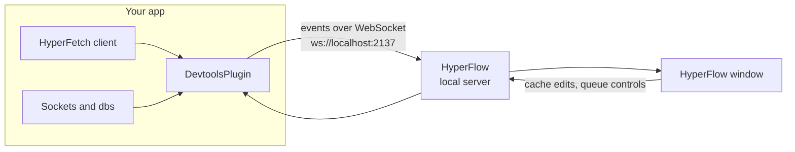

# HyperFlow

HyperFlow is a desktop app for macOS, Windows and Linux that shows what the data layer of your HyperFetch app is doing,
while it runs. Add the [devtools plugin](/docs/integrations/plugin-devtools) to your client, and HyperFlow
lists every request with its payload, response and timing, the cache with its fresh and stale entries, the queues,
socket traffic and `@hyper-fetch/db` collections.

<Screenshot
  src="/img/hyper-flow/app-general.webp"
  alt="HyperFlow showing the General tab of the Acme Store app: network overview with total and successful requests, and a list of recent requests with their status, cache state and response time."
  caption="The start page of a connected app: request totals, success rate and the latest requests."
/>

:::caution Alpha

HyperFlow is in alpha. Expect rough edges, and tell us what you miss on
[GitHub Discussions](https://github.com/BetterTyped/hyper-fetch/discussions).

:::

---

## What you can do with it

<div className="row">
  <div className="col col--6">
    <LinkCard
      type="docs"
      title="Inspect every request"
      description="Payload, response, headers, timing and retries. Filter by success, failure, paused or canceled."
      to="/docs/hyper-flow/features/network"
    />
  </div>
  <div className="col col--6">
    <LinkCard
      type="docs"
      title="Browse and edit the cache"
      description="See fresh and stale entries and their observers. Edit, invalidate or remove an entry and watch your UI react."
      to="/docs/hyper-flow/features/cache"
    />
  </div>
  <div className="col col--6">
    <LinkCard
      type="docs"
      title="Control queues"
      description="Stop, start and clear queues, or force a loading state, to test slow and offline paths."
      to="/docs/hyper-flow/features/queues"
    />
  </div>
  <div className="col col--6">
    <LinkCard
      type="docs"
      title="Find slow endpoints"
      description="Success rate, p95 response times, traffic by endpoint and error summaries."
      to="/docs/hyper-flow/features/dashboard"
    />
  </div>
  <div className="col col--6">
    <LinkCard
      type="docs"
      title="Read socket traffic"
      description="Connection state, every message in and out, and errors for WebSocket and SSE."
      to="/docs/hyper-flow/features/sockets"
    />
  </div>
  <div className="col col--6">
    <LinkCard
      type="docs"
      title="Look inside a db"
      description="Collections, loaded subsets, live query plans and the outbox of @hyper-fetch/db."
      to="/docs/hyper-flow/features/db"
    />
  </div>
</div>

---

## Get started in three steps

1. **[Download HyperFlow](/docs/hyper-flow/download)** for your system and open it.
2. **Add the plugin** to your client:

   ```ts title="api/client.ts"
   import { createClient } from "@hyper-fetch/core";
   import { DevtoolsPlugin } from "@hyper-fetch/plugin-devtools";

   export const client = createClient({ url: "https://api.example.com" }).addPlugin(
     // highlight-next-line
     DevtoolsPlugin({ appName: "My App" }),
   );
   ```

3. **Run your app.** It shows up on the HyperFlow home screen as soon as the plugin connects.

[Connect your app](/docs/hyper-flow/connecting) covers installation, development-only setup, Node.js backends,
sockets and dbs.

---

## How it works



The plugin listens to the client's events and sends them to a small server that HyperFlow runs on your machine, on port
`2137` by default. HyperFlow keeps what it receives in memory and shows it live. The connection also works the other
way: when you edit a cache entry or stop a queue in HyperFlow, the plugin applies the change in your app.

Your requests and responses travel only between your app and HyperFlow on your machine.

---

## Why a desktop app

Browser devtools only see what runs in their tab. The Network tab shows HTTP traffic, but not which requests were
answered from cache, joined an identical request or waited in a queue, and React DevTools shows components, not data.

HyperFlow gets this from the client itself, so it works wherever the client runs. A browser tab, a Next.js server, a
Node.js worker and a React Native app all connect the same way, and each appears as its own application in one window.
The trade-off is one more app to start while you develop.

---

## Next steps

<div className="row">
  <div className="col col--6">
    <LinkCard
      type="download"
      title="Download HyperFlow"
      description="Builds for macOS, Windows and Linux."
      to="/docs/hyper-flow/download"
    />
  </div>
  <div className="col col--6">
    <LinkCard
      type="docs"
      title="Connect your app"
      description="Development-only setup, Node.js backends, sockets and dbs."
      to="/docs/hyper-flow/connecting"
    />
  </div>
  <div className="col col--6">
    <LinkCard
      type="docs"
      title="Tour the interface"
      description="What every part of the window does, in annotated screenshots."
      to="/docs/hyper-flow/interface"
    />
  </div>
  <div className="col col--6">
    <LinkCard
      type="api"
      title="DevtoolsPlugin API reference"
      description="Every option of the devtools plugin."
      to="/docs/api/plugin-devtools/Functions/DevtoolsPlugin"
    />
  </div>
</div>

Try it on the runnable [Devtools example](/examples/integrations/devtools): a small app with buttons that send a cached
list, a mutation, a failed request and a slow one you can cancel.
