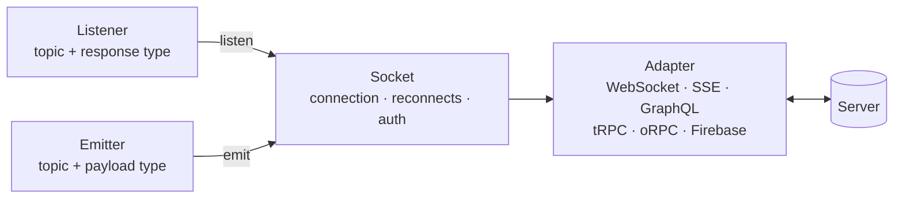

# Sockets overview

`@hyper-fetch/sockets` handles realtime data the way [core](/docs/core/overview) handles requests. You open one
**socket** per server, then define each topic once as a typed **listener** (to receive) or **emitter** (to send). The
socket reconnects with backoff, refreshes credentials on every attempt and reports its state as events.

```ts title="realtime.ts"
import { createSocketClient } from "@hyper-fetch/sockets";

export const socket = createSocketClient({ url: "wss://api.example.com/ws" });

type ChatMessage = { id: string; text: string; author: string };

// highlight-start
export const onChatMessage = socket.createListener<ChatMessage>()({
  topic: "chat/:roomId",
});
export const sendChatMessage = socket.createEmitter<{ text: string }>()({
  topic: "chat/:roomId",
});
// highlight-end

const unlisten = onChatMessage
  .setParams({ roomId: "general" })
  .listen(({ data }) => {
    console.log(data.author, data.text); // data: ChatMessage
  });

sendChatMessage.emit({
  params: { roomId: "general" },
  payload: { text: "Hello" },
});
```

The WebSocket adapter connects as soon as the socket is created. `listen()` returns the function that stops listening.

---

## What you get

<Tabs>
<TabItem value="types" label="Typed topics">

Topic params come from the topic string, and payloads from the emitter's type. Both are checked before anything is sent.

```ts title="realtime.ts"
const sendToRoom = socket.createEmitter<{ text: string }>()({
  topic: "rooms/:roomId",
});

// error-next-line
sendToRoom.emit({ payload: { text: "hi" } });
// Property 'params' is missing: `:roomId` comes from the topic

// highlight-next-line
sendToRoom.emit({ params: { roomId: 1 }, payload: { text: "hi" } }); // OK
```

</TabItem>
<TabItem value="auth" label="Auth and reconnects">

`onConnect` runs before every connection attempt, including automatic reconnects, so an expired token is never reused.
Lost connections come back with exponential backoff and jitter, at once when the device is back online.

```ts title="realtime.ts"
export const socket = createSocketClient({
  url: "wss://api.example.com/ws",
  // highlight-start
  reconnect: 20, // attempts before giving up, Infinity by default
  maxReconnectTime: 15_000, // never wait longer than 15 seconds
  // highlight-end
}).onConnect(async ({ connection, attempt }) => {
  const token = await getAccessToken({ forceRefresh: attempt > 0 });
  return { ...connection, queryParams: { token } };
});
```

</TabItem>
<TabItem value="delivery" label="Fast streams">

High-frequency topics, such as prices or logs, can deliver only the newest message per interval or every message in
batches, so your UI renders less often.

```ts title="prices.ts"
// At most one message, the newest, every 16 ms
const onPrice = socket.createListener<Price>()({
  topic: "prices",
  // highlight-next-line
  delivery: { strategy: "latest", interval: 16 },
});

// Every message, as an array per 100 ms window
const onTrade = socket.createListener<Trade>()({
  topic: "trades",
  // highlight-next-line
  delivery: { strategy: "batch", interval: 100 },
});

onTrade.listen(({ data }) => data.length); // data: Trade[]
```

</TabItem>
<TabItem value="adapters" label="Any transport">

WebSocket is the default. Swap the adapter for Server-Sent Events or another protocol, and keep your listeners.

```ts title="events.ts"
import {
  createSocketClient,
  ServerSentEventsAdapter,
} from "@hyper-fetch/sockets";

const events = createSocketClient({
  url: "https://api.example.com/events",
  // highlight-next-line
  adapter: ServerSentEventsAdapter(),
});
```

| Transport                     | Adapter                                                   |
| ----------------------------- | --------------------------------------------------------- |
| WebSocket                     | `WebsocketAdapter` (default)                              |
| Server-Sent Events            | `ServerSentEventsAdapter` (receive only)                  |
| GraphQL subscriptions         | `GraphqlWsAdapter` from `@hyper-fetch/graphql`            |
| tRPC subscriptions            | `TrpcWebsocketAdapter`, `TrpcSseAdapter` from `@hyper-fetch/trpc` |
| oRPC event iterators          | `OrpcWebsocketAdapter`, `OrpcStreamAdapter` from `@hyper-fetch/orpc` |
| Firestore and Realtime DB     | `FirebaseSocketsAdapter` from `@hyper-fetch/firebase`     |

</TabItem>
<TabItem value="cache" label="Live HTTP cache">

Write realtime updates into the HTTP cache, and every component showing that request updates without a refetch.

```ts title="notes.ts"
const getNote = client.createRequest<{ response: Note }>()({
  endpoint: "/notes/:noteId",
});
const onNoteChange = socket.createListener<Note>()({ topic: "notes" });

onNoteChange.listen(({ data }) => {
  // highlight-next-line
  client.cache.update(getNote.setParams({ noteId: data.id }), { data });
});
```

</TabItem>
<TabItem value="react" label="React">

`useListener` keeps the latest message and `useEmitter` exposes `emit` and the connection state. Both unsubscribe on
unmount.

```tsx title="chat.tsx"
import { useEmitter, useListener } from "@hyper-fetch/react";

const Chat = () => {
  // highlight-start
  const { data } = useListener(onChatMessage.setParams({ roomId: "general" }));
  const { emit, connected } = useEmitter(sendChatMessage);
  // highlight-end

  return <p>{connected ? data?.text : "Reconnecting..."}</p>;
};
```

</TabItem>
</Tabs>

---

## How the pieces fit



| Building block                       | What it owns                                                                   |
| ------------------------------------ | ------------------------------------------------------------------------------ |
| [Socket](/docs/sockets/socket)   | The connection, reconnect policy, `onConnect` and lifecycle events             |
| [Listener](/docs/sockets/listener) | One topic you receive, its data type and its delivery strategy               |
| [Emitter](/docs/sockets/emitter) | One topic you send to, its payload type and payload mapper                     |
| [Adapter](/docs/sockets/adapter) | The transport and its wire format, adjustable with `decode` and `encode`       |
| [Socket SDK](/docs/sockets/sdk)  | Every topic of a server in one typed tree, built from a schema                 |

:::note Before you build on it

- **`emit()` does not wait for an answer.** It returns nothing and drops the message when the socket is disconnected.
  Model replies as their own listener topic.
- **Server-Sent Events only receive.** Calling `emit()` on an SSE socket throws.

:::

---

## Where to start

- **New to sockets:** follow the [quick start](/docs/sockets/quick-start), then the [setup guide](/docs/guides/sockets/setup).
- **Runnable apps:** a [WebSocket chat](/examples/realtime/websocket-chat), a
  [Server-Sent Events feed](/examples/realtime/server-sent-events), [live notifications](/examples/realtime/notifications)
  and [cache kept current by events](/examples/realtime/live-cache-updates).
- **Picking a transport:** [SSE vs WebSocket](/docs/guides/sockets/sse-vs-websocket) and
  [HTTP vs WebSocket](/docs/guides/sockets/http-vs-websocket).

---

## Next steps

<div className="row">
  <div className="col col--6">
    <LinkCard
      type="docs"
      title="Quick start"
      description="Connect to a server, listen to a topic and send messages."
      to="/docs/sockets/quick-start"
    />
  </div>
  <div className="col col--6">
    <LinkCard
      type="guides"
      title="WebSockets in React"
      description="useListener and useEmitter in components, with connection state and cleanup."
      to="/docs/guides/sockets/websockets-in-react"
    />
  </div>
  <div className="col col--6">
    <LinkCard
      type="docs"
      title="Socket"
      description="Connection options, auth, reconnects and lifecycle events."
      to="/docs/sockets/socket"
    />
  </div>
  <div className="col col--6">
    <LinkCard
      type="api"
      title="Sockets API reference"
      description="Every class, function and type of @hyper-fetch/sockets."
      to="/docs/api/sockets/Classes/Socket"
    />
  </div>
</div>
