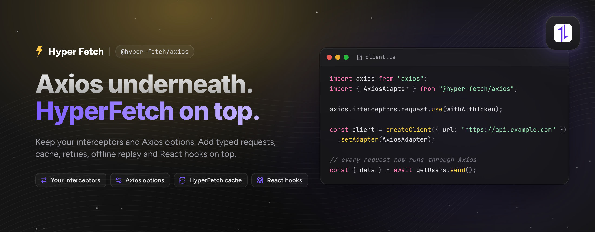

<p align="center">
  <a href="https://hyperfetch.bettertyped.com/docs/integrations/adapter-axios/overview"></a>
</p>

<p align="center">
  <a href="https://hyperfetch.bettertyped.com/docs/integrations/adapter-axios/overview"><b>Quick Start</b></a> ·
  <a href="https://hyperfetch.bettertyped.com/docs/integrations/adapter-axios/overview">Documentation</a> ·
  <a href="https://hyperfetch.bettertyped.com/docs/api/adapter-axios/Variables/AxiosAdapter">API Reference</a> ·
  <a href="https://github.com/BetterTyped/hyper-fetch">GitHub</a> ·
  <a href="https://discord.gg/7upC2kVmyM">Discord</a>
</p>

<p align="center">
  <a href="https://github.com/BetterTyped/hyper-fetch"></a>
  <a href="https://www.npmjs.com/package/@hyper-fetch/axios"></a>
  <a href="https://www.npmjs.com/package/@hyper-fetch/axios"></a>
  <a href="https://bundlejs.com/?q=@hyper-fetch/axios"></a>
  <a href="https://github.com/BetterTyped/hyper-fetch"></a>
  <a href="https://hyperfetch.bettertyped.com/docs/integrations/adapter-axios/overview"></a>
  <a href="https://github.com/BetterTyped/hyper-fetch/blob/main/License.md"></a>
</p>

## 📖 About

`@hyper-fetch/axios` swaps the default HTTP transport of Hyper Fetch for Axios. Your interceptors, `axios.defaults`
and Axios request options keep working, and every request gains typed params and responses, cache, retries, offline
replay and React hooks. Your requests do not change, only the engine that sends them.

## 🎯 Key Capabilities

- 🔌 **One line to switch** - `setAdapter(AxiosAdapter)` and every existing request goes through Axios
- 🎯 **Keep your interceptors** - Interceptors and defaults on the default `axios` export apply to every request
- 🔧 **Axios options per request** - `timeout`, `responseType`, `withCredentials`, `proxy` and agents through `options`
- 📈 **Every progress event** - Axios reports incremental upload progress in the browser, not one final event
- 🖥️ **Node-only options** - `proxy`, `httpAgent`, `httpsAgent` and `maxRedirects` on the server
- 🧾 **Response headers in `extra`** - Read the Axios response headers next to typed `data`
- ✨ **Nothing else changes** - Cache, retries, deduplication, offline replay and React hooks work as before

## 🚀 Quick Start

```bash
npm install @hyper-fetch/core @hyper-fetch/axios axios
```

```ts
import { createClient } from "@hyper-fetch/core";
import { AxiosAdapter } from "@hyper-fetch/axios";

// AxiosAdapter is a ready instance, pass it without parentheses
const client = createClient({ url: "https://api.example.com" }).setAdapter(AxiosAdapter);

const getUser = client.createRequest<{ response: User }>()({
  endpoint: "/users/:userId",
  options: { timeout: 5000, withCredentials: true }, // Axios options, typed
});

const { data, error, extra } = await getUser.setParams({ userId: 1 }).send();
// extra.headers holds the Axios response headers
```

## 📚 Documentation

- **[Axios Adapter](https://hyperfetch.bettertyped.com/docs/integrations/adapter-axios/overview)** - Setup, options, progress and errors
- **[Getting Started](https://hyperfetch.bettertyped.com/docs/getting-started/quick-start)** - The core request API
- **[API Reference](https://hyperfetch.bettertyped.com/docs/api/adapter-axios/Variables/AxiosAdapter)** - `AxiosAdapter` and its types

## 💡 Examples

### Keep your Axios interceptors

`AxiosAdapter` sends every request through the default `axios` export, so register interceptors there. Instances from
`axios.create()` are not used by the adapter.

```ts
import axios from "axios";

axios.interceptors.request.use((config) => {
  config.headers.Authorization = `Bearer ${getToken()}`;
  return config;
});

axios.interceptors.response.use(
  (response) => response,
  (error) => {
    if (error.response?.status === 401) refreshToken();
    return Promise.reject(error);
  },
);

const client = createClient({ url: "https://api.example.com" }).setAdapter(AxiosAdapter);
```

### A timeout and GET deduplication for every request

```ts
// Axios has no default timeout and no GET deduplication, so set both once
const client = createClient({ url: "https://api.example.com" }).setAdapter(
  AxiosAdapter.setAdapterDefaults(() => ({ timeout: 5000 })).setRequestDefaults((options) =>
    (options.method ?? "GET") === "GET" ? { deduplicate: true } : {},
  ),
);
```

### Download a file

```ts
const downloadReport = client.createRequest<{ response: Blob }>()({
  endpoint: "/reports/:reportId",
  options: { responseType: "blob", timeout: 30000 },
});

const { data: report } = await downloadReport.setParams({ reportId: 42 }).send();
```

### Upload with progress

```ts
const uploadAvatar = client.createRequest<{ response: { url: string }; payload: FormData }>()({
  endpoint: "/avatar",
  method: "POST",
});

const form = new FormData();
form.append("file", file);

await uploadAvatar.send({
  payload: form,
  onUploadProgress: ({ progress, loaded, total }) => setUpload({ progress, loaded, total }),
});
```

## 🧩 Hyper Fetch Ecosystem

One typed client for every backend. Swap the adapter and keep the same `createRequest()` everywhere.

<table align="center">
  <tr>
    <td align="center" width="110"><a href="https://github.com/BetterTyped/hyper-fetch/tree/main/packages/core"><br /><sub><b>Core</b></sub></a></td>
    <td align="center" width="110"><a href="https://github.com/BetterTyped/hyper-fetch/tree/main/packages/react"><br /><sub><b>React</b></sub></a></td>
    <td align="center" width="110"><a href="https://github.com/BetterTyped/hyper-fetch/tree/main/packages/sockets"><br /><sub><b>Sockets</b></sub></a></td>
    <td align="center" width="110"><a href="https://github.com/BetterTyped/hyper-fetch/tree/main/packages/db"><br /><sub><b>DB</b></sub></a></td>
    <td align="center" width="110"><a href="https://github.com/BetterTyped/hyper-fetch/tree/main/packages/cli"><br /><sub><b>OpenAPI CLI</b></sub></a></td>
    <td align="center" width="110"><a href="https://github.com/BetterTyped/hyper-fetch/tree/main/packages/adapter-graphql"><br /><sub><b>GraphQL</b></sub></a></td>
    <td align="center" width="110"><a href="https://github.com/BetterTyped/hyper-fetch/tree/main/packages/adapter-trpc"><br /><sub><b>tRPC</b></sub></a></td>
  </tr>
  <tr>
    <td align="center" width="110"><a href="https://github.com/BetterTyped/hyper-fetch/tree/main/packages/adapter-orpc"><picture><source media="(prefers-color-scheme: dark)" srcset="https://raw.githubusercontent.com/BetterTyped/hyper-fetch/main/documentation/static/img/integration-orpc-dark.svg" /></picture><br /><sub><b>oRPC</b></sub></a></td>
    <td align="center" width="110"><a href="https://github.com/BetterTyped/hyper-fetch/tree/main/packages/hono"><br /><sub><b>Hono</b></sub></a></td>
    <td align="center" width="110"><a href="https://github.com/BetterTyped/hyper-fetch/tree/main/packages/elysia"><br /><sub><b>Elysia</b></sub></a></td>
    <td align="center" width="110"><a href="https://github.com/BetterTyped/hyper-fetch/tree/main/packages/adapter-firebase"><br /><sub><b>Firebase</b></sub></a></td>
    <td align="center" width="110"><a href="https://github.com/BetterTyped/hyper-fetch/tree/main/packages/adapter-axios"><br /><sub><b>Axios</b></sub></a></td>
    <td align="center" width="110"><a href="https://github.com/BetterTyped/hyper-fetch/tree/main/packages/hyper-flow"><br /><sub><b>HyperFlow</b></sub></a></td>
  </tr>
</table>

## 💖 Sponsors

<p align="center">
  <a href="https://github.com/sponsors/prc5">
    
  </a>
</p>

## License

[Apache-2.0](https://github.com/BetterTyped/hyper-fetch/blob/main/License.md)
