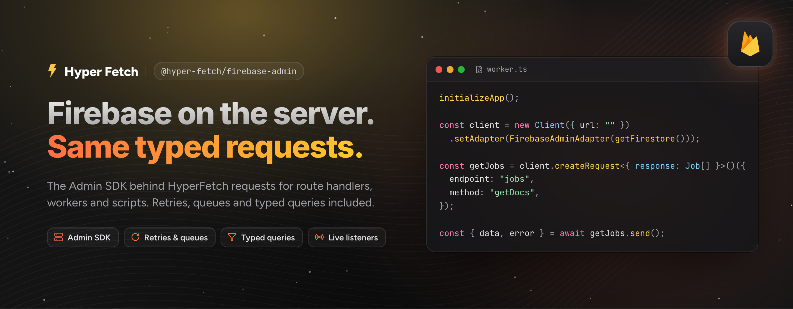

<p align="center">
  <a href="https://hyperfetch.bettertyped.com/docs/integrations/adapter-firebase-admin/overview"></a>
</p>

<p align="center">
  <a href="https://hyperfetch.bettertyped.com/docs/integrations/adapter-firebase-admin/overview"><b>Quick Start</b></a> ·
  <a href="https://hyperfetch.bettertyped.com/docs/integrations/adapter-firebase-admin/overview">Documentation</a> ·
  <a href="https://hyperfetch.bettertyped.com/docs/api/adapter-firebase-admin/Functions/FirebaseAdminAdapter">API Reference</a> ·
  <a href="https://github.com/BetterTyped/hyper-fetch">GitHub</a> ·
  <a href="https://discord.gg/7upC2kVmyM">Discord</a>
</p>

<p align="center">
  <a href="https://github.com/BetterTyped/hyper-fetch"></a>
  <a href="https://www.npmjs.com/package/@hyper-fetch/firebase-admin"></a>
  <a href="https://www.npmjs.com/package/@hyper-fetch/firebase-admin"></a>
  <a href="https://bundlejs.com/?q=@hyper-fetch/firebase-admin"></a>
  <a href="https://github.com/BetterTyped/hyper-fetch"></a>
  <a href="https://hyperfetch.bettertyped.com/docs/integrations/adapter-firebase-admin/overview"></a>
  <a href="https://github.com/BetterTyped/hyper-fetch/blob/main/License.md"></a>
</p>

## 📖 About

`@hyper-fetch/firebase-admin` runs Firestore and Realtime Database operations from server code as Hyper Fetch requests,
on top of the Firebase Admin SDK. Route handlers, workers and scripts get typed responses, retries and queues with the
same request API as `@hyper-fetch/firebase` in the browser.

## 🎯 Key Capabilities

- 🔮 **The same requests on server and client** - Methods, constraints and responses match `@hyper-fetch/firebase`
- 🔁 **Retries and queues for backend work** - Retry, deduplication and queueing on top of Admin SDK calls
- 🧭 **Typed queries** - `c.where("status", "==", "open").limit(50)` is checked against your document type
- 📡 **Server-side listeners** - React to Firestore and Realtime Database changes in workers through sockets
- 🗂️ **Change groups** - `groupByChangeType` splits a snapshot into `added`, `modified` and `removed`
- 🛡️ **Errors in the response** - Firebase errors arrive in `response.error`, and `send()` never throws

## 🚀 Quick Start

```bash
npm install @hyper-fetch/core @hyper-fetch/sockets @hyper-fetch/firebase-admin firebase-admin
```

```ts
import { Client } from "@hyper-fetch/core";
import { FirebaseAdminAdapter } from "@hyper-fetch/firebase-admin";
import { initializeApp } from "firebase-admin/app";
import { getFirestore } from "firebase-admin/firestore";

initializeApp();

const client = new Client({ url: "" }).setAdapter(FirebaseAdminAdapter(getFirestore()));

const getJobs = client.createRequest<{ response: Job[] }>()({ endpoint: "jobs", method: "getDocs" });

const { data, error } = await getJobs.send();
```

## 📚 Documentation

- **[Firebase Admin Adapter](https://hyperfetch.bettertyped.com/docs/integrations/adapter-firebase-admin/overview)** - Setup on the server
- **[Firestore](https://hyperfetch.bettertyped.com/docs/integrations/adapter-firebase-admin/firestore)** - Methods, constraints and typed queries
- **[Realtime Database](https://hyperfetch.bettertyped.com/docs/integrations/adapter-firebase-admin/realtime)** - Methods, ordering and filters
- **[Realtime listening](https://hyperfetch.bettertyped.com/docs/integrations/adapter-firebase-admin/realtime-queries)** - Listeners in workers
- **[API Reference](https://hyperfetch.bettertyped.com/docs/api/adapter-firebase-admin/Functions/FirebaseAdminAdapter)** - Every adapter, method and type

## 💡 Examples

### Server-side CRUD

```ts
type Message = { text: string; author: string; createdAt: number };

const addMessage = client.createRequest<{ response: Message & { __key: string }; payload: Message }>()({
  endpoint: "messages",
  method: "addDoc",
});

const updateMessage = client.createRequest<{ response: Partial<Message>; payload: Partial<Message> }>()({
  endpoint: "messages/:messageId",
  method: "updateDoc",
});

const deleteMessage = client.createRequest<{ response: null }>()({
  endpoint: "messages/:messageId",
  method: "deleteDoc",
});

const { data: created } = await addMessage.send({
  payload: { text: "Hello from the server", author: "system", createdAt: Date.now() },
});

if (created) {
  await updateMessage.setParams({ messageId: created.__key }).send({ payload: { text: "Updated" } });
  await deleteMessage.setParams({ messageId: created.__key }).send();
}
```

### Query with constraints

```ts
import type { FirestoreQueryParams } from "@hyper-fetch/firebase-admin";

const getMessages = client.createRequest<{ response: Message[]; queryParams?: FirestoreQueryParams<Message> }>()({
  endpoint: "messages",
  method: "getDocs",
});

const { data: recent } = await getMessages.send({
  queryParams: (c) => c.where("author", "==", "system").orderBy("createdAt", "desc").limit(50),
});
```

### Process new jobs in a worker

```ts
import { Socket } from "@hyper-fetch/sockets";
import { FirebaseSocketsAdminAdapter } from "@hyper-fetch/firebase-admin";

const socket = new Socket({ url: "", adapter: FirebaseSocketsAdminAdapter(getFirestore()) });

const onQueued = socket
  .createListener<Job[]>()({ topic: "jobs", options: { groupByChangeType: true } })
  .setQueryParams((c) => c.where("state", "==", "queued"));

const stop = onQueued.listen(({ extra }) => {
  extra.groupedResult?.added.forEach((job) => enqueue(job));
});
```

## 🧩 Hyper Fetch Ecosystem

One typed client for every backend. Swap the adapter and keep the same `createRequest()` everywhere.

<table align="center">
  <tr>
    <td align="center" width="110"><a href="https://github.com/BetterTyped/hyper-fetch/tree/main/packages/core"><br /><sub><b>Core</b></sub></a></td>
    <td align="center" width="110"><a href="https://github.com/BetterTyped/hyper-fetch/tree/main/packages/react"><br /><sub><b>React</b></sub></a></td>
    <td align="center" width="110"><a href="https://github.com/BetterTyped/hyper-fetch/tree/main/packages/sockets"><br /><sub><b>Sockets</b></sub></a></td>
    <td align="center" width="110"><a href="https://github.com/BetterTyped/hyper-fetch/tree/main/packages/db"><br /><sub><b>DB</b></sub></a></td>
    <td align="center" width="110"><a href="https://github.com/BetterTyped/hyper-fetch/tree/main/packages/cli"><br /><sub><b>OpenAPI CLI</b></sub></a></td>
    <td align="center" width="110"><a href="https://github.com/BetterTyped/hyper-fetch/tree/main/packages/adapter-graphql"><br /><sub><b>GraphQL</b></sub></a></td>
    <td align="center" width="110"><a href="https://github.com/BetterTyped/hyper-fetch/tree/main/packages/adapter-trpc"><br /><sub><b>tRPC</b></sub></a></td>
  </tr>
  <tr>
    <td align="center" width="110"><a href="https://github.com/BetterTyped/hyper-fetch/tree/main/packages/adapter-orpc"><picture><source media="(prefers-color-scheme: dark)" srcset="https://raw.githubusercontent.com/BetterTyped/hyper-fetch/main/documentation/static/img/integration-orpc-dark.svg" /></picture><br /><sub><b>oRPC</b></sub></a></td>
    <td align="center" width="110"><a href="https://github.com/BetterTyped/hyper-fetch/tree/main/packages/hono"><br /><sub><b>Hono</b></sub></a></td>
    <td align="center" width="110"><a href="https://github.com/BetterTyped/hyper-fetch/tree/main/packages/elysia"><br /><sub><b>Elysia</b></sub></a></td>
    <td align="center" width="110"><a href="https://github.com/BetterTyped/hyper-fetch/tree/main/packages/adapter-firebase"><br /><sub><b>Firebase</b></sub></a></td>
    <td align="center" width="110"><a href="https://github.com/BetterTyped/hyper-fetch/tree/main/packages/adapter-axios"><br /><sub><b>Axios</b></sub></a></td>
    <td align="center" width="110"><a href="https://github.com/BetterTyped/hyper-fetch/tree/main/packages/hyper-flow"><br /><sub><b>HyperFlow</b></sub></a></td>
  </tr>
</table>

## 💖 Sponsors

<p align="center">
  <a href="https://github.com/sponsors/prc5">
    
  </a>
</p>

## License

[Apache-2.0](https://github.com/BetterTyped/hyper-fetch/blob/main/License.md)
