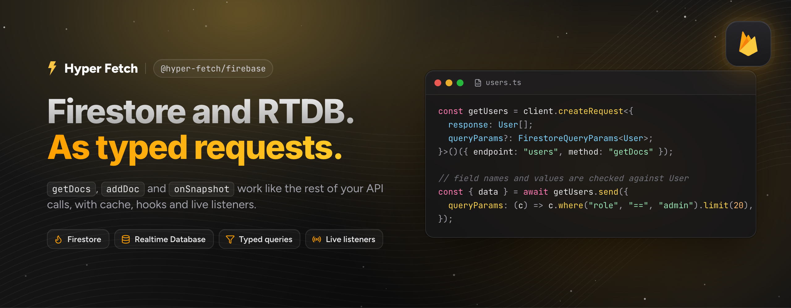

<p align="center">
  <a href="https://hyperfetch.bettertyped.com/docs/integrations/adapter-firebase/overview"></a>
</p>

<p align="center">
  <a href="https://hyperfetch.bettertyped.com/docs/integrations/adapter-firebase/overview"><b>Quick Start</b></a> ·
  <a href="https://hyperfetch.bettertyped.com/docs/integrations/adapter-firebase/overview">Documentation</a> ·
  <a href="https://hyperfetch.bettertyped.com/docs/api/adapter-firebase/Functions/FirebaseAdapter">API Reference</a> ·
  <a href="https://github.com/BetterTyped/hyper-fetch">GitHub</a> ·
  <a href="https://discord.gg/7upC2kVmyM">Discord</a>
</p>

<p align="center">
  <a href="https://github.com/BetterTyped/hyper-fetch"></a>
  <a href="https://www.npmjs.com/package/@hyper-fetch/firebase"></a>
  <a href="https://www.npmjs.com/package/@hyper-fetch/firebase"></a>
  <a href="https://bundlejs.com/?q=@hyper-fetch/firebase"></a>
  <a href="https://github.com/BetterTyped/hyper-fetch"></a>
  <a href="https://hyperfetch.bettertyped.com/docs/integrations/adapter-firebase/overview"></a>
  <a href="https://github.com/BetterTyped/hyper-fetch/blob/main/License.md"></a>
</p>

## 📖 About

`@hyper-fetch/firebase` runs Firestore and Realtime Database operations in the browser as Hyper Fetch requests. You
create them with `createRequest`, send them with `send()` and get typed responses, caching, deduplication and React
hooks, the same API you use for HTTP. Live data comes through `@hyper-fetch/sockets` listeners.

## 🎯 Key Capabilities

- 🔥 **Firebase calls that look like the rest of your app** - `getDocs`, `addDoc`, `push` and `update` are requests
- 🔮 **Typed from path to payload** - Params, payloads, responses and the raw Firebase `extra` are typed per request
- 🧭 **Typed queries** - `c.where("role", "==", "admin").limit(20)` checks field names and values against your type
- 💾 **Every filter cached on its own** - Each query constraint set is its own cache entry
- 📡 **Live data without wiring** - `onSnapshot` and `onValue` become socket listeners and `useListener` state
- 🛡️ **Errors you can render** - Permission and index errors arrive in `response.error`, and `send()` never throws
- 🗂️ **Clean results** - Documents carry their id as `__key`, and Realtime Database lists come back as ordered arrays
- 🧰 **Firestore and Realtime Database** - One adapter API for both, picked by the database you pass in
- 🗃️ **Live db collections** - `firestoreCollection` gives `@hyper-fetch/db` a Firestore collection in one call

## 🚀 Quick Start

```bash
npm install @hyper-fetch/core @hyper-fetch/sockets @hyper-fetch/firebase firebase
```

```ts
import { Client } from "@hyper-fetch/core";
import { FirebaseAdapter } from "@hyper-fetch/firebase";
import { getFirestore } from "firebase/firestore";

const client = new Client({ url: "" }).setAdapter(FirebaseAdapter(getFirestore(app)));

const getTeas = client.createRequest<{ response: Tea[] }>()({ endpoint: "teas", method: "getDocs" });

const { data, error } = await getTeas.send();
```

## 📚 Documentation

- **[Firebase Adapter](https://hyperfetch.bettertyped.com/docs/integrations/adapter-firebase/overview)** - Setup for Firestore and Realtime Database
- **[Firestore](https://hyperfetch.bettertyped.com/docs/integrations/adapter-firebase/firestore)** - Methods, constraints and typed queries
- **[Realtime Database](https://hyperfetch.bettertyped.com/docs/integrations/adapter-firebase/realtime)** - Methods, ordering and filters
- **[Realtime listening](https://hyperfetch.bettertyped.com/docs/integrations/adapter-firebase/realtime-queries)** - Live listeners and change groups
- **[API Reference](https://hyperfetch.bettertyped.com/docs/api/adapter-firebase/Functions/FirebaseAdapter)** - Every adapter, method and type

## 💡 Examples

### Read a document

```ts
type User = { __key: string; name: string; email: string; role: "admin" | "member" };

const getUser = client.createRequest<{ response: User | null }>()({
  endpoint: "users/:userId",
  method: "getDoc",
});

const { data, status } = await getUser.setParams({ userId: "abc123" }).send();
// status is "emptyResource" and data is null when the document does not exist
```

### Query a collection

```ts
import type { FirestoreQueryParams } from "@hyper-fetch/firebase";

const getUsers = client.createRequest<{ response: User[]; queryParams?: FirestoreQueryParams<User> }>()({
  endpoint: "users",
  method: "getDocs",
});

// field names and values are checked against User
const { data: admins } = await getUsers.send({
  queryParams: (c) => c.where("role", "==", "admin").orderBy("name").limit(20),
});
```

### Write a document

```ts
const createUser = client.createRequest<{ response: User; payload: Omit<User, "__key"> }>()({
  endpoint: "users",
  method: "addDoc",
});

// data is the payload plus __key, the id of the new document
const { data: created, error } = await createUser.send({
  payload: { name: "Jane", email: "jane@example.com", role: "member" },
});
```

### Listen to changes

```ts
import { Socket } from "@hyper-fetch/sockets";
import { FirebaseSocketsAdapter } from "@hyper-fetch/firebase";

const socket = new Socket({ url: "", adapter: FirebaseSocketsAdapter(getFirestore(app)) });

const onAdmins = socket
  .createListener<User[]>()({ topic: "users" })
  .setQueryParams((c) => c.where("role", "==", "admin"));

const stop = onAdmins.listen(({ data }) => console.log(data.length, "admins"));
```

### Live collections with @hyper-fetch/db

```ts
import { createDb, eq } from "@hyper-fetch/db";
import { firestoreCollection } from "@hyper-fetch/firebase/db";

const db = createDb({ post: firestoreCollection(PostSchema, { client, socket, path: "posts", key: "id" }) });

const query = db.post.where((post) => eq(post.teamId, 1)); // a Firestore query, kept live by onSnapshot
```

### Use with React

```tsx
import { useFetch, useListener } from "@hyper-fetch/react";

const UserProfile = ({ userId }: { userId: string }) => {
  const { data, loading } = useFetch(getUser.setParams({ userId }));

  if (loading) return <Spinner />;
  return <h1>{data?.name}</h1>;
};

const AdminCount = () => {
  const { data } = useListener(onAdmins);
  return <p>{data?.length ?? 0} admins</p>;
};
```

## 🧩 Hyper Fetch Ecosystem

One typed client for every backend. Swap the adapter and keep the same `createRequest()` everywhere.

<table align="center">
  <tr>
    <td align="center" width="110"><a href="https://github.com/BetterTyped/hyper-fetch/tree/main/packages/core"><br /><sub><b>Core</b></sub></a></td>
    <td align="center" width="110"><a href="https://github.com/BetterTyped/hyper-fetch/tree/main/packages/react"><br /><sub><b>React</b></sub></a></td>
    <td align="center" width="110"><a href="https://github.com/BetterTyped/hyper-fetch/tree/main/packages/sockets"><br /><sub><b>Sockets</b></sub></a></td>
    <td align="center" width="110"><a href="https://github.com/BetterTyped/hyper-fetch/tree/main/packages/db"><br /><sub><b>DB</b></sub></a></td>
    <td align="center" width="110"><a href="https://github.com/BetterTyped/hyper-fetch/tree/main/packages/cli"><br /><sub><b>OpenAPI CLI</b></sub></a></td>
    <td align="center" width="110"><a href="https://github.com/BetterTyped/hyper-fetch/tree/main/packages/adapter-graphql"><br /><sub><b>GraphQL</b></sub></a></td>
    <td align="center" width="110"><a href="https://github.com/BetterTyped/hyper-fetch/tree/main/packages/adapter-trpc"><br /><sub><b>tRPC</b></sub></a></td>
  </tr>
  <tr>
    <td align="center" width="110"><a href="https://github.com/BetterTyped/hyper-fetch/tree/main/packages/adapter-orpc"><picture><source media="(prefers-color-scheme: dark)" srcset="https://raw.githubusercontent.com/BetterTyped/hyper-fetch/main/documentation/static/img/integration-orpc-dark.svg" /></picture><br /><sub><b>oRPC</b></sub></a></td>
    <td align="center" width="110"><a href="https://github.com/BetterTyped/hyper-fetch/tree/main/packages/hono"><br /><sub><b>Hono</b></sub></a></td>
    <td align="center" width="110"><a href="https://github.com/BetterTyped/hyper-fetch/tree/main/packages/elysia"><br /><sub><b>Elysia</b></sub></a></td>
    <td align="center" width="110"><a href="https://github.com/BetterTyped/hyper-fetch/tree/main/packages/adapter-firebase"><br /><sub><b>Firebase</b></sub></a></td>
    <td align="center" width="110"><a href="https://github.com/BetterTyped/hyper-fetch/tree/main/packages/adapter-axios"><br /><sub><b>Axios</b></sub></a></td>
    <td align="center" width="110"><a href="https://github.com/BetterTyped/hyper-fetch/tree/main/packages/hyper-flow"><br /><sub><b>HyperFlow</b></sub></a></td>
  </tr>
</table>

## 💖 Sponsors

<p align="center">
  <a href="https://github.com/sponsors/prc5">
    
  </a>
</p>

## License

[Apache-2.0](https://github.com/BetterTyped/hyper-fetch/blob/main/License.md)
