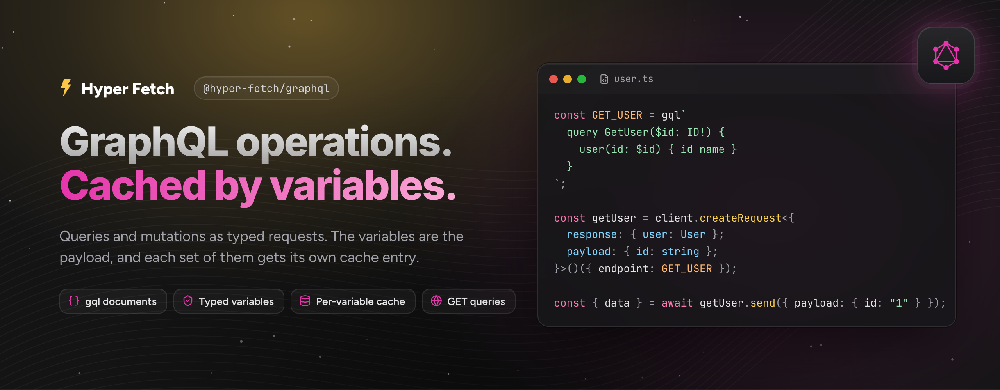

<p align="center">
  <a href="https://hyperfetch.bettertyped.com/docs/integrations/adapter-graphql/overview"></a>
</p>

<p align="center">
  <a href="https://hyperfetch.bettertyped.com/docs/integrations/adapter-graphql/overview"><b>Quick Start</b></a> ·
  <a href="https://hyperfetch.bettertyped.com/docs/integrations/adapter-graphql/overview">Documentation</a> ·
  <a href="https://hyperfetch.bettertyped.com/docs/api/adapter-graphql/Functions/GraphqlAdapter">API Reference</a> ·
  <a href="https://github.com/BetterTyped/hyper-fetch">GitHub</a> ·
  <a href="https://discord.gg/7upC2kVmyM">Discord</a>
</p>

<p align="center">
  <a href="https://github.com/BetterTyped/hyper-fetch"></a>
  <a href="https://www.npmjs.com/package/@hyper-fetch/graphql"></a>
  <a href="https://www.npmjs.com/package/@hyper-fetch/graphql"></a>
  <a href="https://bundlejs.com/?q=@hyper-fetch/graphql"></a>
  <a href="https://github.com/BetterTyped/hyper-fetch"></a>
  <a href="https://hyperfetch.bettertyped.com/docs/integrations/adapter-graphql/overview"></a>
  <a href="https://github.com/BetterTyped/hyper-fetch/blob/main/License.md"></a>
</p>

## 📖 About

`@hyper-fetch/graphql` sends GraphQL queries and mutations over HTTP as regular Hyper Fetch requests. The document is
the endpoint, the variables are the payload, and every set of variables gets its own cache entry. You keep the core
request API, cache, retries, offline replay and React hooks, with no GraphQL-specific client to learn. Subscriptions run
over WebSocket with `GraphqlWsAdapter`, which speaks `graphql-transport-ws`, the protocol of `graphql-ws`.

## 🎯 Key Capabilities

- 🎡 **Operations are requests** - Write a `gql` document as the `endpoint` and call `send()`, `useFetch` or `useSubmit`
- 🔮 **Typed variables and data** - A typed document from GraphQL Code Generator or gql.tada types both, no generics
- 💾 **Cache per variables** - `{ id: "1" }` and `{ id: "2" }` are cached separately and served instantly next time
- 🌐 **GET when you want it** - `GraphqlMethod.GET` makes queries cacheable by browsers and CDNs
- 🛣️ **A URL per operation** - The `document` option keeps a path per operation for gateways, logs and APM
- 🛡️ **Errors you can handle** - The GraphQL `errors` array lands in `response.error`, and `send()` never throws
- 📊 **Extensions included** - Cost and tracing data from `extensions` arrive in `response.extra`
- 🔴 **Subscriptions** - `graphql-transport-ws` over WebSocket, with reconnecting, shared subscriptions and lazy connections
- 📡 **Any spec-compliant server** - Apollo, Yoga, Hasura or your own, over plain HTTP

## 🚀 Quick Start

```bash
npm install @hyper-fetch/core @hyper-fetch/sockets @hyper-fetch/graphql graphql graphql-tag
```

```ts
import { createClient } from "@hyper-fetch/core";
import { GraphqlAdapter } from "@hyper-fetch/graphql";
import gql from "graphql-tag";

const client = createClient({ url: "https://api.example.com/graphql" }).setAdapter(GraphqlAdapter());

const getUser = client.createRequest<{ response: { user: User | null }; payload: { id: string } }>()({
  endpoint: gql`
    query GetUser($id: ID!) {
      user(id: $id) {
        id
        name
      }
    }
  `,
});

// The payload is sent as the GraphQL variables
const { data, error } = await getUser.send({ payload: { id: "1" } });
```

## 📚 Documentation

- **[Overview](https://hyperfetch.bettertyped.com/docs/integrations/adapter-graphql/overview)** - Setup, methods, errors and caching
- **[Queries](https://hyperfetch.bettertyped.com/docs/integrations/adapter-graphql/queries)** - Variables, GET queries and cache keys
- **[Mutations](https://hyperfetch.bettertyped.com/docs/integrations/adapter-graphql/mutations)** - Writes, forms and optimistic updates
- **[Subscriptions](https://hyperfetch.bettertyped.com/docs/integrations/adapter-graphql/subscriptions)** - `GraphqlWsAdapter`, connection params and reconnecting
- **[graphql-tag](https://hyperfetch.bettertyped.com/docs/integrations/adapter-graphql/graphql-tag)** - Documents, fragments and typing
- **[API Reference](https://hyperfetch.bettertyped.com/docs/api/adapter-graphql/Functions/GraphqlAdapter)** - `GraphqlAdapter`, `GraphqlMethod` and types

## 💡 Examples

### Mutation

```ts
const createUser = client.createRequest<{
  response: { createUser: User };
  payload: { name: string; email: string };
}>()({
  endpoint: gql`
    mutation CreateUser($name: String!, $email: String!) {
      createUser(name: $name, email: $email) {
        id
        name
      }
    }
  `,
});

const { data, error } = await createUser.send({ payload: { name: "Jane", email: "jane@example.com" } });
```

### React hooks

```tsx
import { useFetch, useSubmit } from "@hyper-fetch/react";

const UserProfile = ({ id }: { id: string }) => {
  // A new id is a new cache key: known users render instantly
  const { data, loading } = useFetch(getUser.setPayload({ id }));
  const { submit, submitting } = useSubmit(createUser);

  if (loading) return <Spinner />;
  return <Profile user={data?.user} onInvite={(payload) => submit({ payload })} saving={submitting} />;
};
```

### Handle GraphQL errors

```ts
import type { GraphqlErrorType } from "@hyper-fetch/graphql";

// Declare the error shape once. GraphQL errors, network failures, aborts and timeouts all arrive as a list
export const client = createClient<{ error: GraphqlErrorType }>({
  url: "https://api.example.com/graphql",
}).setAdapter(GraphqlAdapter());

const { error, extra } = await getUser.send({ payload: { id: "1" } });

console.log(error?.map((item) => item.message), extra.extensions);
```

### Cacheable GET queries

```ts
import { GraphqlMethod } from "@hyper-fetch/graphql";

const listUsers = client.createRequest<{ response: { users: User[] } }>()({
  endpoint: gql`
    query ListUsers {
      users {
        id
        name
      }
    }
  `,
  method: GraphqlMethod.GET,
});

// GET {client.url}?query=...&variables=...
await listUsers.send();
```

### Typed documents

```ts
import { GetUserDocument } from "./gql/graphql";

// data and variables are typed from the generated document - no generics
const getUserOperation = client.createRequest()({ endpoint: GetUserDocument });
await getUserOperation.send({ payload: { id: "1" } });
```

### Subscriptions

```ts
import { Socket } from "@hyper-fetch/sockets";
import { GraphqlWsAdapter } from "@hyper-fetch/graphql";

const socket = new Socket({
  url: "wss://api.example.com/graphql",
  adapter: GraphqlWsAdapter(),
  // Runs on every connection attempt, so a reconnect sends a fresh token
  adapterOptions: { connectionParams: async () => ({ token: await getToken() }) },
});

const onMessage = socket.createListener()({ topic: "OnMessage", options: { document: OnMessageDocument } });

onMessage.setPayload({ room: "general" }).listen(({ data, extra }) => {
  console.log(data.onMessage.text, extra.errors);
});
```

## 🧩 Hyper Fetch Ecosystem

One typed client for every backend. Swap the adapter and keep the same `createRequest()` everywhere.

<table align="center">
  <tr>
    <td align="center" width="110"><a href="https://github.com/BetterTyped/hyper-fetch/tree/main/packages/core"><br /><sub><b>Core</b></sub></a></td>
    <td align="center" width="110"><a href="https://github.com/BetterTyped/hyper-fetch/tree/main/packages/react"><br /><sub><b>React</b></sub></a></td>
    <td align="center" width="110"><a href="https://github.com/BetterTyped/hyper-fetch/tree/main/packages/sockets"><br /><sub><b>Sockets</b></sub></a></td>
    <td align="center" width="110"><a href="https://github.com/BetterTyped/hyper-fetch/tree/main/packages/cli"><br /><sub><b>OpenAPI CLI</b></sub></a></td>
    <td align="center" width="110"><a href="https://github.com/BetterTyped/hyper-fetch/tree/main/packages/adapter-graphql"><br /><sub><b>GraphQL</b></sub></a></td>
    <td align="center" width="110"><a href="https://github.com/BetterTyped/hyper-fetch/tree/main/packages/adapter-trpc"><br /><sub><b>tRPC</b></sub></a></td>
  </tr>
  <tr>
    <td align="center" width="110"><a href="https://github.com/BetterTyped/hyper-fetch/tree/main/packages/adapter-orpc"><picture><source media="(prefers-color-scheme: dark)" srcset="https://raw.githubusercontent.com/BetterTyped/hyper-fetch/main/documentation/static/img/integration-orpc-dark.svg" /></picture><br /><sub><b>oRPC</b></sub></a></td>
    <td align="center" width="110"><a href="https://github.com/BetterTyped/hyper-fetch/tree/main/packages/hono"><br /><sub><b>Hono</b></sub></a></td>
    <td align="center" width="110"><a href="https://github.com/BetterTyped/hyper-fetch/tree/main/packages/elysia"><br /><sub><b>Elysia</b></sub></a></td>
    <td align="center" width="110"><a href="https://github.com/BetterTyped/hyper-fetch/tree/main/packages/adapter-firebase"><br /><sub><b>Firebase</b></sub></a></td>
    <td align="center" width="110"><a href="https://github.com/BetterTyped/hyper-fetch/tree/main/packages/adapter-axios"><br /><sub><b>Axios</b></sub></a></td>
    <td align="center" width="110"><a href="https://github.com/BetterTyped/hyper-fetch/tree/main/packages/hyper-flow"><br /><sub><b>HyperFlow</b></sub></a></td>
  </tr>
</table>

## 💖 Sponsors

<p align="center">
  <a href="https://github.com/sponsors/prc5">
    
  </a>
</p>

## License

[Apache-2.0](https://github.com/BetterTyped/hyper-fetch/blob/main/License.md)
