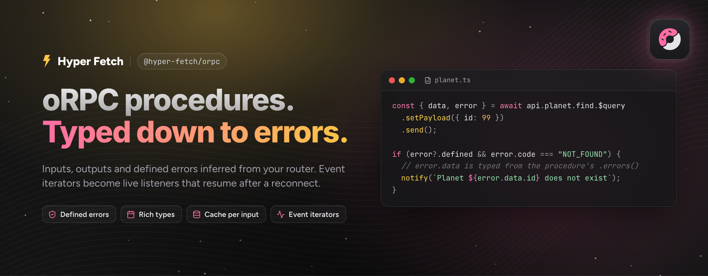
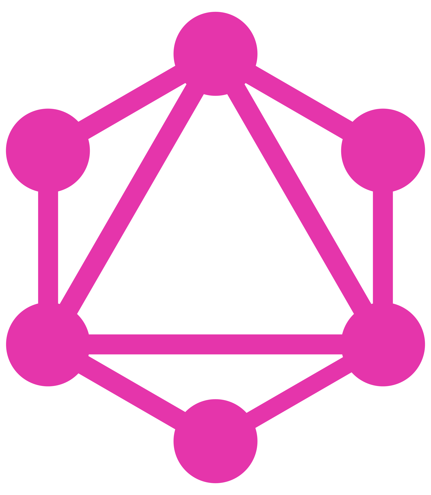

<p align="center">
  <a href="https://hyperfetch.bettertyped.com/docs/integrations/adapter-orpc/overview"></a>
</p>

<p align="center">
  <a href="https://hyperfetch.bettertyped.com/docs/integrations/adapter-orpc/overview"><b>Quick Start</b></a> ·
  <a href="https://hyperfetch.bettertyped.com/docs/integrations/adapter-orpc/overview">Documentation</a> ·
  <a href="https://hyperfetch.bettertyped.com/docs/api/adapter-orpc/Functions/OrpcAdapter">API Reference</a> ·
  <a href="https://github.com/BetterTyped/hyper-fetch">GitHub</a> ·
  <a href="https://discord.gg/7upC2kVmyM">Discord</a>
</p>

<p align="center">
  <a href="https://github.com/BetterTyped/hyper-fetch"></a>
  <a href="https://www.npmjs.com/package/@hyper-fetch/orpc"></a>
  <a href="https://www.npmjs.com/package/@hyper-fetch/orpc"></a>
  <a href="https://bundlejs.com/?q=@hyper-fetch/orpc"></a>
  <a href="https://github.com/BetterTyped/hyper-fetch"></a>
  <a href="https://hyperfetch.bettertyped.com/docs/integrations/adapter-orpc/overview"></a>
  <a href="https://github.com/BetterTyped/hyper-fetch/blob/main/License.md"></a>
</p>

## 📖 About

`@hyper-fetch/orpc` connects Hyper Fetch to an oRPC server through the oRPC RPC protocol. Procedures become regular
Hyper Fetch requests through `createSdk`, with inputs, outputs and defined errors inferred from your router or
contract, and event iterators become typed socket listeners. Rich types survive the wire thanks to the oRPC serializer.

## 🎯 Key Capabilities

- 🔮 **Types from your router or contract** - Inputs, outputs and `.errors()` maps inferred, no codegen
- 🛡️ **Defined errors you can switch on** - `error.code` narrows `error.data` to the shape you declared on the server
- 📅 **Rich types on the wire** - `Date`, `BigInt`, `Map`, `Set`, `URL` and files, encoded by the oRPC serializer
- 💾 **Cache per input** - `{ id: 1 }` and `{ id: 2 }` are cached, deduplicated and queued separately
- 🌐 **GET when your server allows it** - `queryMethod: "GET"` makes queries cacheable by browsers and CDNs
- ⚛️ **React hooks** - `useFetch` on `$query`, `useSubmit` on `$mutation`, file uploads included
- 📡 **Live event iterators** - Listen to `async function*` procedures over HTTP streams or one WebSocket
- ⏯️ **Resume where you stopped** - Reconnects send the last `withEventMeta` id, so the server can replay what you missed

## 🚀 Quick Start

```bash
npm install @hyper-fetch/core @hyper-fetch/orpc @orpc/client
```

```ts
import { createClient, createSdk } from "@hyper-fetch/core";
import { OrpcAdapter } from "@hyper-fetch/orpc";
import type { OrpcSchema } from "@hyper-fetch/orpc";

import type { router } from "./server";

const client = createClient({ url: "http://localhost:3000/rpc" }).setAdapter(OrpcAdapter());

// camelCaseToKebabCase: false keeps procedure names like findById as they are
const api = createSdk<typeof client, OrpcSchema<typeof router>>(client, { camelCaseToKebabCase: false });

const { data, error } = await api.planet.find.$query.setPayload({ id: 1 }).send();
```

## 📚 Documentation

- **[oRPC Adapter](https://hyperfetch.bettertyped.com/docs/integrations/adapter-orpc/overview)** - Setup, GET queries, errors, serializers and caching
- **[Event Iterators](https://hyperfetch.bettertyped.com/docs/integrations/adapter-orpc/event-iterators)** - Streams, WebSockets and resume
- **[SDK](https://hyperfetch.bettertyped.com/docs/core/sdk)** - How `createSdk` turns a schema into requests
- **[API Reference](https://hyperfetch.bettertyped.com/docs/api/adapter-orpc/Functions/OrpcAdapter)** - Adapters, schemas and types

## 💡 Examples

### Handle a defined error

```ts
const { data, error } = await api.planet.find.$query.setPayload({ id: 99 }).send();

// `error` also includes the global error of the client, so check for the oRPC shape first
if (error && "defined" in error && error.defined && error.code === "NOT_FOUND") {
  // error.data has the shape declared in the procedure's .errors()
  console.log(`Planet ${error.data.id} does not exist`);
}
```

### Upload a file from React

```tsx
import { useSubmit } from "@hyper-fetch/react";

const PlanetImage = ({ planetId }: { planetId: number }) => {
  const { submit, submitting } = useSubmit(api.planet.uploadImage.$mutation);

  return (
    <input
      type="file"
      disabled={submitting}
      onChange={(event) => {
        const image = event.target.files?.[0];
        if (image) submit({ payload: { planetId, image } });
      }}
    />
  );
};
```

### Cacheable GET queries

```ts
const client = createClient({ url: "http://localhost:3000/rpc" }).setAdapter(OrpcAdapter({ queryMethod: "GET" }));

// Fall back to POST for one request
const { data } = await api.planet.list.$query.setOptions({ queryMethod: "POST" }).send();
```

The server accepts GET for procedures declared with `.route({ method: "GET" })`.

### Listen to an event iterator

```ts
import { createSocketSdk, Socket } from "@hyper-fetch/sockets";
import { OrpcStreamAdapter } from "@hyper-fetch/orpc";
import type { OrpcSocketSchema } from "@hyper-fetch/orpc";

// Or OrpcWebsocketAdapter() with the RPCHandler of @orpc/server/ws
const socket = new Socket({ url: "http://localhost:3000/rpc", adapter: OrpcStreamAdapter() });
const live = createSocketSdk<typeof socket, OrpcSocketSchema<typeof router>>(socket, { camelCaseToKebabCase: false });

const stop = live.planet.onUpdate.$listener.setPayload({ id: 1 }).listen(({ data, extra }) => {
  console.log(data.name, extra.id);
});
```

### Find the subscription that failed

```ts
import { OrpcSocketError } from "@hyper-fetch/orpc";

socket.onError(({ error }) => {
  if (error instanceof OrpcSocketError && error.code === "UNAUTHORIZED") {
    console.log(`${error.topic} was rejected for`, error.payload);
  }
});
```

### Contract-first APIs

```ts
import type { ContractRouterClient } from "@orpc/contract";

import type { contract } from "./contract";

const api = createSdk<typeof client, OrpcSchema<ContractRouterClient<typeof contract>>>(client, {
  camelCaseToKebabCase: false,
});
```

## 🧩 Hyper Fetch Ecosystem

One typed client for every backend. Swap the adapter and keep the same `createRequest()` everywhere.

<table align="center">
  <tr>
    <td align="center" width="110"><a href="https://github.com/BetterTyped/hyper-fetch/tree/main/packages/core"><br /><sub><b>Core</b></sub></a></td>
    <td align="center" width="110"><a href="https://github.com/BetterTyped/hyper-fetch/tree/main/packages/react"><br /><sub><b>React</b></sub></a></td>
    <td align="center" width="110"><a href="https://github.com/BetterTyped/hyper-fetch/tree/main/packages/sockets"><br /><sub><b>Sockets</b></sub></a></td>
    <td align="center" width="110"><a href="https://github.com/BetterTyped/hyper-fetch/tree/main/packages/cli"><br /><sub><b>OpenAPI CLI</b></sub></a></td>
    <td align="center" width="110"><a href="https://github.com/BetterTyped/hyper-fetch/tree/main/packages/adapter-graphql"><br /><sub><b>GraphQL</b></sub></a></td>
    <td align="center" width="110"><a href="https://github.com/BetterTyped/hyper-fetch/tree/main/packages/adapter-trpc"><br /><sub><b>tRPC</b></sub></a></td>
  </tr>
  <tr>
    <td align="center" width="110"><a href="https://github.com/BetterTyped/hyper-fetch/tree/main/packages/adapter-orpc"><picture><source media="(prefers-color-scheme: dark)" srcset="https://raw.githubusercontent.com/BetterTyped/hyper-fetch/main/documentation/static/img/integration-orpc-dark.svg" /></picture><br /><sub><b>oRPC</b></sub></a></td>
    <td align="center" width="110"><a href="https://github.com/BetterTyped/hyper-fetch/tree/main/packages/hono"><br /><sub><b>Hono</b></sub></a></td>
    <td align="center" width="110"><a href="https://github.com/BetterTyped/hyper-fetch/tree/main/packages/elysia"><br /><sub><b>Elysia</b></sub></a></td>
    <td align="center" width="110"><a href="https://github.com/BetterTyped/hyper-fetch/tree/main/packages/adapter-firebase"><br /><sub><b>Firebase</b></sub></a></td>
    <td align="center" width="110"><a href="https://github.com/BetterTyped/hyper-fetch/tree/main/packages/adapter-axios"><br /><sub><b>Axios</b></sub></a></td>
    <td align="center" width="110"><a href="https://github.com/BetterTyped/hyper-fetch/tree/main/packages/hyper-flow"><br /><sub><b>HyperFlow</b></sub></a></td>
  </tr>
</table>

## 💖 Sponsors

<p align="center">
  <a href="https://github.com/sponsors/prc5">
    
  </a>
</p>

## License

[Apache-2.0](https://github.com/BetterTyped/hyper-fetch/blob/main/License.md)
