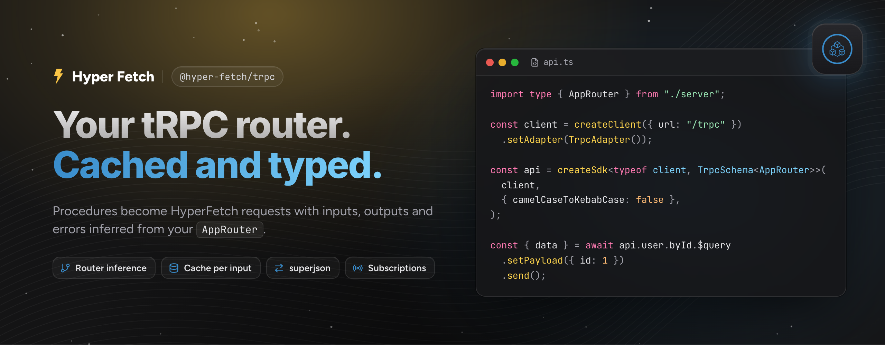
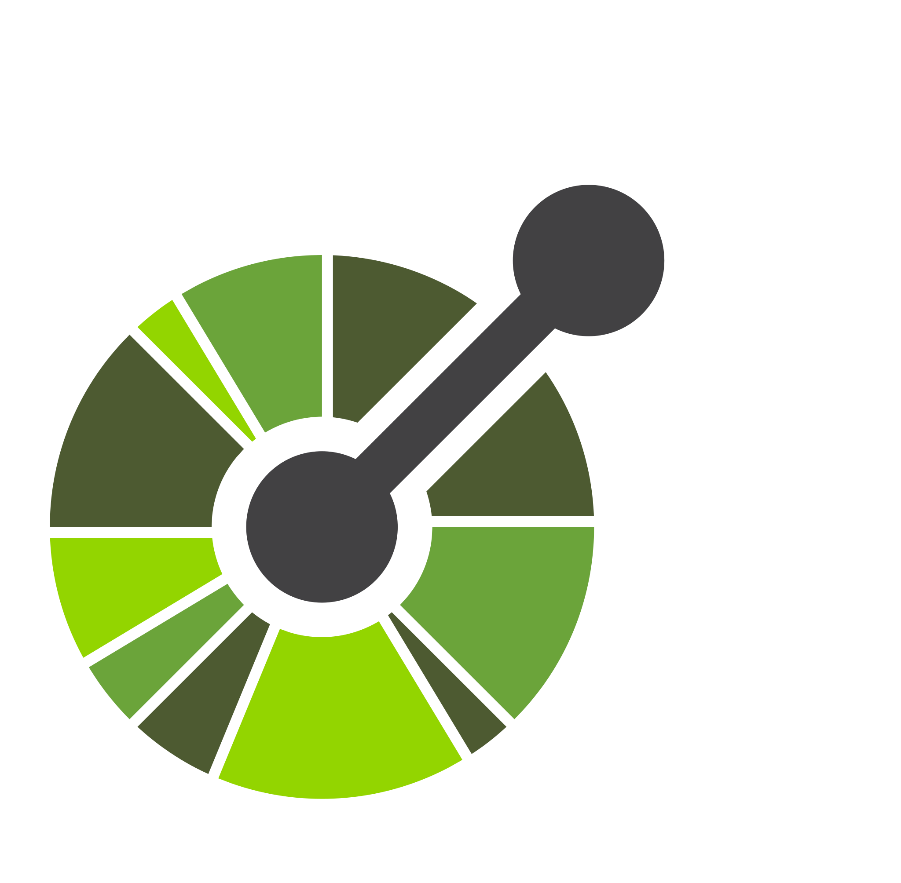

<p align="center">
  <a href="https://hyperfetch.bettertyped.com/docs/integrations/adapter-trpc/overview"></a>
</p>

<p align="center">
  <a href="https://hyperfetch.bettertyped.com/docs/integrations/adapter-trpc/overview"><b>Quick Start</b></a> ·
  <a href="https://hyperfetch.bettertyped.com/docs/integrations/adapter-trpc/overview">Documentation</a> ·
  <a href="https://hyperfetch.bettertyped.com/docs/api/adapter-trpc/Functions/TrpcAdapter">API Reference</a> ·
  <a href="https://github.com/BetterTyped/hyper-fetch">GitHub</a> ·
  <a href="https://discord.gg/7upC2kVmyM">Discord</a>
</p>

<p align="center">
  <a href="https://github.com/BetterTyped/hyper-fetch"></a>
  <a href="https://www.npmjs.com/package/@hyper-fetch/trpc"></a>
  <a href="https://www.npmjs.com/package/@hyper-fetch/trpc"></a>
  <a href="https://bundlejs.com/?q=@hyper-fetch/trpc"></a>
  <a href="https://github.com/BetterTyped/hyper-fetch"></a>
  <a href="https://hyperfetch.bettertyped.com/docs/integrations/adapter-trpc/overview"></a>
  <a href="https://github.com/BetterTyped/hyper-fetch/blob/main/License.md"></a>
</p>

## 📖 About

`@hyper-fetch/trpc` connects Hyper Fetch to a tRPC v11 server. Query and mutation procedures become regular Hyper Fetch
requests through `createSdk`, with inputs, outputs and errors inferred from your `AppRouter` type, and subscription
procedures become typed socket listeners. You get the core cache, retries, deduplication, offline replay and React
hooks without `@trpc/client`.

## 🎯 Key Capabilities

- 🔮 **Types straight from your router** - Inputs, outputs and the error shape come from `AppRouter`, no codegen
- 🪶 **No server code in the bundle** - Import the router as a type. No `@trpc/client` needed
- 💾 **Cache per input** - `{ id: 1 }` and `{ id: 2 }` are cached, deduplicated and refetched separately
- ⚛️ **React hooks on every procedure** - `useFetch` for queries, `useSubmit` for mutations
- 🛡️ **Errors as the server sent them** - `TRPCError` codes and `errorFormatter` fields arrive typed in `response.error`
- 🔁 **Transformers** - `superjson` or any `serialize` / `deserialize` pair, so a `Date` stays a `Date`
- 📡 **Live subscriptions** - WebSocket or SSE listeners that share one server subscription per input
- ⏯️ **Resume after a reconnect** - Subscriptions continue from the last `tracked()` event
- ⚙️ **Defaults per procedure** - `$configure` sets retries or stale time for one procedure or all of them

## 🚀 Quick Start

```bash
npm install @hyper-fetch/core @hyper-fetch/trpc
```

```ts
import { createClient, createSdk } from "@hyper-fetch/core";
import { TrpcAdapter } from "@hyper-fetch/trpc";
import type { TrpcSchema } from "@hyper-fetch/trpc";

import type { AppRouter } from "./server";

const client = createClient({ url: "http://localhost:3000/trpc" }).setAdapter(TrpcAdapter());

// camelCaseToKebabCase: false keeps procedure names like byId as they are
export const api = createSdk<typeof client, TrpcSchema<AppRouter>>(client, { camelCaseToKebabCase: false });

const { data: user } = await api.user.byId.$query.setPayload({ id: 1 }).send();
const { data: created } = await api.user.create.$mutation.setPayload({ name: "John" }).send();
```

## 📚 Documentation

- **[tRPC Adapter](https://hyperfetch.bettertyped.com/docs/integrations/adapter-trpc/overview)** - Setup, the SDK, errors, transformers and caching
- **[Subscriptions](https://hyperfetch.bettertyped.com/docs/integrations/adapter-trpc/subscriptions)** - WebSocket and SSE listeners with resume
- **[SDK](https://hyperfetch.bettertyped.com/docs/core/sdk)** - How `createSdk` turns a schema into requests
- **[API Reference](https://hyperfetch.bettertyped.com/docs/api/adapter-trpc/Functions/TrpcAdapter)** - Adapters, schemas and types

## 💡 Examples

### React hooks

```tsx
import { useFetch, useSubmit } from "@hyper-fetch/react";

export const UserCard = ({ id }: { id: number }) => {
  // A new id is a new cache key: fetched once, then served from the cache
  const { data, loading, error } = useFetch(api.user.byId.$query.setPayload({ id }));

  if (loading) return <Spinner />;
  if (error) return <p>{error.message}</p>;
  return <p>{data?.name}</p>;
};

export const CreateUser = () => {
  const { submit, submitting } = useSubmit(api.user.create.$mutation);

  return (
    <button disabled={submitting} onClick={() => submit({ payload: { name: "John" } })}>
      Create
    </button>
  );
};
```

### Typed tRPC errors

```ts
const { error, status } = await api.user.byId.$query.setPayload({ id: 999 }).send();

if (error && "data" in error) {
  status; // 404
  error.message; // "User not found"
  error.data.code; // "NOT_FOUND"
}

// Retry server errors only, never 4xx
const byId = api.user.byId.$query
  .setRetry(3)
  .setRetryOnError(({ error }) => !(error && "data" in error && error.data.httpStatus < 500));
```

### superjson

```ts
import superjson from "superjson";

const client = createClient({ url: "http://localhost:3000/trpc" }).setAdapter(TrpcAdapter({ transformer: superjson }));
// data?.createdAt is a Date again
```

### Realtime subscriptions

```ts
import { Socket, createSocketSdk } from "@hyper-fetch/sockets";
import { TrpcWebsocketAdapter } from "@hyper-fetch/trpc";
import type { TrpcSocketSchema } from "@hyper-fetch/trpc";

// Or TrpcSseAdapter() with the url of the HTTP handler for Server-Sent Events
const socket = new Socket({ url: "ws://localhost:3001", adapter: TrpcWebsocketAdapter() });

const realtime = createSocketSdk<typeof socket, TrpcSocketSchema<AppRouter>>(socket, { camelCaseToKebabCase: false });

const stop = realtime.chat.onMessage.$listener.setPayload({ room: "general" }).listen(({ data, extra }) => {
  console.log(data.text, extra.eventId);
});
```

Subscriptions need `@hyper-fetch/sockets` installed. Listeners with the same input share one server subscription, and
after a reconnect it resumes from the last `tracked()` event, so the server can send what was missed.

### Defaults for every procedure

```ts
const configured = api.$configure({
  "*": { retry: 1 },
  "user.byId.$query": { staleTime: 30_000 },
});
```

## 🧩 Hyper Fetch Ecosystem

One typed client for every backend. Swap the adapter and keep the same `createRequest()` everywhere.

<table align="center">
  <tr>
    <td align="center" width="110"><a href="https://github.com/BetterTyped/hyper-fetch/tree/main/packages/core"><br /><sub><b>Core</b></sub></a></td>
    <td align="center" width="110"><a href="https://github.com/BetterTyped/hyper-fetch/tree/main/packages/react"><br /><sub><b>React</b></sub></a></td>
    <td align="center" width="110"><a href="https://github.com/BetterTyped/hyper-fetch/tree/main/packages/sockets"><br /><sub><b>Sockets</b></sub></a></td>
    <td align="center" width="110"><a href="https://github.com/BetterTyped/hyper-fetch/tree/main/packages/db"><br /><sub><b>DB</b></sub></a></td>
    <td align="center" width="110"><a href="https://github.com/BetterTyped/hyper-fetch/tree/main/packages/cli"><br /><sub><b>OpenAPI CLI</b></sub></a></td>
    <td align="center" width="110"><a href="https://github.com/BetterTyped/hyper-fetch/tree/main/packages/adapter-graphql"><br /><sub><b>GraphQL</b></sub></a></td>
    <td align="center" width="110"><a href="https://github.com/BetterTyped/hyper-fetch/tree/main/packages/adapter-trpc"><br /><sub><b>tRPC</b></sub></a></td>
  </tr>
  <tr>
    <td align="center" width="110"><a href="https://github.com/BetterTyped/hyper-fetch/tree/main/packages/adapter-orpc"><picture><source media="(prefers-color-scheme: dark)" srcset="https://raw.githubusercontent.com/BetterTyped/hyper-fetch/main/documentation/static/img/integration-orpc-dark.svg" /></picture><br /><sub><b>oRPC</b></sub></a></td>
    <td align="center" width="110"><a href="https://github.com/BetterTyped/hyper-fetch/tree/main/packages/hono"><br /><sub><b>Hono</b></sub></a></td>
    <td align="center" width="110"><a href="https://github.com/BetterTyped/hyper-fetch/tree/main/packages/elysia"><br /><sub><b>Elysia</b></sub></a></td>
    <td align="center" width="110"><a href="https://github.com/BetterTyped/hyper-fetch/tree/main/packages/adapter-firebase"><br /><sub><b>Firebase</b></sub></a></td>
    <td align="center" width="110"><a href="https://github.com/BetterTyped/hyper-fetch/tree/main/packages/adapter-axios"><br /><sub><b>Axios</b></sub></a></td>
    <td align="center" width="110"><a href="https://github.com/BetterTyped/hyper-fetch/tree/main/packages/hyper-flow"><br /><sub><b>HyperFlow</b></sub></a></td>
  </tr>
</table>

## 💖 Sponsors

<p align="center">
  <a href="https://github.com/sponsors/prc5">
    
  </a>
</p>

## License

[Apache-2.0](https://github.com/BetterTyped/hyper-fetch/blob/main/License.md)
