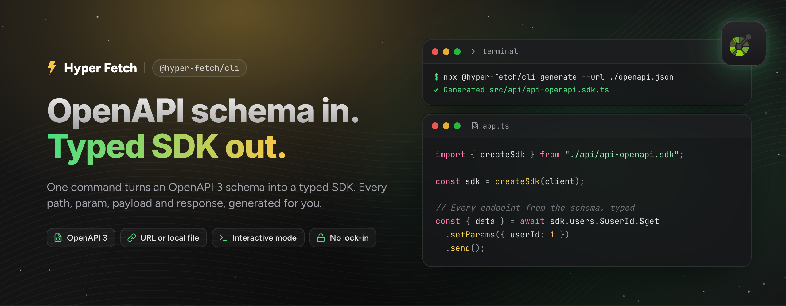

<p align="center">
  <a href="https://hyperfetch.bettertyped.com/docs/cli/commands/generate"></a>
</p>

<p align="center">
  <a href="https://hyperfetch.bettertyped.com/docs/cli/overview"><b>Quick Start</b></a> ·
  <a href="https://hyperfetch.bettertyped.com/docs/cli/commands/generate">Documentation</a> ·
  <a href="https://hyperfetch.bettertyped.com/docs/api/cli/Classes/OpenapiRequestGenerator">API Reference</a> ·
  <a href="https://github.com/BetterTyped/hyper-fetch">GitHub</a> ·
  <a href="https://discord.gg/7upC2kVmyM">Discord</a>
</p>

<p align="center">
  <a href="https://github.com/BetterTyped/hyper-fetch"></a>
  <a href="https://www.npmjs.com/package/@hyper-fetch/cli"></a>
  <a href="https://www.npmjs.com/package/@hyper-fetch/cli"></a>
  <a href="https://hyperfetch.bettertyped.com/docs/cli/commands/generate"></a>
  <a href="https://github.com/BetterTyped/hyper-fetch"></a>
  <a href="https://hyperfetch.bettertyped.com/docs/cli/commands/generate"></a>
  <a href="https://github.com/BetterTyped/hyper-fetch/blob/main/License.md"></a>
</p>

## 📖 About

The Hyper Fetch CLI reads an OpenAPI 3 schema and writes a typed SDK built on `@hyper-fetch/core`. Every operation
becomes a typed request, with params, payloads, query params, responses and errors taken from the schema. The output is
one plain TypeScript file you own, so there is no runtime to adopt and nothing to eject from.

## 🎯 Key Capabilities

- 🪄 **One command, full SDK** - Point it at a schema and get a typed client for every endpoint
- 🔮 **Types you never write** - Params, payloads, query params, responses and errors come from the schema
- 🧭 **Paths become properties** - `GET /users/{userId}` is `sdk.users.$userId.$get` with typed `setParams()`
- 📡 **Remote or local schemas** - Pass a URL or a local `.json` file
- 🧭 **Interactive or scripted** - Run it bare for prompts, or pass every flag for CI
- 🔓 **No lock-in** - The output is standard `@hyper-fetch/core` code you can read, edit and extend
- ⚡ **Every HyperFetch feature** - Cache, retries, deduplication, offline replay and React hooks on every endpoint

## 🚀 Quick Start

```bash
# 1. Create the api.json config and the output folder (default: src/api)
npx @hyper-fetch/cli init

# 2. Generate the SDK from your schema
npx @hyper-fetch/cli generate --url https://api.example.com/openapi.json
```

```ts
// 3. Use it
import { createClient } from "@hyper-fetch/core";

import { createSdk } from "./api/api-openapi.sdk";

const sdk = createSdk(createClient({ url: "https://api.example.com" }));

const { data: users } = await sdk.users.$get.send();
const { data: user } = await sdk.users.$userId.$get.setParams({ userId: 1 }).send();
```

## 📋 Commands

### `init`

Creates the `api.json` config at the project root and the directory for generated files.

```bash
npx @hyper-fetch/cli init
```

| Flag                 | Description                                         |
| -------------------- | --------------------------------------------------- |
| `-y`, `--yes`        | Skip prompts and use the defaults (`src/api/`)      |
| `-c`, `--cwd <path>` | Working directory (default: the current directory)  |

Without `--yes` it asks for the main directory (`src`, `app` or a custom path) and the API subdirectory (default `api`).

### `generate`

Reads an OpenAPI schema and writes the SDK file.

```bash
npx @hyper-fetch/cli generate --url <schema> [options]
```

| Flag                      | Description                                                         |
| ------------------------- | ------------------------------------------------------------------- |
| `-u`, `--url <url>`       | Schema source, a URL or a local file path relative to the cwd       |
| `-t`, `--template <type>` | Schema type: `openapi` or `swagger` (default: interactive prompt)   |
| `-f`, `--fileName <name>` | Output file name (default: `api-openapi.sdk.ts`)                    |
| `-o`, `--overwrite`       | Overwrite an existing file without asking                           |
| `-c`, `--cwd <path>`      | Working directory (default: the current directory)                  |

Without flags the CLI runs in **interactive mode** and prompts for every option.

## ⚙️ Configuration

`init` writes `api.json`, the only config file the CLI reads.

```json
{
  "tsx": true,
  "aliases": {
    "api": "@/api",
    "hooks": "@/hooks",
    "ui": "@/components/ui",
    "components": "@/components",
    "lib": "@/lib"
  }
}
```

| Field     | Description                                                                                       |
| --------- | ------------------------------------------------------------------------------------------------- |
| `tsx`     | `true` generates `.ts` files, `false` generates `.js`                                             |
| `aliases` | Path aliases resolved through your `tsconfig.json` paths. They decide where the SDK file is written |

## 📁 What gets generated

One TypeScript file under your API directory, for example `src/api/api-openapi.sdk.ts`, with:

1. **Schema types** - an interface for every schema component
2. **Operation types** - `ResponseType`, `RequestBody`, `QueryParams`, `PathParams` and `ErrorType` per operation
3. **`SdkSchema`** - a tree that mirrors your paths, with a `$`-prefixed key per HTTP method (`$get`, `$post`, ...)
4. **`createSdk`** - a factory that binds the tree to your client

```ts
// Simplified output
import { createSdk as coreCreateSdk } from "@hyper-fetch/core";
import type { ClientInstance, RequestModel } from "@hyper-fetch/core";

declare namespace Components {
  namespace Schemas {
    export interface User {
      id: number;
      name: string;
    }
  }
}

export type GetUsersResponseType = Components.Schemas.User[];

export type SdkSchema = {
  users: {
    $get: RequestModel<{ response: GetUsersResponseType; endpoint: "/users" }>;
  };
};

export const createSdk = <Client extends ClientInstance>(
  client: Client,
  options?: Parameters<typeof coreCreateSdk>[1] | undefined,
) => {
  return coreCreateSdk<Client, SdkSchema>(client, options);
};
```

## ⚠️ Good to know

- **`operationId` is optional.** Operations without one get names from the method and path, for example
  `GetUsers$userIdResponseType` for `GET /users/{userId}`
- **Local files must be JSON.** YAML is not supported for local schemas
- **Remote schemas are fetched with a plain GET.** No auth headers are sent, so download protected schemas first
- **Path params are converted.** `{userId}` becomes `:userId` in the endpoint and `$userId` in the SDK tree
- **Path segments are camelCased.** `/user-profiles` becomes `sdk.userProfiles`

## 📚 Documentation

- **[CLI Overview](https://hyperfetch.bettertyped.com/docs/cli/overview)** - What the CLI does and when to use it
- **[`generate`](https://hyperfetch.bettertyped.com/docs/cli/commands/generate)** - Every flag and the generated output
- **[`init`](https://hyperfetch.bettertyped.com/docs/cli/commands/init)** - Project setup and path aliases
- **[SDK](https://hyperfetch.bettertyped.com/docs/core/sdk)** - How `createSdk` turns a schema into requests
- **[API Reference](https://hyperfetch.bettertyped.com/docs/api/cli/Classes/OpenapiRequestGenerator)** - `OpenapiRequestGenerator` for scripts

## 💡 Examples

### Regenerate in CI with no prompts

```bash
npx @hyper-fetch/cli generate \
  --url https://api.example.com/openapi.json \
  --template openapi \
  --fileName api.sdk.ts \
  --overwrite
```

### Generate from a local file

```bash
npx @hyper-fetch/cli generate --url ./schemas/openapi.json --fileName billing.sdk.ts
```

### Add auth to every generated request

```ts
import { createClient } from "@hyper-fetch/core";

import { createSdk } from "./api/api-openapi.sdk";

const client = createClient({ url: "https://api.example.com" }).onAuth((request) =>
  request.setHeaders({ ...request.headers, Authorization: `Bearer ${getToken()}` }),
);

export const sdk = createSdk(client);

// Every SDK call now sends the header
const { data } = await sdk.users.me.$get.send();
```

### Use the generated SDK in React

```tsx
import { useFetch, useSubmit } from "@hyper-fetch/react";

const Pet = ({ petId }: { petId: number }) => {
  const { data, loading } = useFetch(sdk.pets.$petId.$get.setParams({ petId }));
  const { submit, submitting } = useSubmit(sdk.pets.$petId.$delete.setParams({ petId }));

  if (loading) return <Spinner />;
  return <PetCard pet={data} onDelete={() => submit()} deleting={submitting} />;
};
```

### Run the generator from a script

```ts
import { OpenapiRequestGenerator } from "@hyper-fetch/cli";

// Relative schema paths resolve from resolvedPaths.cwd, the file is written to resolvedPaths.api
const config = {
  tsx: true,
  aliases: { api: "@/api", hooks: "@/hooks", ui: "@/components/ui", components: "@/components", lib: "@/lib" },
  resolvedPaths: {
    cwd: process.cwd(),
    api: "./src/api",
    hooks: "./src/hooks",
    ui: "./src/components/ui",
    components: "./src/components",
    lib: "./src/lib",
  },
};

const schema = await OpenapiRequestGenerator.getSchemaFromUrl({ url: "./openapi.json", config });
const generator = new OpenapiRequestGenerator(schema);
const filePath = await generator.generateFile({ fileName: "api.sdk.ts", config });
```

> The generator is inspired by [openapi-client-axios](https://www.npmjs.com/package/openapi-client-axios).

## 🧩 Hyper Fetch Ecosystem

One typed client for every backend. Swap the adapter and keep the same `createRequest()` everywhere.

<table align="center">
  <tr>
    <td align="center" width="110"><a href="https://github.com/BetterTyped/hyper-fetch/tree/main/packages/core"><br /><sub><b>Core</b></sub></a></td>
    <td align="center" width="110"><a href="https://github.com/BetterTyped/hyper-fetch/tree/main/packages/react"><br /><sub><b>React</b></sub></a></td>
    <td align="center" width="110"><a href="https://github.com/BetterTyped/hyper-fetch/tree/main/packages/sockets"><br /><sub><b>Sockets</b></sub></a></td>
    <td align="center" width="110"><a href="https://github.com/BetterTyped/hyper-fetch/tree/main/packages/db"><br /><sub><b>DB</b></sub></a></td>
    <td align="center" width="110"><a href="https://github.com/BetterTyped/hyper-fetch/tree/main/packages/cli"><br /><sub><b>OpenAPI CLI</b></sub></a></td>
    <td align="center" width="110"><a href="https://github.com/BetterTyped/hyper-fetch/tree/main/packages/adapter-graphql"><br /><sub><b>GraphQL</b></sub></a></td>
    <td align="center" width="110"><a href="https://github.com/BetterTyped/hyper-fetch/tree/main/packages/adapter-trpc"><br /><sub><b>tRPC</b></sub></a></td>
  </tr>
  <tr>
    <td align="center" width="110"><a href="https://github.com/BetterTyped/hyper-fetch/tree/main/packages/adapter-orpc"><picture><source media="(prefers-color-scheme: dark)" srcset="https://raw.githubusercontent.com/BetterTyped/hyper-fetch/main/documentation/static/img/integration-orpc-dark.svg" /></picture><br /><sub><b>oRPC</b></sub></a></td>
    <td align="center" width="110"><a href="https://github.com/BetterTyped/hyper-fetch/tree/main/packages/hono"><br /><sub><b>Hono</b></sub></a></td>
    <td align="center" width="110"><a href="https://github.com/BetterTyped/hyper-fetch/tree/main/packages/elysia"><br /><sub><b>Elysia</b></sub></a></td>
    <td align="center" width="110"><a href="https://github.com/BetterTyped/hyper-fetch/tree/main/packages/adapter-firebase"><br /><sub><b>Firebase</b></sub></a></td>
    <td align="center" width="110"><a href="https://github.com/BetterTyped/hyper-fetch/tree/main/packages/adapter-axios"><br /><sub><b>Axios</b></sub></a></td>
    <td align="center" width="110"><a href="https://github.com/BetterTyped/hyper-fetch/tree/main/packages/hyper-flow"><br /><sub><b>HyperFlow</b></sub></a></td>
  </tr>
</table>

## 💖 Sponsors

<p align="center">
  <a href="https://github.com/sponsors/prc5">
    
  </a>
</p>

## License

[Apache-2.0](https://github.com/BetterTyped/hyper-fetch/blob/main/License.md)
