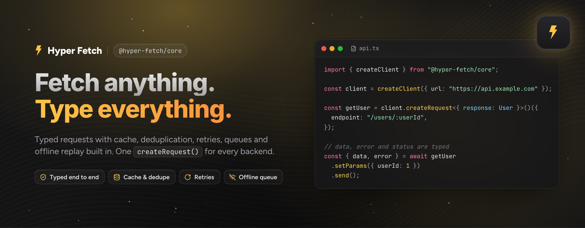

<p align="center">
  <a href="https://hyperfetch.bettertyped.com/docs/core/overview"></a>
</p>

<p align="center">
  <a href="https://hyperfetch.bettertyped.com/docs/getting-started/quick-start"><b>Quick Start</b></a> ·
  <a href="https://hyperfetch.bettertyped.com/docs/core/overview">Documentation</a> ·
  <a href="https://hyperfetch.bettertyped.com/docs/api/core/Classes/Client">API Reference</a> ·
  <a href="https://github.com/BetterTyped/hyper-fetch">GitHub</a> ·
  <a href="https://discord.gg/7upC2kVmyM">Discord</a>
</p>

<p align="center">
  <a href="https://github.com/BetterTyped/hyper-fetch"></a>
  <a href="https://www.npmjs.com/package/@hyper-fetch/core"></a>
  <a href="https://www.npmjs.com/package/@hyper-fetch/core"></a>
  <a href="https://bundlejs.com/?q=@hyper-fetch/core"></a>
  <a href="https://github.com/BetterTyped/hyper-fetch"></a>
  <a href="https://github.com/BetterTyped/hyper-fetch/blob/main/License.md"></a>
</p>

## 📖 About

`@hyper-fetch/core` is the foundation of Hyper Fetch. Every API call is a typed, immutable request with cache,
deduplication, queues, retries and offline replay built in. It runs in the browser, Node.js and Bun, and every adapter
in the ecosystem (GraphQL, tRPC, oRPC, Firebase, Axios) plugs into the same `createRequest()`.

## 🎯 Key Capabilities

- 🔮 **Zero guesswork** - Params, payload, query params, response and error are typed on every request. No `any`
- 🧭 **URL params checked at compile time** - `/users/:userId` makes `userId` required. A typo fails the build
- 💾 **Stop re-fetching what you have** - Cache with stale time, invalidation and persistence through `lazyStorage`
- 🚫 **No duplicate calls** - Identical requests in flight share one response
- 🔁 **Failed requests retry themselves** - Attempts and delay per request with `setRetry()` and `setRetryTime()`
- 📴 **Works offline** - Requests sent offline wait in the queue and replay when the connection returns
- 🎯 **Cancel anything** - Abort one request or a whole group that shares an abort key
- ⏱️ **Progress you can show** - Upload and download progress events with time estimates
- 🧪 **Mocks without a server** - `setMock()` returns your data and status with no network call
- 🔌 **One API for every backend** - Swap the adapter for GraphQL, tRPC, oRPC, Firebase or Axios and keep your requests

## 🚀 Quick Start

```bash
npm install @hyper-fetch/core
```

```ts
import { createClient } from "@hyper-fetch/core";

// One client per API. Every request inherits its base URL
const client = createClient({ url: "https://api.example.com" });

// :userId becomes a required, typed param
const getUser = client.createRequest<{ response: { id: number; name: string } }>()({
  endpoint: "/users/:userId",
  method: "GET",
});

// send() never throws. data, error and status are typed
const { data, error, status } = await getUser.setParams({ userId: 1 }).send();
```

Have an OpenAPI schema? Generate every request at once with
[`@hyper-fetch/cli`](https://github.com/BetterTyped/hyper-fetch/tree/main/packages/cli).

## 📚 Documentation

- **[Quick Start](https://hyperfetch.bettertyped.com/docs/getting-started/quick-start)** - Install and send your first typed request
- **[Client](https://hyperfetch.bettertyped.com/docs/core/client)** - Base URL, interceptors, auth and global error types
- **[Request](https://hyperfetch.bettertyped.com/docs/core/request)** - Params, payload, query params, retries and keys
- **[Cache](https://hyperfetch.bettertyped.com/docs/core/cache)** - Stale time, invalidation and persistent storage
- **[SDK](https://hyperfetch.bettertyped.com/docs/core/sdk)** - Typed request trees from a schema or a backend type
- **[Mocking](https://hyperfetch.bettertyped.com/docs/core/mocking)** - Fake responses for tests, stories and demos
- **[Guides](https://hyperfetch.bettertyped.com/docs/guides/core/basics/setup)** - Auth, error handling, offline, persistence and more
- **[API Reference](https://hyperfetch.bettertyped.com/docs/api/core/Classes/Client)** - Every class, function and type

## 💡 Examples

### Params, payload and query params

```ts
interface User {
  id: number;
  name: string;
  email: string;
}

const createUser = client.createRequest<{
  response: User;
  payload: { name: string; email: string };
}>()({
  endpoint: "/teams/:teamId/users",
  method: "POST",
});

const listUsers = client.createRequest<{
  response: User[];
  queryParams: { page?: number; search?: string };
}>()({
  endpoint: "/users",
  method: "GET",
});

// params go in the URL, the payload in the body. Both are checked
await createUser.send({ params: { teamId: 1 }, payload: { name: "Jane", email: "jane@example.com" } });

// GET /users?page=2&search=jane
await listUsers.send({ queryParams: { page: 2, search: "jane" } });
```

### Auth for every request

```ts
const client = createClient<{ error: ApiError | Error }>({ url: "https://api.example.com" }).onAuth((request) => {
  const token = tokenStore.get();
  return token ? request.setHeaders({ ...request.headers, Authorization: `Bearer ${token}` }) : request;
});
```

`onAuth` runs before every request that has `auth` enabled, which is the default. Mark public endpoints with
`auth: false`.

### Retries and caching per request

```ts
const getDashboard = client
  .createRequest<{ response: Dashboard }>()({ endpoint: "/dashboard" })
  .setRetry(3) // try 3 more times when it fails
  .setRetryTime(1000) // wait 1s between attempts
  .setStaleTime(30_000) // cached data counts as fresh for 30s
  .setDeduplicate(true); // concurrent calls share one response
```

### Errors come back in the response

```ts
const { data, error, status, success } = await getUser.setParams({ userId: 1 }).send();

if (!success) {
  // error is typed from the client and request error generics
  reportError(status, error);
}
```

### Mock a request

```ts
const mocked = getUser.setMock(() => ({ data: { id: 1, name: "Jane" }, status: 200 }));

// resolves with the mock, no network call
const { data } = await mocked.setParams({ userId: 1 }).send();
```

### Progress and lifecycle callbacks

```ts
await uploadAvatar.send({
  payload: formData,
  onRequestStart: ({ requestId }) => console.log(`Request ${requestId} started`),
  onUploadProgress: ({ progress, timeLeft }) => setUpload({ progress, timeLeft }),
  onResponse: ({ response }) => console.log("Done with", response.status),
});
```

## 🧩 Hyper Fetch Ecosystem

One typed client for every backend. Swap the adapter and keep the same `createRequest()` everywhere.

<table align="center">
  <tr>
    <td align="center" width="110"><a href="https://github.com/BetterTyped/hyper-fetch/tree/main/packages/core"><br /><sub><b>Core</b></sub></a></td>
    <td align="center" width="110"><a href="https://github.com/BetterTyped/hyper-fetch/tree/main/packages/react"><br /><sub><b>React</b></sub></a></td>
    <td align="center" width="110"><a href="https://github.com/BetterTyped/hyper-fetch/tree/main/packages/sockets"><br /><sub><b>Sockets</b></sub></a></td>
    <td align="center" width="110"><a href="https://github.com/BetterTyped/hyper-fetch/tree/main/packages/db"><br /><sub><b>DB</b></sub></a></td>
    <td align="center" width="110"><a href="https://github.com/BetterTyped/hyper-fetch/tree/main/packages/cli"><br /><sub><b>OpenAPI CLI</b></sub></a></td>
    <td align="center" width="110"><a href="https://github.com/BetterTyped/hyper-fetch/tree/main/packages/adapter-graphql"><br /><sub><b>GraphQL</b></sub></a></td>
    <td align="center" width="110"><a href="https://github.com/BetterTyped/hyper-fetch/tree/main/packages/adapter-trpc"><br /><sub><b>tRPC</b></sub></a></td>
  </tr>
  <tr>
    <td align="center" width="110"><a href="https://github.com/BetterTyped/hyper-fetch/tree/main/packages/adapter-orpc"><picture><source media="(prefers-color-scheme: dark)" srcset="https://raw.githubusercontent.com/BetterTyped/hyper-fetch/main/documentation/static/img/integration-orpc-dark.svg" /></picture><br /><sub><b>oRPC</b></sub></a></td>
    <td align="center" width="110"><a href="https://github.com/BetterTyped/hyper-fetch/tree/main/packages/hono"><br /><sub><b>Hono</b></sub></a></td>
    <td align="center" width="110"><a href="https://github.com/BetterTyped/hyper-fetch/tree/main/packages/elysia"><br /><sub><b>Elysia</b></sub></a></td>
    <td align="center" width="110"><a href="https://github.com/BetterTyped/hyper-fetch/tree/main/packages/adapter-firebase"><br /><sub><b>Firebase</b></sub></a></td>
    <td align="center" width="110"><a href="https://github.com/BetterTyped/hyper-fetch/tree/main/packages/adapter-axios"><br /><sub><b>Axios</b></sub></a></td>
    <td align="center" width="110"><a href="https://github.com/BetterTyped/hyper-fetch/tree/main/packages/hyper-flow"><br /><sub><b>HyperFlow</b></sub></a></td>
  </tr>
</table>

## 💖 Sponsors

<p align="center">
  <a href="https://github.com/sponsors/prc5">
    
  </a>
</p>

## License

[Apache-2.0](https://github.com/BetterTyped/hyper-fetch/blob/main/License.md)
