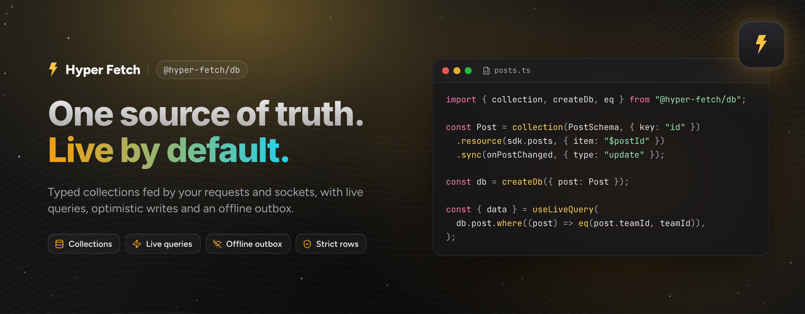

<p align="center">
  <a href="https://hyperfetch.bettertyped.com/docs/db/overview"></a>
</p>

<p align="center">
  <a href="https://hyperfetch.bettertyped.com/docs/db/quick-start"><b>Quick Start</b></a> ·
  <a href="https://hyperfetch.bettertyped.com/docs/db/overview">Documentation</a> ·
  <a href="https://hyperfetch.bettertyped.com/docs/api/db/Functions/createDb">API Reference</a> ·
  <a href="https://github.com/BetterTyped/hyper-fetch">GitHub</a> ·
  <a href="https://discord.gg/7upC2kVmyM">Discord</a>
</p>

<p align="center">
  <a href="https://github.com/BetterTyped/hyper-fetch"></a>
  <a href="https://www.npmjs.com/package/@hyper-fetch/db"></a>
  <a href="https://www.npmjs.com/package/@hyper-fetch/db"></a>
  <a href="https://bundlejs.com/?q=@hyper-fetch/db"></a>
  <a href="https://github.com/BetterTyped/hyper-fetch"></a>
  <a href="https://standardschema.dev"></a>
  <a href="https://github.com/BetterTyped/hyper-fetch/blob/main/License.md"></a>
</p>

## 📖 About

`@hyper-fetch/db` keeps your data in typed collections, one row per record, fed by the requests and socket listeners you
already have. Components query collections instead of endpoints, and every mutation, socket event or ingested response
updates each query that shows the row. It is for apps where the same data appears in several views, changes from several
places, or has to work offline.

## 🎯 Key Capabilities

- 🧭 **Query data, not endpoints** - `db.post.where(...)` picks the loader, sends what the backend serves, filters the
  rest
- 🔁 **One write, every view** - Mutations, socket events and ingested responses update every live query at once
- 🛡️ **Rows that never lie** - A loader, sync or mutation whose rows don't match the schema does not compile
- ⚡ **Optimistic without rollback code** - Writes show instantly and revert exactly what they changed on failure
- 🕰️ **Late responses can't win** - Writes are ordered per field, by `version` or by when the request was sent
- 📶 **Offline outbox** - Writes persist, replay in order with idempotency ids, and one tab replays for all
- 🧩 **REST resources in one line** - `.resource(sdk.posts, { item: "$postId" })` derives loaders and mutations
- 🔗 **Related data** - Links keep a post and its summary in step, `normalize` stores nested records, joins batch-load
  them
- 🔥 **Firestore in one call** - `firestoreCollection` from `@hyper-fetch/firebase/db` maps queries and stays live
- ♾️ **Infinite lists that stay live** - `useLiveInfiniteQuery` pages over held rows and loads backend pages on demand
- 🧾 **Transactions** - `db.transaction` keeps or reverts several writes together, as one request or in order
- 🖥️ **Server rendering** - `db.dehydrate()` on the server, `createDb(collections, { state })` and `DbProvider` on the
  client
- 🔬 **Inspect it in HyperFlow** - `DevtoolsPlugin({ dbs: [db] })` shows collections, plans, subsets and the outbox
- 🔍 **No hidden magic** - `query.explain()` shows the loader, what is sent, what runs locally and which syncs apply
- ⚛️ **React ready** - `useLiveQuery` from `@hyper-fetch/react`, no dependency arrays

## 🚀 Quick Start

```bash
npm install @hyper-fetch/core @hyper-fetch/sockets @hyper-fetch/db
```

```ts
import { collection, createDb, eq } from "@hyper-fetch/db";

const Post = collection(PostSchema, { key: "id", version: "updatedAt" })
  .load(getTeamPosts, { where: { teamId: { eq: (teamId) => ({ params: { teamId } }), required: true } } })
  .load(getPost, { byKey: (id) => ({ params: { postId: id } }) })
  .sync(onPostChanged, { type: "update" })
  .mutate({
    update: { request: updatePost, map: (key, changes) => ({ params: { postId: key }, payload: changes }) },
  });

export const db = createDb({ post: Post });

const posts = db.post.where((post) => eq(post.teamId, 1)).orderBy((post) => post.createdAt, "desc");
const unsubscribe = posts.subscribe(() => render(posts.getSnapshot().data));

db.post.update(1, { title: "Renamed" }); // every query showing post 1 updates at once
```

## 📚 Documentation

- **[Overview](https://hyperfetch.bettertyped.com/docs/db/overview)** - Collections, loaders, syncs and live queries
- **[Quick Start](https://hyperfetch.bettertyped.com/docs/db/quick-start)** - From a request to a live query
- **[Related Data](https://hyperfetch.bettertyped.com/docs/db/related-data)** - Links, normalizing and joins
- **[Firestore](https://hyperfetch.bettertyped.com/docs/db/firestore)** - A whole collection from one call
- **[Server Rendering](https://hyperfetch.bettertyped.com/docs/db/server-rendering)** - A db per request, hydrated on
  the client
- **[Transactions](https://hyperfetch.bettertyped.com/docs/db/transactions)** - Several writes kept or reverted together
- **[useLiveInfiniteQuery](https://hyperfetch.bettertyped.com/docs/react/db/use-live-infinite-query)** - Live infinite
  lists
- **[API Reference](https://hyperfetch.bettertyped.com/docs/api/db/Functions/createDb)** - Every function and type

## 💡 Examples

### List and detail without stale copies

A list that returns summaries is its own collection. The detail header renders from the summary at once, the body waits
for the full post, and one listener keeps both current.

```ts
const PostSummary = collection(PostSummarySchema, { key: "id" })
  .load(getTeamPosts, { where: { teamId: { eq: (teamId) => ({ params: { teamId } }), required: true } } })
  .sync(onPostChanged, { type: "update", row: ({ body, ...changes }) => changes });

const Post = collection(PostSchema, { key: "id" })
  .load(getPost, { byKey: (id) => ({ params: { postId: id } }) })
  .sync(onPostChanged, { type: "update" });

const db = createDb({ post: Post, postSummary: PostSummary });

const header = useLiveQuery(db.postSummary.findOne(postId).local());
const body = useLiveQuery(db.post.findOne(postId));
```

### Joined authors in one request

```ts
const db = createDb({ postSummary: PostSummary, user: User }); // User loads with `byKeys`

const { data } = useLiveQuery(
  db.postSummary.where((post) => eq(post.teamId, teamId)).join("author", db.user, (post) => post.authorId),
);
// data?.[0].author: User | undefined
```

### Paginated lists

```ts
const Feed = collection(PostSchema, { key: "id" }).load(getFeed, {
  rows: (response) => response.items,
  cursor: (response) => response.next,
  page: (cursor) => ({ queryParams: { cursor } }),
  orderBy: { createdAt: (direction) => ({ queryParams: { sort: `createdAt:${direction}` } }) },
});

const { data, hasNextPage, fetchNextPage } = useLiveQuery(db.feed.orderBy((post) => post.createdAt, "desc"));
```

### Offline writes

```ts
const db = createDb(
  { post: Post },
  { offline: true, persistence: { storage: localStorage, scope: user.id, version: 1 } },
);

const created = db.post.insert(draft);
db.comment.insert(comment, { dependsOn: [created] }); // dropped if the post is rejected
```

## 🧩 Hyper Fetch Ecosystem

One typed client for every backend. Swap the adapter and keep the same `createRequest()` everywhere.

<table align="center">
  <tr>
    <td align="center" width="110"><a href="https://github.com/BetterTyped/hyper-fetch/tree/main/packages/core"><br /><sub><b>Core</b></sub></a></td>
    <td align="center" width="110"><a href="https://github.com/BetterTyped/hyper-fetch/tree/main/packages/react"><br /><sub><b>React</b></sub></a></td>
    <td align="center" width="110"><a href="https://github.com/BetterTyped/hyper-fetch/tree/main/packages/sockets"><br /><sub><b>Sockets</b></sub></a></td>
    <td align="center" width="110"><a href="https://github.com/BetterTyped/hyper-fetch/tree/main/packages/db"><br /><sub><b>DB</b></sub></a></td>
    <td align="center" width="110"><a href="https://github.com/BetterTyped/hyper-fetch/tree/main/packages/cli"><br /><sub><b>OpenAPI CLI</b></sub></a></td>
    <td align="center" width="110"><a href="https://github.com/BetterTyped/hyper-fetch/tree/main/packages/adapter-graphql"><br /><sub><b>GraphQL</b></sub></a></td>
    <td align="center" width="110"><a href="https://github.com/BetterTyped/hyper-fetch/tree/main/packages/adapter-trpc"><br /><sub><b>tRPC</b></sub></a></td>
  </tr>
  <tr>
    <td align="center" width="110"><a href="https://github.com/BetterTyped/hyper-fetch/tree/main/packages/adapter-orpc"><picture><source media="(prefers-color-scheme: dark)" srcset="https://raw.githubusercontent.com/BetterTyped/hyper-fetch/main/documentation/static/img/integration-orpc-dark.svg" /></picture><br /><sub><b>oRPC</b></sub></a></td>
    <td align="center" width="110"><a href="https://github.com/BetterTyped/hyper-fetch/tree/main/packages/hono"><br /><sub><b>Hono</b></sub></a></td>
    <td align="center" width="110"><a href="https://github.com/BetterTyped/hyper-fetch/tree/main/packages/elysia"><br /><sub><b>Elysia</b></sub></a></td>
    <td align="center" width="110"><a href="https://github.com/BetterTyped/hyper-fetch/tree/main/packages/adapter-firebase"><br /><sub><b>Firebase</b></sub></a></td>
    <td align="center" width="110"><a href="https://github.com/BetterTyped/hyper-fetch/tree/main/packages/adapter-axios"><br /><sub><b>Axios</b></sub></a></td>
    <td align="center" width="110"><a href="https://github.com/BetterTyped/hyper-fetch/tree/main/packages/hyper-flow"><br /><sub><b>HyperFlow</b></sub></a></td>
  </tr>
</table>

## 💖 Sponsors

<p align="center">
  <a href="https://github.com/sponsors/prc5">
    
  </a>
</p>

## License

[Apache-2.0](https://github.com/BetterTyped/hyper-fetch/blob/main/License.md)
