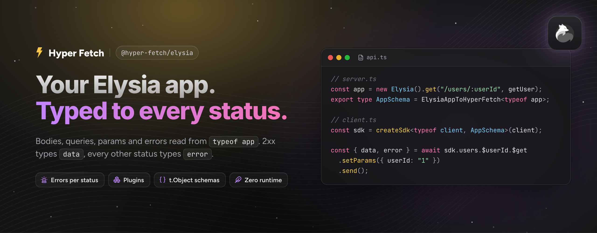

<p align="center">
  <a href="https://hyperfetch.bettertyped.com/docs/integrations/elysia/overview"></a>
</p>

<p align="center">
  <a href="https://hyperfetch.bettertyped.com/docs/integrations/elysia/overview"><b>Quick Start</b></a> ·
  <a href="https://hyperfetch.bettertyped.com/docs/integrations/elysia/overview">Documentation</a> ·
  <a href="https://hyperfetch.bettertyped.com/docs/api/elysia/Types/ElysiaAppToHyperFetch">API Reference</a> ·
  <a href="https://github.com/BetterTyped/hyper-fetch">GitHub</a> ·
  <a href="https://discord.gg/7upC2kVmyM">Discord</a>
</p>

<p align="center">
  <a href="https://github.com/BetterTyped/hyper-fetch"></a>
  <a href="https://www.npmjs.com/package/@hyper-fetch/elysia"></a>
  <a href="https://www.npmjs.com/package/@hyper-fetch/elysia"></a>
  <a href="https://bundlejs.com/?q=@hyper-fetch/elysia"></a>
  <a href="https://github.com/BetterTyped/hyper-fetch"></a>
  <a href="https://hyperfetch.bettertyped.com/docs/integrations/elysia/overview"></a>
  <a href="https://github.com/BetterTyped/hyper-fetch/blob/main/License.md"></a>
</p>

## 📖 About

`@hyper-fetch/elysia` turns the type of an Elysia app into a Hyper Fetch SDK schema. Your frontend calls the backend
through `createSdk` with response, error, payload, query and param types read straight from your Elysia routes and
schemas. It ships types only, so nothing from your server ends up in the client bundle.

## 🎯 Key Capabilities

- 🔗 **Backend types, frontend calls** - Change an Elysia route and every SDK call that uses it fails to compile
- 🧭 **Paths become properties** - `/users/:userId/posts` is `sdk.users.$userId.posts.$get`, with typed `setParams()`
- 🛂 **Schemas drive the inputs** - `body` and `query` schemas type `setPayload()` and `setQueryParams()`
- 🚦 **Typed errors per status** - 2xx bodies type `data`. Every other status, `422` validation errors included, types `error`
- 📡 **Types match the wire** - Dates arrive as strings, file bodies are `FormData` and streams stay `unknown`
- 🧩 **Plugins included** - `prefix`, `.group()`, `.guard()`, `.model()` and macros land in the endpoint and the types
- 🪶 **Zero runtime** - A single type export, so it adds no code to your bundle
- ⚡ **Every HyperFetch feature** - Cache, retries, deduplication, offline replay and React hooks on every route

## 🚀 Quick Start

```bash
npm install @hyper-fetch/core @hyper-fetch/elysia
```

```ts
// backend
import { Elysia } from "elysia";
import type { ElysiaAppToHyperFetch } from "@hyper-fetch/elysia";

const app = new Elysia().get("/users/:userId", ({ params }) => ({ id: params.userId, name: "Ann" }));

export type AppSchema = ElysiaAppToHyperFetch<typeof app>;
```

```ts
// frontend
import { createClient, createSdk } from "@hyper-fetch/core";
import type { AppSchema } from "@my-app/backend";

const client = createClient({ url: "https://api.example.com" });
const sdk = createSdk<typeof client, AppSchema>(client);

const { data } = await sdk.users.$userId.$get.setParams({ userId: "1" }).send();
```

## 📚 Documentation

- **[Elysia Integration](https://hyperfetch.bettertyped.com/docs/integrations/elysia/overview)** - Setup, schemas, errors and plugins
- **[SDK](https://hyperfetch.bettertyped.com/docs/core/sdk)** - How `createSdk` turns a schema into requests
- **[Getting Started](https://hyperfetch.bettertyped.com/docs/getting-started/quick-start)** - The core request API
- **[API Reference](https://hyperfetch.bettertyped.com/docs/api/elysia/Types/ElysiaAppToHyperFetch)** - Every exported type

## 💡 Examples

### Plugins with schemas and error statuses

```ts
import { Elysia, t } from "elysia";
import type { ElysiaAppToHyperFetch } from "@hyper-fetch/elysia";

const users = new Elysia({ prefix: "/users" })
  .post("/", ({ body, status }) => status(201, { id: "2", name: body.name }), {
    body: t.Object({ name: t.String() }),
  })
  .get("/:userId", ({ params, status }) =>
    params.userId === "missing" ? status(404, { message: "User not found" }) : { id: params.userId, name: "Ann" },
  );

const auth = new Elysia({ prefix: "/auth" }).get("/google-login", () => ({ authUrl: "https://accounts.example.com" }));

const app = new Elysia().use(users).use(auth);

export type AppSchema = ElysiaAppToHyperFetch<typeof app>;
```

```ts
const sdk = createSdk<typeof client, AppSchema>(client);

// the payload is typed by t.Object({ name: t.String() })
await sdk.users.$post.setPayload({ name: "Bob" }).send();

const { data, error } = await sdk.users.$userId.$get.setParams({ userId: "missing" }).send();
// data: { id: string; name: string } | null, error: { message: "User not found" } | ...

// kebab-case paths become camelCase properties: GET /auth/google-login
await sdk.auth.googleLogin.$get.send();
```

### React hooks on an Elysia route

```tsx
import { useFetch } from "@hyper-fetch/react";

import { sdk } from "./api";

export const UserName = ({ userId }: { userId: string }) => {
  const { data, error, loading } = useFetch(sdk.users.$userId.$get.setParams({ userId }));

  if (loading) return <Spinner />;
  if (error) return <p>Could not load the user</p>;
  return <p>{data?.name}</p>;
};
```

## 🧩 Hyper Fetch Ecosystem

One typed client for every backend. Swap the adapter and keep the same `createRequest()` everywhere.

<table align="center">
  <tr>
    <td align="center" width="110"><a href="https://github.com/BetterTyped/hyper-fetch/tree/main/packages/core"><br /><sub><b>Core</b></sub></a></td>
    <td align="center" width="110"><a href="https://github.com/BetterTyped/hyper-fetch/tree/main/packages/react"><br /><sub><b>React</b></sub></a></td>
    <td align="center" width="110"><a href="https://github.com/BetterTyped/hyper-fetch/tree/main/packages/sockets"><br /><sub><b>Sockets</b></sub></a></td>
    <td align="center" width="110"><a href="https://github.com/BetterTyped/hyper-fetch/tree/main/packages/cli"><br /><sub><b>OpenAPI CLI</b></sub></a></td>
    <td align="center" width="110"><a href="https://github.com/BetterTyped/hyper-fetch/tree/main/packages/adapter-graphql"><br /><sub><b>GraphQL</b></sub></a></td>
    <td align="center" width="110"><a href="https://github.com/BetterTyped/hyper-fetch/tree/main/packages/adapter-trpc"><br /><sub><b>tRPC</b></sub></a></td>
  </tr>
  <tr>
    <td align="center" width="110"><a href="https://github.com/BetterTyped/hyper-fetch/tree/main/packages/adapter-orpc"><picture><source media="(prefers-color-scheme: dark)" srcset="https://raw.githubusercontent.com/BetterTyped/hyper-fetch/main/documentation/static/img/integration-orpc-dark.svg" /></picture><br /><sub><b>oRPC</b></sub></a></td>
    <td align="center" width="110"><a href="https://github.com/BetterTyped/hyper-fetch/tree/main/packages/hono"><br /><sub><b>Hono</b></sub></a></td>
    <td align="center" width="110"><a href="https://github.com/BetterTyped/hyper-fetch/tree/main/packages/elysia"><br /><sub><b>Elysia</b></sub></a></td>
    <td align="center" width="110"><a href="https://github.com/BetterTyped/hyper-fetch/tree/main/packages/adapter-firebase"><br /><sub><b>Firebase</b></sub></a></td>
    <td align="center" width="110"><a href="https://github.com/BetterTyped/hyper-fetch/tree/main/packages/adapter-axios"><br /><sub><b>Axios</b></sub></a></td>
    <td align="center" width="110"><a href="https://github.com/BetterTyped/hyper-fetch/tree/main/packages/hyper-flow"><br /><sub><b>HyperFlow</b></sub></a></td>
  </tr>
</table>

## 💖 Sponsors

<p align="center">
  <a href="https://github.com/sponsors/prc5">
    
  </a>
</p>

## License

[Apache-2.0](https://github.com/BetterTyped/hyper-fetch/blob/main/License.md)
