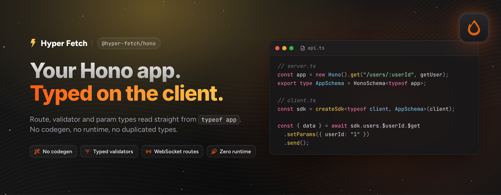

<p align="center">
  <a href="https://hyperfetch.bettertyped.com/docs/integrations/hono/overview"></a>
</p>

<p align="center">
  <a href="https://hyperfetch.bettertyped.com/docs/integrations/hono/overview"><b>Quick Start</b></a> ·
  <a href="https://hyperfetch.bettertyped.com/docs/integrations/hono/overview">Documentation</a> ·
  <a href="https://hyperfetch.bettertyped.com/docs/api/hono/Types/HonoSchema">API Reference</a> ·
  <a href="https://github.com/BetterTyped/hyper-fetch">GitHub</a> ·
  <a href="https://discord.gg/7upC2kVmyM">Discord</a>
</p>

<p align="center">
  <a href="https://github.com/BetterTyped/hyper-fetch"></a>
  <a href="https://www.npmjs.com/package/@hyper-fetch/hono"></a>
  <a href="https://www.npmjs.com/package/@hyper-fetch/hono"></a>
  <a href="https://bundlejs.com/?q=@hyper-fetch/hono"></a>
  <a href="https://github.com/BetterTyped/hyper-fetch"></a>
  <a href="https://hyperfetch.bettertyped.com/docs/integrations/hono/overview"></a>
  <a href="https://github.com/BetterTyped/hyper-fetch/blob/main/License.md"></a>
</p>

## 📖 About

`@hyper-fetch/hono` turns the type of a Hono app into a Hyper Fetch SDK schema. Your frontend calls the backend
through `createSdk` with response, payload, query and param types read straight from your Hono routes and validators,
and its sockets connect to `upgradeWebSocket()` and `streamSSE()` routes at type-checked paths. It ships types only, so
nothing from your server ends up in the client bundle.

## 🎯 Key Capabilities

- 🔗 **Backend types, frontend calls** - Change a Hono route and every SDK call that uses it fails to compile
- 🧭 **Paths become properties** - `/users/:userId/posts` is `sdk.users.$userId.posts.$get`, with typed `setParams()`
- 🛂 **Validators drive the payload** - `json` and `query` validators type `setPayload()` and `setQueryParams()`
- 🧩 **Mounted routers included** - `app.route()` and `basePath()` prefixes land in the endpoint and the nesting
- 🧷 **Every path shape** - Optional `:id?` and regex `:id{[0-9]+}` params, `.all()` and `app.on()` get typed accessors
- 📡 **Realtime routes too** - `HonoSocketPath` rejects socket URLs that match no `upgradeWebSocket()` route
- 🚫 **No fake requests** - WebSocket routes stay out of the HTTP SDK, so nobody calls `send()` on them
- 🪶 **Zero runtime** - Type exports only, so it adds no code to your bundle
- ⚡ **Every HyperFetch feature** - Cache, retries, deduplication, offline replay and React hooks on every route

## 🚀 Quick Start

```bash
npm install @hyper-fetch/core @hyper-fetch/hono
```

```ts
// backend
import { Hono } from "hono";
import type { HonoSchema } from "@hyper-fetch/hono";

const app = new Hono().get("/users/:userId", (c) => c.json({ id: c.req.param("userId"), name: "Ann" }));

export type AppSchema = HonoSchema<typeof app>;
```

```ts
// frontend
import { createClient, createSdk } from "@hyper-fetch/core";
import type { AppSchema } from "@my-app/backend";

const client = createClient({ url: "https://api.example.com" });
const sdk = createSdk<typeof client, AppSchema>(client);

// data is { id: string; name: string } | null
const { data } = await sdk.users.$userId.$get.setParams({ userId: "1" }).send();
```

## 📚 Documentation

- **[Hono Integration](https://hyperfetch.bettertyped.com/docs/integrations/hono/overview)** - Setup, routes, validators and path shapes
- **[Hono Realtime](https://hyperfetch.bettertyped.com/docs/integrations/hono/realtime)** - WebSocket and Server-Sent Events routes
- **[SDK](https://hyperfetch.bettertyped.com/docs/core/sdk)** - How `createSdk` turns a schema into requests
- **[API Reference](https://hyperfetch.bettertyped.com/docs/api/hono/Types/HonoSchema)** - Every exported type

## 💡 Examples

### Mounted routers with validators

```ts
import { Hono } from "hono";
import { validator } from "hono/validator";
import type { HonoSchema } from "@hyper-fetch/hono";

const users = new Hono()
  .get("/", (c) => c.json([{ id: "1", name: "Ann" }]))
  .post(
    "/",
    validator("json", (value: { name: string }) => value),
    (c) => c.json({ id: "2", name: c.req.valid("json").name }, 201),
  );

const auth = new Hono().get("/google-login", (c) => c.json({ authUrl: "https://accounts.example.com" }));

const app = new Hono().route("/users", users).route("/auth", auth);

export type AppSchema = HonoSchema<typeof app>;
```

```ts
const sdk = createSdk<typeof client, AppSchema>(client);

// the payload is typed by the json validator
await sdk.users.$post.setPayload({ name: "Bob" }).send();

// kebab-case paths become camelCase properties: GET /auth/google-login
await sdk.auth.googleLogin.$get.send();
```

### React hooks on a Hono route

```tsx
import { useFetch } from "@hyper-fetch/react";

import { sdk } from "./api";

export const UserName = ({ userId }: { userId: string }) => {
  const { data, loading } = useFetch(sdk.users.$userId.$get.setParams({ userId }));

  if (loading) return <Spinner />;
  return <p>{data?.name}</p>;
};
```

### WebSocket routes with a typed socket SDK

```ts
// backend
import { createNodeWebSocket } from "@hono/node-ws";
import type { ListenerModel } from "@hyper-fetch/sockets";

const base = new Hono();
const { upgradeWebSocket } = createNodeWebSocket({ app: base }); // plus injectWebSocket(server) on Node

const app = base.get(
  "/chat/:roomId",
  upgradeWebSocket((c) => ({
    onOpen: (_event, ws) => ws.send(JSON.stringify({ topic: "message", data: { text: "Welcome" } })),
  })),
);

export type AppType = typeof app;
export type ChatSchema = { message: { $listener: ListenerModel<{ response: { text: string }; topic: "message" }> } };
```

```ts
// frontend
import { createSocketSdk, Socket } from "@hyper-fetch/sockets";
import type { HonoSocketPath } from "@hyper-fetch/hono";

const path: HonoSocketPath<AppType> = `/chat/${roomId}`; // "/rooms/1" would not compile
const socket = new Socket({ url: `wss://api.example.com${path}` });
const chat = createSocketSdk<typeof socket, ChatSchema>(socket);

chat.message.$listener.listen(({ data }) => console.log(data.text));
```

### Server-Sent Events with named events

```ts
// backend: named events reach the listeners of that event name, JSON data is parsed
app.get("/events", (c) =>
  streamSSE(c, async (stream) => {
    await stream.writeSSE({ id: "1", event: "tick", data: JSON.stringify({ symbol: "BTC", price: 100 }) });
  }),
);
```

```ts
// frontend: Node has no global EventSource, so pass the `eventsource` package there
import { EventSource } from "eventsource";
import { ServerSentEventsAdapter, Socket } from "@hyper-fetch/sockets";

const events = new Socket({
  url: "http://localhost:3000/events",
  adapter: ServerSentEventsAdapter(),
  adapterOptions: { EventSource },
});

events
  .createListener<{ symbol: string; price: number }>()({ topic: "tick" })
  .listen(({ data }) => console.log(data.price));
```

## 🧩 Hyper Fetch Ecosystem

One typed client for every backend. Swap the adapter and keep the same `createRequest()` everywhere.

<table align="center">
  <tr>
    <td align="center" width="110"><a href="https://github.com/BetterTyped/hyper-fetch/tree/main/packages/core"><br /><sub><b>Core</b></sub></a></td>
    <td align="center" width="110"><a href="https://github.com/BetterTyped/hyper-fetch/tree/main/packages/react"><br /><sub><b>React</b></sub></a></td>
    <td align="center" width="110"><a href="https://github.com/BetterTyped/hyper-fetch/tree/main/packages/sockets"><br /><sub><b>Sockets</b></sub></a></td>
    <td align="center" width="110"><a href="https://github.com/BetterTyped/hyper-fetch/tree/main/packages/cli"><br /><sub><b>OpenAPI CLI</b></sub></a></td>
    <td align="center" width="110"><a href="https://github.com/BetterTyped/hyper-fetch/tree/main/packages/adapter-graphql"><br /><sub><b>GraphQL</b></sub></a></td>
    <td align="center" width="110"><a href="https://github.com/BetterTyped/hyper-fetch/tree/main/packages/adapter-trpc"><br /><sub><b>tRPC</b></sub></a></td>
  </tr>
  <tr>
    <td align="center" width="110"><a href="https://github.com/BetterTyped/hyper-fetch/tree/main/packages/adapter-orpc"><picture><source media="(prefers-color-scheme: dark)" srcset="https://raw.githubusercontent.com/BetterTyped/hyper-fetch/main/documentation/static/img/integration-orpc-dark.svg" /></picture><br /><sub><b>oRPC</b></sub></a></td>
    <td align="center" width="110"><a href="https://github.com/BetterTyped/hyper-fetch/tree/main/packages/hono"><br /><sub><b>Hono</b></sub></a></td>
    <td align="center" width="110"><a href="https://github.com/BetterTyped/hyper-fetch/tree/main/packages/elysia"><br /><sub><b>Elysia</b></sub></a></td>
    <td align="center" width="110"><a href="https://github.com/BetterTyped/hyper-fetch/tree/main/packages/adapter-firebase"><br /><sub><b>Firebase</b></sub></a></td>
    <td align="center" width="110"><a href="https://github.com/BetterTyped/hyper-fetch/tree/main/packages/adapter-axios"><br /><sub><b>Axios</b></sub></a></td>
    <td align="center" width="110"><a href="https://github.com/BetterTyped/hyper-fetch/tree/main/packages/hyper-flow"><br /><sub><b>HyperFlow</b></sub></a></td>
  </tr>
</table>

## 💖 Sponsors

<p align="center">
  <a href="https://github.com/sponsors/prc5">
    
  </a>
</p>

## License

[Apache-2.0](https://github.com/BetterTyped/hyper-fetch/blob/main/License.md)
