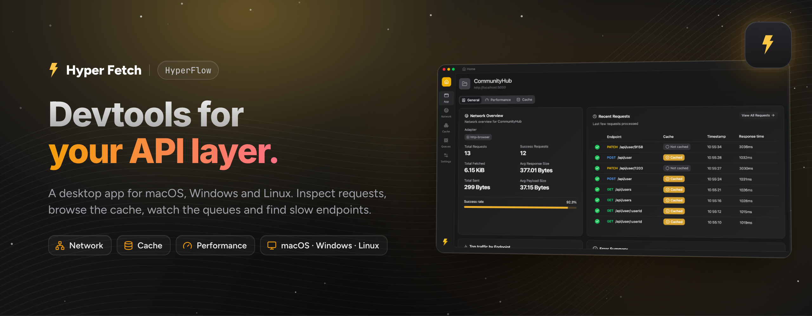

<p align="center">
  <a href="https://hyperfetch.bettertyped.com/docs/hyper-flow"></a>
</p>

<p align="center">
  <a href="https://hyperfetch.bettertyped.com/docs/hyper-flow/download"><b>Download</b></a> ·
  <a href="https://hyperfetch.bettertyped.com/docs/hyper-flow">Documentation</a> ·
  <a href="https://github.com/BetterTyped/hyper-fetch">GitHub</a> ·
  <a href="https://discord.gg/7upC2kVmyM">Discord</a>
</p>

<p align="center">
  <a href="https://github.com/BetterTyped/hyper-fetch"></a>
  <a href="https://hyperfetch.bettertyped.com/docs/hyper-flow/download"></a>
  <a href="https://github.com/BetterTyped/hyper-fetch/releases"></a>
  <a href="https://github.com/BetterTyped/hyper-fetch"></a>
  <a href="https://github.com/BetterTyped/hyper-fetch/blob/main/packages/hyper-flow/LICENSE.md"></a>
</p>

## 📖 About

HyperFlow is the desktop devtools app for Hyper Fetch, for macOS, Windows and Linux. It connects to your app through
[`@hyper-fetch/plugin-devtools`](https://github.com/BetterTyped/hyper-fetch/tree/main/packages/plugin-devtools) and
shows every request, cache entry, queue and socket in real time, so you can debug failures, inspect responses and find
slow endpoints without `console.log`. HyperFlow is in alpha.

## 🎯 Key Capabilities

- 🔮 **X-ray vision for your API layer** - Every request with its payload, response, headers, status and timing
- 🔎 **Find the request in seconds** - Search by endpoint, method or key, filter by success, failure, paused or canceled
- 💎 **Browse the cache** - Fresh or stale, observers, last update, and edits that your hooks pick up live
- 🚦 **Watch the queues** - Pending and in-flight requests per queue, with the history of what passed through
- 📡 **Read socket traffic** - Connection state, messages in and out, and errors for WebSocket and SSE
- 📊 **Spot slow endpoints** - A dashboard with success rates, cache efficiency and performance insights
- 🧭 **Every adapter** - fetch, Axios, GraphQL, tRPC, oRPC and Firebase, each tested end to end
- 🏷️ **All your apps in one window** - Each client shows up as its own connection

## 🚀 Quick Start

1. [Download HyperFlow](https://hyperfetch.bettertyped.com/docs/hyper-flow/download) and start it
2. Install the plugin in your app:

```bash
npm install -D @hyper-fetch/plugin-devtools @hyper-fetch/sockets
```

3. Connect your client in development:

```ts
if (process.env.NODE_ENV === "development") {
  void import("@hyper-fetch/plugin-devtools").then(({ DevtoolsPlugin }) => {
    client.addPlugin(DevtoolsPlugin({ appName: "My App" }));
  });
}
```

Run your app and its requests appear in HyperFlow.

## 📚 Documentation

- **[HyperFlow](https://hyperfetch.bettertyped.com/docs/hyper-flow)** - Overview of every inspector
- **[Download](https://hyperfetch.bettertyped.com/docs/hyper-flow/download)** - Builds for macOS, Windows and Linux
- **[Connecting](https://hyperfetch.bettertyped.com/docs/hyper-flow/connecting)** - Set up the devtools plugin
- **[Network Inspector](https://hyperfetch.bettertyped.com/docs/hyper-flow/features/network)** - Requests, search and filters
- **[Adapter compatibility](https://hyperfetch.bettertyped.com/docs/hyper-flow/compatibility)** - What works with each adapter

## 💡 Examples

### Debug a failed request

Open **Network**, filter by **Failed** and pick the request. You see the method, endpoint, params, payload, the error
the app received, the status and the time it took, in one view.

### Check what the cache holds

Open **Cache** to see every key, whether it is fresh or stale, how many components observe it and when it was last
updated. Edit or remove an entry and the mounted hooks re-render with the change.

### Follow a queue

Open **Queues** to watch requests enter and leave each queue. Paused and pending requests show up as soon as they are
queued, so offline replays and sequential uploads are easy to follow.

### Inspect sockets

Pass your sockets to the plugin and open **Sockets** to read every message in and out, with its topic and size.

```ts
client.addPlugin(DevtoolsPlugin({ appName: "My App", sockets: [socket] }));
```

## 🧩 Hyper Fetch Ecosystem

One typed client for every backend. Swap the adapter and keep the same `createRequest()` everywhere.

<table align="center">
  <tr>
    <td align="center" width="110"><a href="https://github.com/BetterTyped/hyper-fetch/tree/main/packages/core"><br /><sub><b>Core</b></sub></a></td>
    <td align="center" width="110"><a href="https://github.com/BetterTyped/hyper-fetch/tree/main/packages/react"><br /><sub><b>React</b></sub></a></td>
    <td align="center" width="110"><a href="https://github.com/BetterTyped/hyper-fetch/tree/main/packages/sockets"><br /><sub><b>Sockets</b></sub></a></td>
    <td align="center" width="110"><a href="https://github.com/BetterTyped/hyper-fetch/tree/main/packages/cli"><br /><sub><b>OpenAPI CLI</b></sub></a></td>
    <td align="center" width="110"><a href="https://github.com/BetterTyped/hyper-fetch/tree/main/packages/adapter-graphql"><br /><sub><b>GraphQL</b></sub></a></td>
    <td align="center" width="110"><a href="https://github.com/BetterTyped/hyper-fetch/tree/main/packages/adapter-trpc"><br /><sub><b>tRPC</b></sub></a></td>
  </tr>
  <tr>
    <td align="center" width="110"><a href="https://github.com/BetterTyped/hyper-fetch/tree/main/packages/adapter-orpc"><picture><source media="(prefers-color-scheme: dark)" srcset="https://raw.githubusercontent.com/BetterTyped/hyper-fetch/main/documentation/static/img/integration-orpc-dark.svg" /></picture><br /><sub><b>oRPC</b></sub></a></td>
    <td align="center" width="110"><a href="https://github.com/BetterTyped/hyper-fetch/tree/main/packages/hono"><br /><sub><b>Hono</b></sub></a></td>
    <td align="center" width="110"><a href="https://github.com/BetterTyped/hyper-fetch/tree/main/packages/elysia"><br /><sub><b>Elysia</b></sub></a></td>
    <td align="center" width="110"><a href="https://github.com/BetterTyped/hyper-fetch/tree/main/packages/adapter-firebase"><br /><sub><b>Firebase</b></sub></a></td>
    <td align="center" width="110"><a href="https://github.com/BetterTyped/hyper-fetch/tree/main/packages/adapter-axios"><br /><sub><b>Axios</b></sub></a></td>
    <td align="center" width="110"><a href="https://github.com/BetterTyped/hyper-fetch/tree/main/packages/hyper-flow"><br /><sub><b>HyperFlow</b></sub></a></td>
  </tr>
</table>

## 💖 Sponsors

<p align="center">
  <a href="https://github.com/sponsors/prc5">
    
  </a>
</p>

## License

[GPL-3.0-or-later](https://github.com/BetterTyped/hyper-fetch/blob/main/packages/hyper-flow/LICENSE.md)
