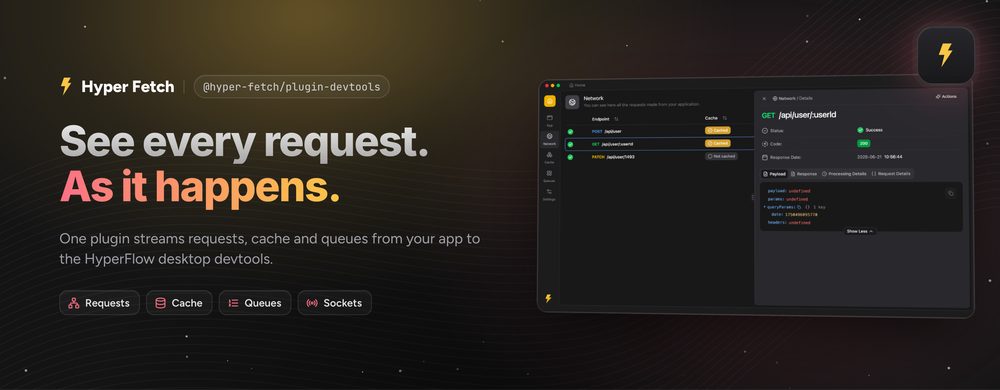

<p align="center">
  <a href="https://hyperfetch.bettertyped.com/docs/integrations/plugin-devtools"></a>
</p>

<p align="center">
  <a href="https://hyperfetch.bettertyped.com/docs/hyper-flow/connecting"><b>Quick Start</b></a> ·
  <a href="https://hyperfetch.bettertyped.com/docs/integrations/plugin-devtools">Documentation</a> ·
  <a href="https://hyperfetch.bettertyped.com/docs/api/plugin-devtools/Functions/DevtoolsPlugin">API Reference</a> ·
  <a href="https://github.com/BetterTyped/hyper-fetch">GitHub</a> ·
  <a href="https://discord.gg/7upC2kVmyM">Discord</a>
</p>

<p align="center">
  <a href="https://github.com/BetterTyped/hyper-fetch"></a>
  <a href="https://www.npmjs.com/package/@hyper-fetch/plugin-devtools"></a>
  <a href="https://www.npmjs.com/package/@hyper-fetch/plugin-devtools"></a>
  <a href="https://bundlejs.com/?q=@hyper-fetch/plugin-devtools"></a>
  <a href="https://github.com/BetterTyped/hyper-fetch"></a>
  <a href="https://hyperfetch.bettertyped.com/docs/integrations/plugin-devtools"></a>
  <a href="https://github.com/BetterTyped/hyper-fetch/blob/main/License.md"></a>
</p>

## 📖 About

`@hyper-fetch/plugin-devtools` connects a Hyper Fetch client to [HyperFlow](https://github.com/BetterTyped/hyper-fetch/tree/main/packages/hyper-flow),
the desktop devtools. It streams every request, cache change and queue update from your app over a local socket, and
lets HyperFlow edit the cache and control queues while you debug. Add it in development and keep it out of production.

## 🎯 Key Capabilities

- 🔮 **See every request live** - Method, endpoint, payload, response, status and timing as they happen
- 💎 **Watch the cache change** - Entries appear, update, go stale and get invalidated in front of you
- 🚦 **Follow your queues** - Pending, running, paused and canceled requests per queue
- 📡 **Inspect sockets too** - Pass `sockets: [socket]` and HyperFlow shows connections, messages and errors
- 📊 **Find slow endpoints** - Response times and statistics collected per endpoint
- 🧪 **Debug by editing** - Change cache entries and control queues from HyperFlow, your hooks re-render with it
- 🧭 **Every adapter** - fetch, Axios, GraphQL, tRPC, oRPC and Firebase requests all show up the same way
- 🏷️ **Many apps, one window** - One `appName` per client, each shown as its own connection

## 🚀 Quick Start

```bash
npm install -D @hyper-fetch/plugin-devtools @hyper-fetch/sockets
```

```ts
import { createClient } from "@hyper-fetch/core";

export const client = createClient({ url: "https://api.example.com" });

// A build-time flag drops the plugin and its chunk from production builds
if (process.env.NODE_ENV === "development") {
  void import("@hyper-fetch/plugin-devtools").then(({ DevtoolsPlugin }) => {
    client.addPlugin(DevtoolsPlugin({ appName: "Web App" }));
  });
}
```

Then [download HyperFlow](https://hyperfetch.bettertyped.com/docs/hyper-flow/download), start it, and run your app.

## 📚 Documentation

- **[Devtools Plugin](https://hyperfetch.bettertyped.com/docs/integrations/plugin-devtools)** - Install, options and production safety
- **[Connecting HyperFlow](https://hyperfetch.bettertyped.com/docs/hyper-flow/connecting)** - Ports, environments and multiple apps
- **[HyperFlow](https://hyperfetch.bettertyped.com/docs/hyper-flow)** - Network, cache, queue and socket inspectors
- **[Adapter compatibility](https://hyperfetch.bettertyped.com/docs/hyper-flow/compatibility)** - What works with each adapter
- **[API Reference](https://hyperfetch.bettertyped.com/docs/api/plugin-devtools/Functions/DevtoolsPlugin)** - Every option and type

## 💡 Examples

### Vite

```ts
import { createClient } from "@hyper-fetch/core";

export const client = createClient({ url: import.meta.env.VITE_API_URL });

if (import.meta.env.DEV) {
  void import("@hyper-fetch/plugin-devtools").then(({ DevtoolsPlugin }) => {
    client.addPlugin(DevtoolsPlugin({ appName: "Web App", environment: "development" }));
  });
}
```

### Several clients side by side

```ts
// One plugin and one appName per client, so HyperFlow shows them as separate connections
apiClient.addPlugin(DevtoolsPlugin({ appName: "API" }));
authClient.addPlugin(DevtoolsPlugin({ appName: "Auth" }));
graphqlClient.addPlugin(DevtoolsPlugin({ appName: "GraphQL" }));
```

### Inspect sockets

```ts
import { Socket } from "@hyper-fetch/sockets";

const socket = new Socket({ url: "ws://localhost:3000" });

client.addPlugin(DevtoolsPlugin({ appName: "My App", sockets: [socket] }));
```

### A custom HyperFlow port

```ts
client.addPlugin(
  DevtoolsPlugin({
    appName: "My App",
    url: "ws://localhost:4000", // the default is ws://localhost:2137
    debug: true, // log connection events through the client logger
  }),
);
```

> **Never ship the plugin to production.** It sends headers, payloads, responses and cache contents to whatever listens
> on its URL, and accepts commands that change your cache. Gate it on a build-time constant and import it dynamically.

## 🧩 Hyper Fetch Ecosystem

One typed client for every backend. Swap the adapter and keep the same `createRequest()` everywhere.

<table align="center">
  <tr>
    <td align="center" width="110"><a href="https://github.com/BetterTyped/hyper-fetch/tree/main/packages/core"><br /><sub><b>Core</b></sub></a></td>
    <td align="center" width="110"><a href="https://github.com/BetterTyped/hyper-fetch/tree/main/packages/react"><br /><sub><b>React</b></sub></a></td>
    <td align="center" width="110"><a href="https://github.com/BetterTyped/hyper-fetch/tree/main/packages/sockets"><br /><sub><b>Sockets</b></sub></a></td>
    <td align="center" width="110"><a href="https://github.com/BetterTyped/hyper-fetch/tree/main/packages/cli"><br /><sub><b>OpenAPI CLI</b></sub></a></td>
    <td align="center" width="110"><a href="https://github.com/BetterTyped/hyper-fetch/tree/main/packages/adapter-graphql"><br /><sub><b>GraphQL</b></sub></a></td>
    <td align="center" width="110"><a href="https://github.com/BetterTyped/hyper-fetch/tree/main/packages/adapter-trpc"><br /><sub><b>tRPC</b></sub></a></td>
  </tr>
  <tr>
    <td align="center" width="110"><a href="https://github.com/BetterTyped/hyper-fetch/tree/main/packages/adapter-orpc"><picture><source media="(prefers-color-scheme: dark)" srcset="https://raw.githubusercontent.com/BetterTyped/hyper-fetch/main/documentation/static/img/integration-orpc-dark.svg" /></picture><br /><sub><b>oRPC</b></sub></a></td>
    <td align="center" width="110"><a href="https://github.com/BetterTyped/hyper-fetch/tree/main/packages/hono"><br /><sub><b>Hono</b></sub></a></td>
    <td align="center" width="110"><a href="https://github.com/BetterTyped/hyper-fetch/tree/main/packages/elysia"><br /><sub><b>Elysia</b></sub></a></td>
    <td align="center" width="110"><a href="https://github.com/BetterTyped/hyper-fetch/tree/main/packages/adapter-firebase"><br /><sub><b>Firebase</b></sub></a></td>
    <td align="center" width="110"><a href="https://github.com/BetterTyped/hyper-fetch/tree/main/packages/adapter-axios"><br /><sub><b>Axios</b></sub></a></td>
    <td align="center" width="110"><a href="https://github.com/BetterTyped/hyper-fetch/tree/main/packages/hyper-flow"><br /><sub><b>HyperFlow</b></sub></a></td>
  </tr>
</table>

## 💖 Sponsors

<p align="center">
  <a href="https://github.com/sponsors/prc5">
    
  </a>
</p>

## License

[Apache-2.0](https://github.com/BetterTyped/hyper-fetch/blob/main/License.md)
