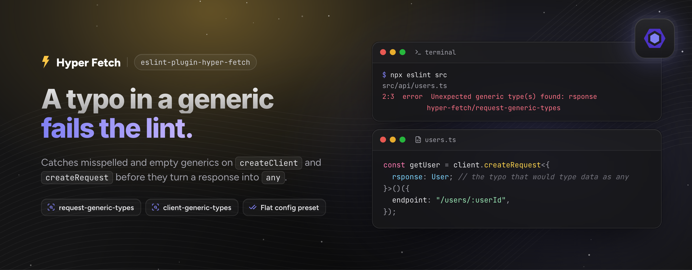

<p align="center">
  <a href="https://hyperfetch.bettertyped.com/docs/integrations/plugin-eslint"></a>
</p>

<p align="center">
  <a href="https://hyperfetch.bettertyped.com/docs/integrations/plugin-eslint"><b>Quick Start</b></a> ·
  <a href="https://hyperfetch.bettertyped.com/docs/integrations/plugin-eslint">Documentation</a> ·
  <a href="https://hyperfetch.bettertyped.com/docs/api/plugin-eslint/Variables/rules">API Reference</a> ·
  <a href="https://github.com/BetterTyped/hyper-fetch">GitHub</a> ·
  <a href="https://discord.gg/7upC2kVmyM">Discord</a>
</p>

<p align="center">
  <a href="https://github.com/BetterTyped/hyper-fetch"></a>
  <a href="https://www.npmjs.com/package/eslint-plugin-hyper-fetch"></a>
  <a href="https://www.npmjs.com/package/eslint-plugin-hyper-fetch"></a>
  <a href="https://bundlejs.com/?q=eslint-plugin-hyper-fetch"></a>
  <a href="https://github.com/BetterTyped/hyper-fetch"></a>
  <a href="https://hyperfetch.bettertyped.com/docs/integrations/plugin-eslint"></a>
  <a href="https://github.com/BetterTyped/hyper-fetch/blob/main/License.md"></a>
</p>

## 📖 About

`eslint-plugin-hyper-fetch` checks the generics you pass to `createClient` and `createRequest`. TypeScript accepts a
misspelled key like `rsponse` next to valid ones, and the request then silently types `data` as `undefined`. These
rules catch that at lint time, with no type information needed, so they stay fast on large codebases.

## 🎯 Key Capabilities

- ✨ **No more typo-induced `any`** - Flags `rsponse`, `paylod` and every other unknown key in request generics
- 🧭 **Client generics too** - `createClient<{ eror: ApiError }>` is caught by `client-generic-types`
- 🕳️ **Empty generics flagged** - `createRequest<{}>()` is reported instead of quietly typing nothing
- ⚡ **Syntactic and fast** - No `parserOptions.project` and no type checker, so it adds almost nothing to lint time
- 🧩 **One line in flat config** - `hyperFetch.configs.recommended` registers the plugin and turns both rules on
- 🔁 **ESLint 8.57 to 10** - Flat config everywhere, `recommended-legacy` for `.eslintrc` on ESLint 8

## 🚀 Quick Start

```bash
npm install -D eslint eslint-plugin-hyper-fetch typescript-eslint
```

```js
// eslint.config.mjs
import hyperFetch from "eslint-plugin-hyper-fetch";
import tseslint from "typescript-eslint";

export default [
  { files: ["**/*.{ts,tsx}"], languageOptions: { parser: tseslint.parser } },
  hyperFetch.configs.recommended,
];
```

Still on `.eslintrc` with ESLint 8? Extend the legacy preset:

```json
{
  "parser": "@typescript-eslint/parser",
  "extends": ["plugin:hyper-fetch/recommended-legacy"]
}
```

## 📚 Documentation

- **[ESLint Plugin](https://hyperfetch.bettertyped.com/docs/integrations/plugin-eslint)** - Install and set up
- **[Configuration](https://hyperfetch.bettertyped.com/docs/integrations/plugin-eslint/configuration)** - Presets and severity levels
- **[Rules](https://hyperfetch.bettertyped.com/docs/integrations/plugin-eslint/rules)** - What each rule reports and why
- **[API Reference](https://hyperfetch.bettertyped.com/docs/api/plugin-eslint/Variables/rules)** - Exported rules and configs

Prefer Oxlint? [`oxlint-plugin-hyper-fetch`](https://github.com/BetterTyped/hyper-fetch/tree/main/packages/plugin-oxlint)
ships the same rules under the same names.

## 💡 Examples

### A misspelled request generic

```ts
// ❌ hyper-fetch/request-generic-types: Unexpected generic type(s) found: rsponse
const getUser = client.createRequest<{ rsponse: User }>()({
  endpoint: "/users/:userId",
});

// ✅
const getUser = client.createRequest<{ response: User }>()({
  endpoint: "/users/:userId",
});
```

### A misspelled client generic

```ts
// ❌ hyper-fetch/client-generic-types: Unexpected generic type(s) found: eror
const client = createClient<{ eror: ApiError }>({ url: "https://api.example.com" });

// ✅
const client = createClient<{ error: ApiError }>({ url: "https://api.example.com" });
```

### Pick the rules and their severity

```js
// eslint.config.mjs
export default [
  { files: ["**/*.{ts,tsx}"], languageOptions: { parser: tseslint.parser } },
  {
    plugins: { "hyper-fetch": hyperFetch },
    rules: {
      "hyper-fetch/request-generic-types": "error",
      "hyper-fetch/client-generic-types": "warn",
    },
  },
];
```

### Check the setup on purpose

Lint a file that must fail before you trust a green run. Both lines typecheck, so only the rules catch them.

```ts
// lint-check.ts
import { createClient } from "@hyper-fetch/core";

const client = createClient<{ error: Error; eror: Error }>({ url: "/" });
const getUser = client.createRequest<{ response: { id: number }; rsponse: { id: number } }>()({ endpoint: "/users" });
```

## 🧩 Hyper Fetch Ecosystem

One typed client for every backend. Swap the adapter and keep the same `createRequest()` everywhere.

<table align="center">
  <tr>
    <td align="center" width="110"><a href="https://github.com/BetterTyped/hyper-fetch/tree/main/packages/core"><br /><sub><b>Core</b></sub></a></td>
    <td align="center" width="110"><a href="https://github.com/BetterTyped/hyper-fetch/tree/main/packages/react"><br /><sub><b>React</b></sub></a></td>
    <td align="center" width="110"><a href="https://github.com/BetterTyped/hyper-fetch/tree/main/packages/sockets"><br /><sub><b>Sockets</b></sub></a></td>
    <td align="center" width="110"><a href="https://github.com/BetterTyped/hyper-fetch/tree/main/packages/db"><br /><sub><b>DB</b></sub></a></td>
    <td align="center" width="110"><a href="https://github.com/BetterTyped/hyper-fetch/tree/main/packages/cli"><br /><sub><b>OpenAPI CLI</b></sub></a></td>
    <td align="center" width="110"><a href="https://github.com/BetterTyped/hyper-fetch/tree/main/packages/adapter-graphql"><br /><sub><b>GraphQL</b></sub></a></td>
    <td align="center" width="110"><a href="https://github.com/BetterTyped/hyper-fetch/tree/main/packages/adapter-trpc"><br /><sub><b>tRPC</b></sub></a></td>
  </tr>
  <tr>
    <td align="center" width="110"><a href="https://github.com/BetterTyped/hyper-fetch/tree/main/packages/adapter-orpc"><picture><source media="(prefers-color-scheme: dark)" srcset="https://raw.githubusercontent.com/BetterTyped/hyper-fetch/main/documentation/static/img/integration-orpc-dark.svg" /></picture><br /><sub><b>oRPC</b></sub></a></td>
    <td align="center" width="110"><a href="https://github.com/BetterTyped/hyper-fetch/tree/main/packages/hono"><br /><sub><b>Hono</b></sub></a></td>
    <td align="center" width="110"><a href="https://github.com/BetterTyped/hyper-fetch/tree/main/packages/elysia"><br /><sub><b>Elysia</b></sub></a></td>
    <td align="center" width="110"><a href="https://github.com/BetterTyped/hyper-fetch/tree/main/packages/adapter-firebase"><br /><sub><b>Firebase</b></sub></a></td>
    <td align="center" width="110"><a href="https://github.com/BetterTyped/hyper-fetch/tree/main/packages/adapter-axios"><br /><sub><b>Axios</b></sub></a></td>
    <td align="center" width="110"><a href="https://github.com/BetterTyped/hyper-fetch/tree/main/packages/hyper-flow"><br /><sub><b>HyperFlow</b></sub></a></td>
  </tr>
</table>

## 💖 Sponsors

<p align="center">
  <a href="https://github.com/sponsors/prc5">
    
  </a>
</p>

## License

[Apache-2.0](https://github.com/BetterTyped/hyper-fetch/blob/main/License.md)
