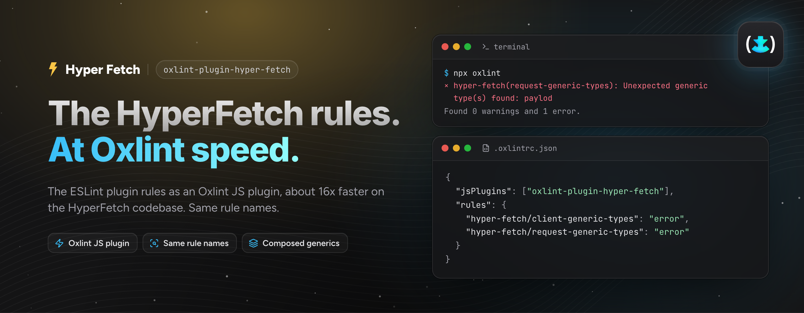

<p align="center">
  <a href="https://hyperfetch.bettertyped.com/docs/integrations/plugin-oxlint"></a>
</p>

<p align="center">
  <a href="https://hyperfetch.bettertyped.com/docs/integrations/plugin-oxlint"><b>Quick Start</b></a> ·
  <a href="https://hyperfetch.bettertyped.com/docs/integrations/plugin-oxlint">Documentation</a> ·
  <a href="https://hyperfetch.bettertyped.com/docs/api/plugin-oxlint/Variables/requestGenericTypes">API Reference</a> ·
  <a href="https://github.com/BetterTyped/hyper-fetch">GitHub</a> ·
  <a href="https://discord.gg/7upC2kVmyM">Discord</a>
</p>

<p align="center">
  <a href="https://github.com/BetterTyped/hyper-fetch"></a>
  <a href="https://www.npmjs.com/package/oxlint-plugin-hyper-fetch"></a>
  <a href="https://www.npmjs.com/package/oxlint-plugin-hyper-fetch"></a>
  <a href="https://bundlejs.com/?q=oxlint-plugin-hyper-fetch"></a>
  <a href="https://github.com/BetterTyped/hyper-fetch"></a>
  <a href="https://hyperfetch.bettertyped.com/docs/integrations/plugin-oxlint"></a>
  <a href="https://github.com/BetterTyped/hyper-fetch/blob/main/License.md"></a>
</p>

## 📖 About

`oxlint-plugin-hyper-fetch` brings the Hyper Fetch lint rules to [Oxlint](https://oxc.rs/docs/guide/usage/linter) as a
JS plugin. It catches typos and unknown keys in the generics of `createClient` and `createRequest` before they quietly
turn a response into `any`. Rule names match `eslint-plugin-hyper-fetch`, so moving from ESLint is a config change.

## 🎯 Key Capabilities

- ⚡ **Fast on big codebases** - About 16x faster than the ESLint plugin on the Hyper Fetch codebase
- ✨ **No more typo-induced `any`** - Flags `rsponse` instead of `response` in `createRequest<{ ... }>()`
- 🔮 **Knows the real generics** - Accepts every key of `RequestGenericType`, including `params`
- 🧩 **Handles composed types** - Checks each object part of `GqlResponse<User> & { payload: Input }`
- 🎯 **Only your HyperFetch client** - `createClient` is checked when imported from `@hyper-fetch/core`
- 🔁 **Same rule names as ESLint** - `hyper-fetch/request-generic-types` and `hyper-fetch/client-generic-types`
- 💬 **Disable comments keep working** - Existing `eslint-disable-next-line hyper-fetch/...` comments are honored

## 🚀 Quick Start

```bash
npm install -D oxlint oxlint-plugin-hyper-fetch
```

```jsonc
// .oxlintrc.json
{
  "jsPlugins": ["oxlint-plugin-hyper-fetch"],
  "rules": {
    "hyper-fetch/client-generic-types": "error",
    "hyper-fetch/request-generic-types": "error"
  }
}
```

Requires Oxlint `1.62.0` or newer. There is no preset, so enable both rules.

## 📚 Documentation

- **[Oxlint Plugin](https://hyperfetch.bettertyped.com/docs/integrations/plugin-oxlint)** - Install, configure and migrate
- **[Rules](https://hyperfetch.bettertyped.com/docs/integrations/plugin-oxlint/rules)** - What each rule reports and why
- **[Oxlint JS plugins](https://oxc.rs/docs/guide/usage/linter/js-plugins)** - How Oxlint loads plugins
- **[API Reference](https://hyperfetch.bettertyped.com/docs/api/plugin-oxlint/Variables/requestGenericTypes)** - Exported rules

## 💡 Examples

### Catch a misspelled generic

```ts
// ❌ hyper-fetch/request-generic-types: Unexpected generic type(s) found: rsponse
const getUser = client.createRequest<{ rsponse: User }>()({
  endpoint: "/users/:userId",
});

// ✅
const getUser = client.createRequest<{ response: User }>()({
  endpoint: "/users/:userId",
});
```

### Check composed generics part by part

```ts
// ❌ hyper-fetch/request-generic-types: Unexpected generic type(s) found: paylod
const updateUser = client.createRequest<GqlResponse<{ user: User }> & { paylod: UserInput }>()({
  endpoint: updateUserMutation,
});
```

### Configure in TypeScript

```ts
// oxlint.config.ts
import { defineConfig } from "oxlint";

export default defineConfig({
  jsPlugins: ["oxlint-plugin-hyper-fetch"],
  rules: {
    "hyper-fetch/client-generic-types": "error",
    "hyper-fetch/request-generic-types": "error",
  },
});
```

### Move over from ESLint

```diff
- "plugins": ["hyper-fetch"],
+ "jsPlugins": ["oxlint-plugin-hyper-fetch"],
  "rules": {
    "hyper-fetch/client-generic-types": "error",
    "hyper-fetch/request-generic-types": "error"
  }
```

Turn the ESLint rules off when both linters run, or every mistake is reported twice.

## 🧩 Hyper Fetch Ecosystem

One typed client for every backend. Swap the adapter and keep the same `createRequest()` everywhere.

<table align="center">
  <tr>
    <td align="center" width="110"><a href="https://github.com/BetterTyped/hyper-fetch/tree/main/packages/core"><br /><sub><b>Core</b></sub></a></td>
    <td align="center" width="110"><a href="https://github.com/BetterTyped/hyper-fetch/tree/main/packages/react"><br /><sub><b>React</b></sub></a></td>
    <td align="center" width="110"><a href="https://github.com/BetterTyped/hyper-fetch/tree/main/packages/sockets"><br /><sub><b>Sockets</b></sub></a></td>
    <td align="center" width="110"><a href="https://github.com/BetterTyped/hyper-fetch/tree/main/packages/db"><br /><sub><b>DB</b></sub></a></td>
    <td align="center" width="110"><a href="https://github.com/BetterTyped/hyper-fetch/tree/main/packages/cli"><br /><sub><b>OpenAPI CLI</b></sub></a></td>
    <td align="center" width="110"><a href="https://github.com/BetterTyped/hyper-fetch/tree/main/packages/adapter-graphql"><br /><sub><b>GraphQL</b></sub></a></td>
    <td align="center" width="110"><a href="https://github.com/BetterTyped/hyper-fetch/tree/main/packages/adapter-trpc"><br /><sub><b>tRPC</b></sub></a></td>
  </tr>
  <tr>
    <td align="center" width="110"><a href="https://github.com/BetterTyped/hyper-fetch/tree/main/packages/adapter-orpc"><picture><source media="(prefers-color-scheme: dark)" srcset="https://raw.githubusercontent.com/BetterTyped/hyper-fetch/main/documentation/static/img/integration-orpc-dark.svg" /></picture><br /><sub><b>oRPC</b></sub></a></td>
    <td align="center" width="110"><a href="https://github.com/BetterTyped/hyper-fetch/tree/main/packages/hono"><br /><sub><b>Hono</b></sub></a></td>
    <td align="center" width="110"><a href="https://github.com/BetterTyped/hyper-fetch/tree/main/packages/elysia"><br /><sub><b>Elysia</b></sub></a></td>
    <td align="center" width="110"><a href="https://github.com/BetterTyped/hyper-fetch/tree/main/packages/adapter-firebase"><br /><sub><b>Firebase</b></sub></a></td>
    <td align="center" width="110"><a href="https://github.com/BetterTyped/hyper-fetch/tree/main/packages/adapter-axios"><br /><sub><b>Axios</b></sub></a></td>
    <td align="center" width="110"><a href="https://github.com/BetterTyped/hyper-fetch/tree/main/packages/hyper-flow"><br /><sub><b>HyperFlow</b></sub></a></td>
  </tr>
</table>

## 💖 Sponsors

<p align="center">
  <a href="https://github.com/sponsors/prc5">
    
  </a>
</p>

## License

[Apache-2.0](https://github.com/BetterTyped/hyper-fetch/blob/main/License.md)
