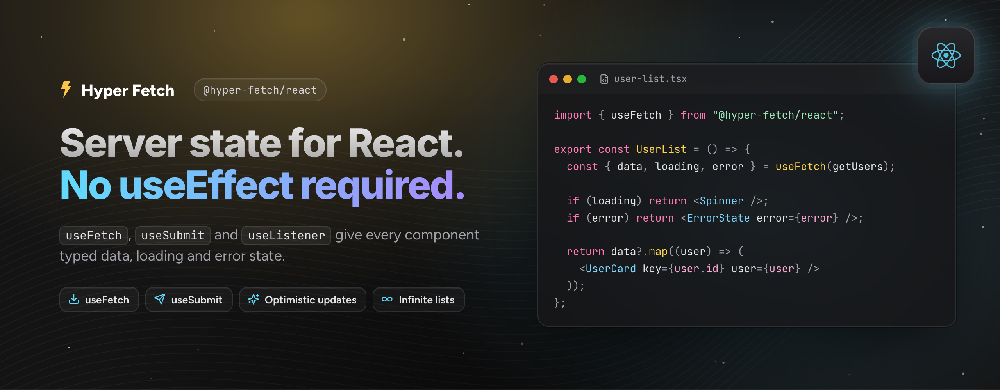

<p align="center">
  <a href="https://hyperfetch.bettertyped.com/docs/react/overview"></a>
</p>

<p align="center">
  <a href="https://hyperfetch.bettertyped.com/docs/react/quick-start"><b>Quick Start</b></a> ·
  <a href="https://hyperfetch.bettertyped.com/docs/react/overview">Documentation</a> ·
  <a href="https://hyperfetch.bettertyped.com/docs/api/react/Hooks/useFetch">API Reference</a> ·
  <a href="https://github.com/BetterTyped/hyper-fetch">GitHub</a> ·
  <a href="https://discord.gg/7upC2kVmyM">Discord</a>
</p>

<p align="center">
  <a href="https://github.com/BetterTyped/hyper-fetch"></a>
  <a href="https://www.npmjs.com/package/@hyper-fetch/react"></a>
  <a href="https://www.npmjs.com/package/@hyper-fetch/react"></a>
  <a href="https://bundlejs.com/?q=@hyper-fetch/react"></a>
  <a href="https://github.com/BetterTyped/hyper-fetch"></a>
  <a href="https://hyperfetch.bettertyped.com/docs/react/overview"></a>
  <a href="https://github.com/BetterTyped/hyper-fetch/blob/main/License.md"></a>
</p>

## 📖 About

`@hyper-fetch/react` binds Hyper Fetch requests to React components. `useFetch` reads, `useSubmit` writes, and both
return typed `data`, `error` and loading state backed by the client cache. Every component that uses the same request
shares one response, one in-flight call and one cache entry, so you can drop the `useEffect` fetching and the state
library for server data.

## 🎯 Key Capabilities

- ⚡ **Data on mount, no `useEffect`** - `useFetch` fetches, caches and refetches when params or query params change
- ✍️ **Mutations in one call** - `useSubmit` waits for `submit()` and tracks `submitting`, errors and upload progress
- 🔗 **One request, one cache entry** - Components that use the same request share one response and one network call
- ✨ **Optimistic updates with rollback** - `setOptimistic` updates the list now and reverts it if the request fails
- 🔄 **Always fresh** - Refetch on window focus, on reconnect or on an interval with `refresh` and `refreshTime`
- ⏳ **Search without request floods** - `bounce` debounces or throttles requests while the user types
- ♾️ **Infinite lists** - `useInfiniteFetch` pages through cursors with `fetchNextPage` and `hasNextPage`
- 🎯 **Re-renders only for what you read** - Hooks track the fields a component uses and ignore the rest
- 🖥️ **SSR hydration** - `Hydrate` carries server responses into the first render in Next.js and other SSR frameworks
- 📡 **Realtime in components** - `useListener` and `useEmitter` bind typed sockets from `@hyper-fetch/sockets`

## 🚀 Quick Start

```bash
npm install @hyper-fetch/core @hyper-fetch/react
```

```tsx
import { useFetch } from "@hyper-fetch/react";

import { getUsers } from "./api";

export const UserList = () => {
  // Fetches on mount and returns typed state. No useEffect, no useState
  const { data, loading, error, refetch } = useFetch(getUsers);

  if (loading && !data) return <Spinner />;
  if (error) return <button onClick={refetch}>Try again</button>;

  return (
    <ul>
      {data?.map((user) => (
        <li key={user.id}>{user.name}</li>
      ))}
    </ul>
  );
};
```

## 📚 Documentation

- **[Quick Start](https://hyperfetch.bettertyped.com/docs/react/quick-start)** - Your first hook in a few lines
- **[useFetch](https://hyperfetch.bettertyped.com/docs/react/hooks/use-fetch)** - Fetching, refetching, polling, suspense and `select`
- **[useSubmit](https://hyperfetch.bettertyped.com/docs/react/hooks/use-submit)** - Forms, mutations and progress
- **[useInfiniteFetch](https://hyperfetch.bettertyped.com/docs/react/hooks/use-infinite-fetch)** - Cursor and page based lists
- **[Hydrate](https://hyperfetch.bettertyped.com/docs/react/hydrate)** - Server rendering and hydration
- **[useListener](https://hyperfetch.bettertyped.com/docs/react/sockets/use-listener)** - Realtime data from sockets
- **[Guides](https://hyperfetch.bettertyped.com/docs/guides/react/basics/optimistic-approach)** - Optimistic updates, pagination, dependent requests and more
- **[API Reference](https://hyperfetch.bettertyped.com/docs/api/react/Hooks/useFetch)** - Every hook, option and return type

## 💡 Examples

### Search with debounce

```tsx
const UserSearch = ({ search }: { search: string }) => {
  // The first request goes out right away, later changes wait 300ms
  const { data, loading } = useFetch(getUsers.setQueryParams({ search }), { bounce: true, bounceTime: 300 });

  return <UsersTable users={data ?? []} dimmed={loading} />;
};
```

### Submit a form and refresh the list

```tsx
import { useSubmit } from "@hyper-fetch/react";

const AddUser = () => {
  const { submit, submitting, error, onSubmitSuccess } = useSubmit(createUser);

  // every mounted useFetch(getUsers) refetches
  onSubmitSuccess(() => client.cache.invalidate(getUsers));

  const onSave = async (name: string) => {
    const response = await submit({ payload: { name } });
    if (response.success) closeModal();
  };

  return <UserForm onSubmit={onSave} disabled={submitting} error={error?.message} />;
};
```

### Optimistic update with rollback

```ts
import { optimistic } from "@hyper-fetch/core";

export const toggleTodo = client
  .createRequest<{ response: Todo; payload: { completed: boolean } }>()({ endpoint: "/todos/:todoId", method: "PATCH" })
  .setOptimistic(({ params, payload }) => [
    optimistic(getTodos)
      .patch(params.todoId, payload)
      .rollback(({ data, previous }) => {
        const before = previous.find((todo) => todo.id === Number(params.todoId));
        return data.map((todo) => (todo.id === Number(params.todoId) && before ? before : todo));
      }),
  ]);
```

```tsx
// The component needs nothing optimistic-specific
const { submit } = useSubmit(toggleTodo);

submit({ params: { todoId: todo.id }, payload: { completed: !todo.completed } });
```

### Dependent requests

```tsx
const { data: user } = useFetch(getCurrentUser);

// Waits until the user is loaded, then fetches on its own
const { data: posts } = useFetch(getUserPosts.setParams({ userId: user?.id ?? 0 }), { disabled: !user });
```

### Infinite feed

```tsx
import { useInfiniteFetch } from "@hyper-fetch/react";

const Feed = ({ topic }: { topic: string }) => {
  const { items, hasNextPage, isFetchingNextPage, fetchNextPage } = useInfiniteFetch(
    getFeed.setQueryParams({ topic }),
    { pagination: { cursor: "cursor", next: "nextCursor", items: "data" } },
  );

  return (
    <>
      {items.map((post) => (
        <PostCard key={post.id} post={post} />
      ))}
      {hasNextPage && (
        <button onClick={() => fetchNextPage()} disabled={isFetchingNextPage}>
          Load more
        </button>
      )}
    </>
  );
};
```

### Server rendering with Next.js

```tsx
// app/users/page.tsx (server component)
export default async function Page() {
  const response = await getFirstPage.send();
  return <UsersList hydration={[getFirstPage.dehydrate({ response })]} />;
}
```

```tsx
// app/users/users-list.tsx
"use client";

import { Hydrate, useFetch } from "@hyper-fetch/react";
import type { HydrateProps } from "@hyper-fetch/react";

export const UsersList = ({ hydration }: { hydration: HydrateProps["data"] }) => (
  <Hydrate client={client} data={hydration}>
    <Users />
  </Hydrate>
);

const Users = () => {
  // The first render already has the server data
  const { data } = useFetch(getFirstPage, { revalidate: false });
  return <UsersTable users={data ?? []} />;
};
```

## 🧩 Hyper Fetch Ecosystem

One typed client for every backend. Swap the adapter and keep the same `createRequest()` everywhere.

<table align="center">
  <tr>
    <td align="center" width="110"><a href="https://github.com/BetterTyped/hyper-fetch/tree/main/packages/core"><br /><sub><b>Core</b></sub></a></td>
    <td align="center" width="110"><a href="https://github.com/BetterTyped/hyper-fetch/tree/main/packages/react"><br /><sub><b>React</b></sub></a></td>
    <td align="center" width="110"><a href="https://github.com/BetterTyped/hyper-fetch/tree/main/packages/sockets"><br /><sub><b>Sockets</b></sub></a></td>
    <td align="center" width="110"><a href="https://github.com/BetterTyped/hyper-fetch/tree/main/packages/db"><br /><sub><b>DB</b></sub></a></td>
    <td align="center" width="110"><a href="https://github.com/BetterTyped/hyper-fetch/tree/main/packages/cli"><br /><sub><b>OpenAPI CLI</b></sub></a></td>
    <td align="center" width="110"><a href="https://github.com/BetterTyped/hyper-fetch/tree/main/packages/adapter-graphql"><br /><sub><b>GraphQL</b></sub></a></td>
    <td align="center" width="110"><a href="https://github.com/BetterTyped/hyper-fetch/tree/main/packages/adapter-trpc"><br /><sub><b>tRPC</b></sub></a></td>
  </tr>
  <tr>
    <td align="center" width="110"><a href="https://github.com/BetterTyped/hyper-fetch/tree/main/packages/adapter-orpc"><picture><source media="(prefers-color-scheme: dark)" srcset="https://raw.githubusercontent.com/BetterTyped/hyper-fetch/main/documentation/static/img/integration-orpc-dark.svg" /></picture><br /><sub><b>oRPC</b></sub></a></td>
    <td align="center" width="110"><a href="https://github.com/BetterTyped/hyper-fetch/tree/main/packages/hono"><br /><sub><b>Hono</b></sub></a></td>
    <td align="center" width="110"><a href="https://github.com/BetterTyped/hyper-fetch/tree/main/packages/elysia"><br /><sub><b>Elysia</b></sub></a></td>
    <td align="center" width="110"><a href="https://github.com/BetterTyped/hyper-fetch/tree/main/packages/adapter-firebase"><br /><sub><b>Firebase</b></sub></a></td>
    <td align="center" width="110"><a href="https://github.com/BetterTyped/hyper-fetch/tree/main/packages/adapter-axios"><br /><sub><b>Axios</b></sub></a></td>
    <td align="center" width="110"><a href="https://github.com/BetterTyped/hyper-fetch/tree/main/packages/hyper-flow"><br /><sub><b>HyperFlow</b></sub></a></td>
  </tr>
</table>

## 💖 Sponsors

<p align="center">
  <a href="https://github.com/sponsors/prc5">
    
  </a>
</p>

## License

[Apache-2.0](https://github.com/BetterTyped/hyper-fetch/blob/main/License.md)
