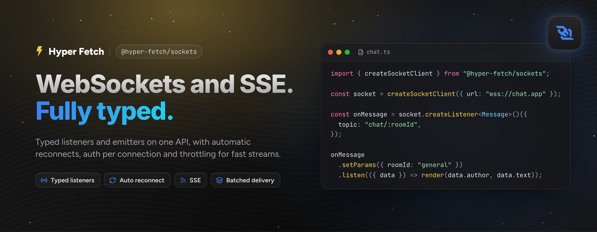

<p align="center">
  <a href="https://hyperfetch.bettertyped.com/docs/sockets/overview"></a>
</p>

<p align="center">
  <a href="https://hyperfetch.bettertyped.com/docs/sockets/quick-start"><b>Quick Start</b></a> ·
  <a href="https://hyperfetch.bettertyped.com/docs/sockets/overview">Documentation</a> ·
  <a href="https://hyperfetch.bettertyped.com/docs/api/sockets/Classes/Socket">API Reference</a> ·
  <a href="https://github.com/BetterTyped/hyper-fetch">GitHub</a> ·
  <a href="https://discord.gg/7upC2kVmyM">Discord</a>
</p>

<p align="center">
  <a href="https://github.com/BetterTyped/hyper-fetch"></a>
  <a href="https://www.npmjs.com/package/@hyper-fetch/sockets"></a>
  <a href="https://www.npmjs.com/package/@hyper-fetch/sockets"></a>
  <a href="https://bundlejs.com/?q=@hyper-fetch/sockets"></a>
  <a href="https://github.com/BetterTyped/hyper-fetch"></a>
  <a href="https://hyperfetch.bettertyped.com/docs/sockets/overview"></a>
  <a href="https://github.com/BetterTyped/hyper-fetch/blob/main/License.md"></a>
</p>

## 📖 About

`@hyper-fetch/sockets` is the realtime side of Hyper Fetch. It puts WebSockets and Server-Sent Events behind one API of
typed listeners and emitters, with reconnects, authentication per connection attempt and delivery strategies for fast
streams. Listeners and emitters are immutable templates, just like core requests, and plug into React through
`useListener` and `useEmitter`.

## 🎯 Key Capabilities

- 🔮 **Typed events** - Every listener and emitter is typed, so `data` is never a `JSON.parse` guess
- 🧭 **Typed topic params** - `chat/:roomId` makes `roomId` required on `setParams()` and `emit()`
- 📡 **WebSocket and SSE, one API** - Switch the adapter and keep your listeners
- 🔁 **Reconnects on its own** - Jittered backoff, an immediate retry when the app is back online or in focus
- 🎧 **Listeners survive outages** - Every listener stays registered across reconnects
- 🔐 **Fresh tokens on every attempt** - `onConnect` resolves credentials before each connection and reconnection
- 🚦 **Tame fast streams** - `latest` and `batch` delivery strategies throttle or batch messages per listener
- 🧱 **Your wire format** - `decode` and `encode` map any message shape to topics, no custom adapter needed
- ⚛️ **React hooks** - `useListener` and `useEmitter` from `@hyper-fetch/react` handle subscribe and cleanup

## 🚀 Quick Start

```bash
npm install @hyper-fetch/core @hyper-fetch/sockets
```

```ts
import { createSocketClient } from "@hyper-fetch/sockets";

// One socket per server connection, created once at module level
const socket = createSocketClient({ url: "wss://api.example.com/ws" });

const onMessage = socket.createListener<{ text: string; author: string }>()({
  topic: "chat/:roomId",
});

// roomId is required and typed. listen() returns the remover
const stop = onMessage.setParams({ roomId: "general" }).listen(({ data }) => {
  console.log(`${data.author}: ${data.text}`);
});
```

## 📚 Documentation

- **[Quick Start](https://hyperfetch.bettertyped.com/docs/sockets/quick-start)** - Connect and listen in a few lines
- **[Socket](https://hyperfetch.bettertyped.com/docs/sockets/socket)** - Connection options, reconnects and lifecycle events
- **[Listener](https://hyperfetch.bettertyped.com/docs/sockets/listener)** and **[Emitter](https://hyperfetch.bettertyped.com/docs/sockets/emitter)** - Typed messages in both directions
- **[Socket SDK](https://hyperfetch.bettertyped.com/docs/sockets/sdk)** - A typed tree of listeners and emitters from a schema
- **[Authentication](https://hyperfetch.bettertyped.com/docs/guides/sockets/authentication)** - Tokens per attempt with `onConnect`
- **[Throttling](https://hyperfetch.bettertyped.com/docs/guides/sockets/throttling)** - `latest` and `batch` delivery
- **[API Reference](https://hyperfetch.bettertyped.com/docs/api/sockets/Classes/Socket)** - Every class, option and type

## 💡 Examples

### Emit typed events

```ts
const sendMessage = socket.createEmitter<{ text: string }>()({ topic: "chat/:roomId" });

sendMessage.emit({ params: { roomId: "general" }, payload: { text: "Hello" } });
```

`emit()` is fire and forget. A message emitted while the socket is disconnected is dropped and reported through
`socket.events.onEmitterError`, so gate the UI on `connected`.

### Authenticate every connection attempt

```ts
export const socket = createSocketClient({ url: "wss://api.example.com/ws" }).onConnect(async ({ connection, attempt }) => {
  // attempt is 0 for a fresh connection, so refresh the token only on reconnects
  const token = await getAccessToken({ forceRefresh: attempt > 0 });
  return { ...connection, queryParams: { token } };
});
```

### Throttle a fast stream

```ts
// State-like data: only the newest price per 16ms frame
const onPrice = socket.createListener<{ symbol: string; value: number }>()({
  topic: "prices",
  delivery: { strategy: "latest", interval: 16 },
});

// Event-like data: every trade, delivered as arrays per 100ms window
const onTrade = socket.createListener<{ id: string; price: number }>()({
  topic: "trades",
  delivery: { strategy: "batch", interval: 100, maxSize: 500 },
});

onTrade.listen(({ data }) => appendTrades(data)); // data is an array of trades
```

### Live chat in React

```tsx
import { useEmitter, useListener } from "@hyper-fetch/react";

const Chat = ({ roomId }: { roomId: string }) => {
  const { data, connected } = useListener(onMessage.setParams({ roomId }));
  const { emit } = useEmitter(sendMessage);

  return (
    <>
      <StatusDot online={connected} />
      {data && <Message author={data.author} text={data.text} />}
      <Composer onSend={(text) => emit({ params: { roomId }, payload: { text } })} />
    </>
  );
};
```

### Server-Sent Events

```ts
import { createSocketClient, ServerSentEventsAdapter } from "@hyper-fetch/sockets";

const events = createSocketClient({ url: "https://api.example.com/events", adapter: ServerSentEventsAdapter() });

const onDeploy = events.createListener<{ service: string; status: "started" | "done" }>()({ topic: "deploy" });

onDeploy.listen(({ data }) => console.log(`${data.service} ${data.status}`));
```

SSE is receive-only, so `emit()` on an SSE socket throws.

### Keep the HTTP cache in sync

```ts
const onNoteChange = socket.createListener<Note>()({ topic: "notes" });

onNoteChange.listen(({ data }) => {
  // every useFetch(getNote) for this note re-renders with the pushed data
  client.cache.update(getNote.setParams({ noteId: data.id }), { data });
});
```

## 🧩 Hyper Fetch Ecosystem

One typed client for every backend. Swap the adapter and keep the same `createRequest()` everywhere.

<table align="center">
  <tr>
    <td align="center" width="110"><a href="https://github.com/BetterTyped/hyper-fetch/tree/main/packages/core"><br /><sub><b>Core</b></sub></a></td>
    <td align="center" width="110"><a href="https://github.com/BetterTyped/hyper-fetch/tree/main/packages/react"><br /><sub><b>React</b></sub></a></td>
    <td align="center" width="110"><a href="https://github.com/BetterTyped/hyper-fetch/tree/main/packages/sockets"><br /><sub><b>Sockets</b></sub></a></td>
    <td align="center" width="110"><a href="https://github.com/BetterTyped/hyper-fetch/tree/main/packages/db"><br /><sub><b>DB</b></sub></a></td>
    <td align="center" width="110"><a href="https://github.com/BetterTyped/hyper-fetch/tree/main/packages/cli"><br /><sub><b>OpenAPI CLI</b></sub></a></td>
    <td align="center" width="110"><a href="https://github.com/BetterTyped/hyper-fetch/tree/main/packages/adapter-graphql"><br /><sub><b>GraphQL</b></sub></a></td>
    <td align="center" width="110"><a href="https://github.com/BetterTyped/hyper-fetch/tree/main/packages/adapter-trpc"><br /><sub><b>tRPC</b></sub></a></td>
  </tr>
  <tr>
    <td align="center" width="110"><a href="https://github.com/BetterTyped/hyper-fetch/tree/main/packages/adapter-orpc"><picture><source media="(prefers-color-scheme: dark)" srcset="https://raw.githubusercontent.com/BetterTyped/hyper-fetch/main/documentation/static/img/integration-orpc-dark.svg" /></picture><br /><sub><b>oRPC</b></sub></a></td>
    <td align="center" width="110"><a href="https://github.com/BetterTyped/hyper-fetch/tree/main/packages/hono"><br /><sub><b>Hono</b></sub></a></td>
    <td align="center" width="110"><a href="https://github.com/BetterTyped/hyper-fetch/tree/main/packages/elysia"><br /><sub><b>Elysia</b></sub></a></td>
    <td align="center" width="110"><a href="https://github.com/BetterTyped/hyper-fetch/tree/main/packages/adapter-firebase"><br /><sub><b>Firebase</b></sub></a></td>
    <td align="center" width="110"><a href="https://github.com/BetterTyped/hyper-fetch/tree/main/packages/adapter-axios"><br /><sub><b>Axios</b></sub></a></td>
    <td align="center" width="110"><a href="https://github.com/BetterTyped/hyper-fetch/tree/main/packages/hyper-flow"><br /><sub><b>HyperFlow</b></sub></a></td>
  </tr>
</table>

## 💖 Sponsors

<p align="center">
  <a href="https://github.com/sponsors/prc5">
    
  </a>
</p>

## License

[Apache-2.0](https://github.com/BetterTyped/hyper-fetch/blob/main/License.md)
